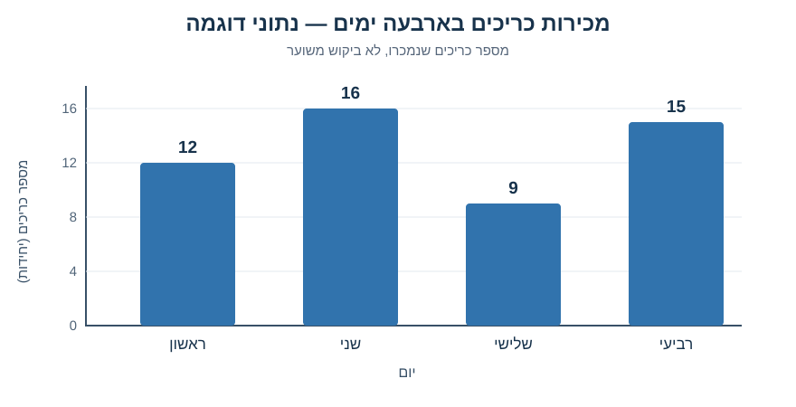

# מפגש 1 — מדוע מדען נתונים מתחיל בשאלה?

**יחידה 3 • כיתה י׳ • ספר תלמיד מורחב, מהדורה בבקרת איכות**

## סיפור הפתיחה: דודו, הקיוסק והשאלה שאי אפשר לפתור בכפל

דודו אחראי על הקיוסק בבית הספר. ביום ראשון נמכרו 12 כריכים במחיר 8 ₪ לכריך. בסיום היום הוא מבקש לדעת כמה כסף התקבל ממכירת הכריכים. על השאלה הזאת אפשר לענות מיד, כי כל הנתונים הדרושים ידועים לנו.

אבל ביום שני דודו נתקל בבעיה קשה יותר: ביום אחד נשארו כריכים שלא נמכרו, וביום אחר תלמידים רצו לקנות אך המלאי נגמר. כמה כריכים עליו להכין מחר? מה אם יתקיים אירוע בית ספרי, תלמידים יהיו בטיול או מזג האוויר ישתנה?

שתי השאלות נוגעות לאותו קיוסק, אבל הן דורשות דרכי חשיבה שונות. **חישוב** מפעיל כלל שכבר ידוע על נתונים ידועים. **חיזוי** מנסה להעריך תוצאה של אירוע שטרם התרחש. כדי ללמוד לחזות, נזדקק לנתוני עבר, להנחות ולשיטה לבדיקת תחזיות על נתונים חדשים.

**משימת חשיבה:** הציעו שני נתונים שכדאי לדודו למדוד מראש לקראת תחזית למחר. האם מספר הכריכים שנמכרו משקף תמיד את כל הביקוש?

## 1. מהו ניתוח נתונים ומהי למידת מכונה?

ניתוח נתונים מתחיל בשאלה, באיסוף ובבדיקת נתונים ובהצגתם בצורה שאפשר להבין. למשל, אפשר לתאר באיזה יום נמכרו הכי הרבה כריכים ומה היה הממוצע. משם אפשר להציע השערה ולבדוק אותה.

למידת מכונה היא דרך לבנות מודל שמתאים עצמו לדוגמאות, כך שאפשר לנסות להפיק תחזית או החלטה עבור מקרים חדשים. המודל אינו רק פקודה שמחברת שני מספרים. בהמשך נלמד כיצד מאמנים מודל, בודקים אותו ומשווים לתחזית בסיס.

**שימו לב:** גם תוכנית שמחזירה מספר על מחר אינה בהכרח למידת מכונה. חשוב לדעת כיצד היא הגיעה לתוצאה ומה נבדק.

## 2. נוסחה ראשונה: הכנסה ממכירה

הנתונים הידועים הם: כמות כריכים שנמכרו q=12 כריכים; מחיר לכריך p=8 שקלים לכריך.

\[
R=q\cdot p
\]

- R — הכנסה בשקלים מהמכירה.
- q — כמות שנמכרה, במספר כריכים.
- p — מחיר ליחידה, בשקלים לכריך.

**פתרון ידני ללא דילוגים:**

1. קובעים מה מחפשים: הכנסה ממכירת כריכים ביום ראשון.
2. כותבים את הכלל: כמות שנמכרה כפול מחיר ליחידה.
3. מציבים: R=12×8.
4. מחשבים: R=96 ₪.
5. מפרשים: זה הסכום שהתקבל ממכירת הכריכים באותו יום.

**למה זו הכנסה ולא רווח?** מפני שלא נמסרו עלויות של לחם, גבינה, שכר עבודה והוצאות אחרות. **למה זו לא תחזית?** כי לא חישבנו שום ערך של מחר.

## 3. ארבעה ימים, ארבע תצפיות

כדי להתחיל לחקור דודו כתב טבלה. **אלה נתוני דוגמה מומצאים לצורכי הוראה, לא תוצאה של מחקר אמיתי.**

| יום | מספר כריכים שנמכרו |
|---|---:|
| ראשון | 12 |
| שני | 16 |
| שלישי | 9 |
| רביעי | 15 |

**תצפית**: תיאור מקרה אחד, כאן יום אחד. **מאפיין (Feature)**: תכונה שאפשר לדעת בזמן החיזוי, למשל יום בשבוע. **יעד (Target)**: הכמות שנרצה לחזות — מספר הכריכים שיימכרו ביום הבא.

הערה של חוקר: אם ביום מסוים נגמר המלאי, מספר המכירות אינו שווה בהכרח למספר התלמידים שרצו לקנות. חיזוי מכירות וחיזוי ביקוש אינם תמיד אותה בעיה.

## 4. גרף אמיתי מנתוני הדוגמה

ציר אופקי: היום. ציר אנכי: מספר כריכים שנמכרו, ביחידות. כל עמודה תואמת במדויק לשורה בטבלה. מן הגרף אפשר לתאר שביום שני נמכרו יותר כריכים מבכל אחד משלושת הימים האחרים; ביום שלישי נמכרו הכי מעט. **אין לנו הצדקה לקבוע כמה יימכרו ביום חמישי בוודאות.**

## 5. נוסחה שנייה: ממוצע יומי

נחשב את ממוצע המכירות של ארבעת הימים, לא את תחזית מחר:

\[
\bar{x}=\frac{x_1+x_2+x_3+x_4}{4}
\]

כאן כל x הוא מספר הכריכים שנמכרו באותו יום; המספר 4 במכנה הוא מספר הימים, ולא כמות הכריכים הכוללת.

1. סכום המכירות בארבעת הימים: 12+16+9+15=52 כריכים.
2. מספר הימים: 4.
3. ממוצע ליום: 52÷4=13 כריכים ליום.

**מה מלמד המספר 13?** בארבעת הימים המתועדים נמכרו בממוצע 13 כריכים ביום. בעתיד אפשר להשתמש ב־13 כתחזית בסיס פשוטה להשוואה, אבל אין זו הבטחה למחר ואין כאן מודל שאומן.

**שאלת ביקורת:** האם נכון להסתמך על ממוצע של ארבעה ימים בלבד אם מחר צפוי אירוע גדול בבית הספר? הסבירו.

## 6. אותו חישוב ב־Google Colab

Google Colab היא מחברת שבה משלבים **תאי קוד** (פקודות שהמחשב מבצע) ו**תאי טקסט** (שאלה, דרך, פירוש ומגבלה). במחקר נצטרך את שני הסוגים.

דוגמת קוד שאפשר לקרוא ולבצע:

    sandwiches_sold = 12
    price_per_sandwich_nis = 8
    revenue_nis = sandwiches_sold * price_per_sandwich_nis
    print("Revenue (NIS):", revenue_nis)

- המשתנה הראשון שומר כמות כריכים שנמכרו.
- המשתנה השני שומר מחיר יחידה. חלק השם nis מזכיר לנו את היחידה שקל.
- הכוכבית היא סימן הכפל בפייתון. הסימן = **משייך ערך למשתנה**, ואין פירושו כאן "הוכח שווה".
- הפעולה print מציגה ערך שחושב קודם. היא אינה מאמנת מודל.

לפני הרצה כתבו מה צריך להיות הפלט. אחרי הרצה השוו ל־96 ₪ שחישבתם על הלוח. מה ישתנה אם נכפיל 15 כריכים ב־8 ₪? נחשב 120 ₪; אותה נוסחה על קלט אחר.

**הקוד לציור גרף קיים במחברת המורה כתא מוכן בלבד.** אין צורך ללמוד כעת תחביר של רשימות, לולאות או Matplotlib — אלה יילמדו בהמשך היחידה.

## 7. מעבדה: מעבר לסיפורים חדשים

עתה תתרגלו על **ספרייה** ועל **מחשב משומש**. במעבדה תגדירו משתנים, תבצעו חישובים בסיסיים ותסבירו פלט. פתרון מעבדה אינו העתקה של דוגמת הקיוסק: בוחרים בכל פעם פעולה לפי הנתונים והבעיה.

במחברת Student-Fill-Blanks-Audited.ipynb סימני שאלה בתאי הקוד מסמנים **מקומות להשלמת מספר, אופרטור או ביטוי Python**. תאים שמכילים סימנים כאלה אינם יכולים לרוץ עד השלמתם. תלמיד שכבר שולט בפעולות יכול לעבוד במחברת Student-Lab המקורית, שבה משימות פתוחות ללא שלד מלא.

בכל משימה כתבו גם בתא טקסט: השאלה, הנתונים והיחידות, חישוב ידני, פירוש ומגבלה. אין לכתוב "המחשב אמר" כתחליף לנימוק.

## 8. חושבים כמו חוקרים

כרטיס הסיום:
1. מה בדיוק דודו רוצה לחזות למחר: מספר כריכים שנמכרו או הביקוש? האם אלו אותו הדבר?
2. תארו תצפית אחת ונסחו שני מאפיינים שניתן לדעת **לפני** יום המכירה.
3. איזה מידע נוסף צריך למדוד כדי להבחין בין "לא היו קונים" לבין "לא נשארו כריכים"?
4. הציעו כיצד תדעו אם תחזית היא טובה — בלי להסתמך רק על הנתונים ששימשו להכנתה.
5. הסבירו מדוע חיבור כמויות הספרים שהושאלו אינו אימון מודל ML.

במפגש הבא נלמד לארגן תצפיות רבות **ברשימות** ולפעול עליהן באמצעות **לולאת for**. הרגל המחקר מתחיל כבר היום: **לפני הקוד שואלים; אחרי הקוד מפרשים.**

