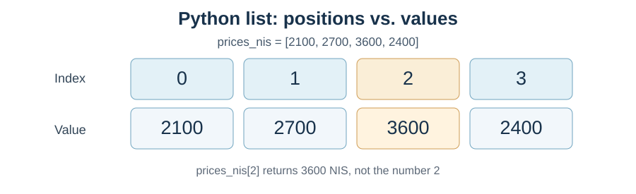
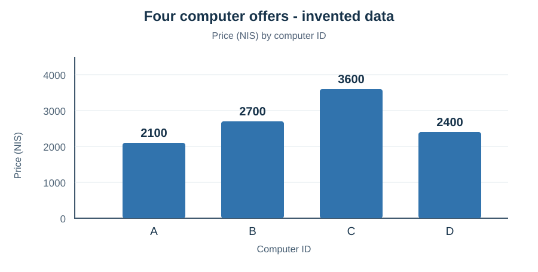

# מפגש 2 — מרשימת מספרים לחקר נתונים: רשימות, אינדקסים ולולאות
**יחידה 3: ניתוח נתונים ולמידת מכונה • כיתה י׳ • ספר תלמיד מורחב**

## הסיפור: למי מתאים כל מחשב?

דודו, שהכרתם בקיוסק במפגש הקודם, מתנדב כעת במועדון הטכנולוגיה של בית הספר. יש למועדון תקציב מוגבל לרכישת מחשבים משומשים. התקבלו ארבע הצעות: בכל אחת יש מחיר ושנת ייצור. דודו חשב לשמור כל מחיר במשתנה נפרד, אבל אז גילה שצריך לכתוב כמעט אותה פעולה לכל מחשב: למצוא מחיר, לחשב גיל ולהשוות.

**שאלת המחקר:** כיצד מארגנים את הנתונים כדי לא לטעות בהתאמה בין מחשב למחיר, וכיצד מחשבים את אותה תכונה עבור כל מחשב בלי לשכפל פקודות?

זהו שלב חשוב בנתיב להיות חוקר נתונים. לפני שנבנה מודל חיזוי מחיר מחשב, עלינו לדעת לייצג תצפיות, לבדוק שהמידע שייך לתצפית הנכונה ולהפיק ממנו חישובים פשוטים. **אף אחת מהפעולות בשיעור זה אינה אימון מודל למידת מכונה.**

## 1. ארבע תצפיות, שלושה שדות

| מחשב | שנת ייצור | מחיר בש״ח |
|---|---:|---:|
| A | 2021 | 2,100 |
| B | 2023 | 2,700 |
| C | 2020 | 3,600 |
| D | 2024 | 2,400 |

**כל הנתונים בטבלה מומצאים להוראה.** שורה אחת היא תצפית: למשל מחשב B שמחירו 2,700 ₪ ושנת ייצורו 2023. שדה (או מאפיין) הוא פרט שמתאר תצפית. מזהה A/B/C/D מסייע להתייחס למחשב, אך אינו בהכרח מאפיין מתאים לחיזוי.

בעתיד נוכל לשאול האם גיל המחשב, הזיכרון, מצב החומרה וסוג המעבד מסייעים לחזות את מחירו. היום נחשב מחירים וגילים מוכרים בלבד; אין לנו די נתונים על כל השוק.

## 2. למה רשימה (list) ולא ארבעה משתנים?

במקום price_a=2100, price_b=2700 וכך הלאה, אפשר לשמור את המחירים במבנה מסודר:

    prices_nis = [2100, 2700, 3600, 2400]

הרשימה שומרת **ערכים** ומיקומם **לפי סדר**. סוגריים מרובעים משמשים ליצירת הרשימה; פסיקים מפרידים בין האיברים. השם prices_nis רומז שהערכים הם מחירים בשקלים.

**אינדקס (index)** הוא מיקום של ערך ברשימה. בפייתון האינדקס הראשון הוא **0**, ולא 1:

| מספר סידורי בשפה רגילה | ראשון | שני | שלישי | רביעי |
|---|---:|---:|---:|---:|
| אינדקס בפייתון | 0 | 1 | 2 | 3 |
| הערך במיקום זה (₪) | 2100 | 2700 | 3600 | 2400 |

הביטוי prices_nis[2] פירושו **קח את האיבר שהאינדקס שלו 2**. התוצאה היא **3600**, משום שזהו האיבר השלישי.

שאלת חיזוי פלט: מה תדפיס הפקודה הבאה, ולמה?

    print(prices_nis[1])

התוצאה היא 2700. אין בלולאה או בפעולת אינדקס שום ניסיון לנחש מחיר; אנו קוראים נתון שכבר הוזן.

**טעות נפוצה:** ברשימה בת ארבעה איברים המחיר האחרון נמצא ב־prices_nis[3]. בקשה ל־prices_nis[4] תגרום לשגיאת IndexError, מפני שאיבר חמישי אינו קיים.

## 3. נוסחה חשובה לניתוח נתונים: ממוצע

לפני הרצת Python נחשב הכול ידנית. ההצעות הן 2,100, 2,700, 3,600 ו־2,400 ₪. נקרא למספר ההצעות n ולכל מחיר x_i.

\[
\bar{x}=\frac{\sum_{i=1}^{n}x_i}{n}
\]

- \(\bar{x}\) — ממוצע המחירים של התצפיות שבדקנו, בשקלים.
- \(x_i\) — מחיר של מחשב מספר i בדוגמה המתמטית.
- \(n\) — מספר הצעות המחיר, כאן 4.
- \(\sum\) — מחברים את כל המחירים.

אל תבלבלו בין האינדקס המתמטי i שמתחיל בדרך כלל ב־1 בנוסחה לבין אינדקס רשימה ב־Python, שמתחיל ב־0. אלה צורות סימון שונות.

**חישוב ידני מדורג:**

| שלב | חישוב | תוצאה |
|---|---|---:|
| 1 | 2100+2700 | 4800 ₪ |
| 2 | 4800+3600 | 8400 ₪ |
| 3 | 8400+2400 | 10800 ₪ |
| 4 | מספר ההצעות | 4 |
| 5 | 10800÷4 | 2700 ₪ למחשב בממוצע |

ב־Python נוכל להשתמש בפעולה len כדי לדעת כמה איברים יש ברשימה וב־sum כדי לחשב את סכומם:

    number_of_computers = len(prices_nis)
    total_prices_nis = sum(prices_nis)
    average_price_nis = total_prices_nis / number_of_computers
    print(average_price_nis)

הפלט הצפוי הוא 2700.0. כתיבה עם נקודה עשרונית אינה שינוי ביחידות — מדובר עדיין ב־2,700 שקלים.

**מה באמת מלמד הממוצע?** הוא מסכם ארבע הצעות מחיר. הוא אינו מחיר מומלץ למחשב, ואינו בהכרח משקף את כל השוק. מחשב יקר יותר עשוי להיות חזק יותר, חדש יותר או בעל אחריות.

## 4. משווים מחירים באמצעות גרף וטווח

קראו את ציר המחיר: כל עמודה מתאימה למחשב אחד. מזהים בקלות שהמחיר הגבוה ביותר בטבלה הוא של מחשב C והנמוך ביותר של מחשב A.

ה**טווח** הוא המרחק בין הערך הגבוה ביותר לנמוך ביותר:

\[
Range=x_{\max}-x_{\min}
\]

הצבה: \(Range=3600-2100=1500\) ₪.

הטווח אינו אומר כמה מחשבים יש במחקר, אינו אומר מהו המחיר הנפוץ ביותר ואינו מוכיח מהי הקנייה המשתלמת. הוא מודד רק את פער המחירים בין שתי הקצוות.

בשיעור זה הגרף מופק מקוד מוכן במחברת המודרכת. **עדיין לא נדרש ללמוד תחביר Matplotlib.** בהמשך היחידה נלמד ליצור ולהתאים תרשימים בעצמנו.

## 5. למה לולאת for?

דודו רוצה לדעת מהו גיל כל מחשב ביחס לשנת הייחוס 2026. הוא יכול לכתוב ארבע פקודות חיסור, אבל אם יהיו 100 מחשבים, הקוד יהיה ארוך וקשה לתחזוקה.

שנות הייצור מסודרות ברשימה לפי אותו סדר של המחשבים:

    years = [2021, 2023, 2020, 2024]

**הנוסחה לחישוב הפרש שנות לוח:**

\[
Age=ReferenceYear-ManufactureYear
\]

כאן Age נמדד בקירוב בשנות לוח, ReferenceYear=2026, ו־ManufactureYear היא שנת ייצורו של המחשב. בלי יום וחודש ייצור אין לנו גיל מדויק עד היום.

**חישוב ידני לכל תצפית:**
- A: ‏2026−2021=5 שנות לוח.
- B: ‏2026−2023=3 שנות לוח.
- C: ‏2026−2020=6 שנות לוח.
- D: ‏2026−2024=2 שנות לוח.

## 6. קוראים את הלולאה, מילה אחר מילה

    reference_year = 2026
    for year in years:
        age = reference_year - year
        print(age)

הכותרת for year in years: אומרת: **עבור כל ערך מתוך הרשימה years, בצע את גוף הלולאה**.

- for פותחת חזרה על איברי הרשימה.
- year הוא משתנה זמני שמקבל בכל מעבר **ערך שנת ייצור**, ולא אינדקס. למשל 2021 ואז 2023.
- in years מפנה לרשימה שממנה נלקחים הערכים.
- הנקודתיים מסיימות את כותרת הלולאה.
- ההזחה בתחילת השורות age ו־print מגדירה אותן כחלק מגוף הלולאה.

**טבלת מעקב ידנית — חובה להבין לפני ההרצה:**

| מספר מעבר | הערך בתוך year | חישוב | age אחרי החישוב | מה יודפס |
|---|---:|---|---:|---:|
| 1 | 2021 | 2026−2021 | 5 | 5 |
| 2 | 2023 | 2026−2023 | 3 | 3 |
| 3 | 2020 | 2026−2020 | 6 | 6 |
| 4 | 2024 | 2026−2024 | 2 | 2 |

כשהלולאה מסיימת ארבעה מעברים, הפלט הוא ארבע שורות: 5, 3, 6, 2. הוא אינו מציג את האינדקסים 0,1,2,3, משום שלא ביקשנו אותם.

**הזחה משנה התנהגות.** אם נוסיף אחרי הלולאה שורת print ללא הזחה, ההודעה תודפס פעם אחת, אחרי ארבעת המעברים. אם נשים אותה בתוך גוף הלולאה, היא תודפס ארבע פעמים.

## 7. שומרים על ההתאמה בין השדות

בנתונים המקוריים כל שורה היא יחידה אחת. כאשר אנו משתמשים בשלוש רשימות נפרדות, אנו חייבים להבטיח ששלושת הערכים באינדקס 1 מתארים אותו מחשב:

    computer_ids = ["A", "B", "C", "D"]
    years = [2021, 2023, 2020, 2024]
    prices_nis = [2100, 2700, 3600, 2400]

למשל, אינדקס 1 מייצג B, שנת ייצור 2023 ומחיר 2700 ₪.

**מה ישתבש אם נסדר רק את המחירים מן הקטן לגדול?** נסמן לדוגמה [2100,2400,2700,3600] בלי לשנות את הרשימות האחרות. כעת במקום המחיר 2700 השייך ל־B, האינדקס של B יוביל למחיר 2400 של מחשב D. זהו **כשל באיכות הנתונים** — הגרף והחישוב עשויים להיראות תקינים, אבל ניתוח הקשר בין שנה למחיר כבר מבוסס על התאמות שגויות.

לא נלמד היום כיצד למיין כמה רשימות יחד; נלמד בעתיד להשתמש במבנה טבלאי ששומר תצפיות שלמות.

## 8. תרגול עצמאי — אותה חשיבה, נתונים אחרים

עתה תנתחו **חמש הצעות למחשבים P1–P5** לפי המשימות המקוריות:
- יצירת רשימות מזהה, זיכרון ומחיר.
- שליפת המחשב השלישי לפי אינדקס.
- חישוב מספר מחשבים, סכום מחירים, ממוצע וטווח.
- לולאה על רשימת שנות ייצור אחרת, חישוב גיל וטבלת מעקב.
- הסבר למה אין להסיק מחמש דוגמאות מה מחיר השוק.

המחברת עם השלמות הקוד נותנת שלד. תלמידים שמסוגלים לפתור לבד יכולים לפתוח את Student-Lab המקורית. כל סימן שאלה בתא קוד הוא **חסר תחבירי ממשי**, שיש להחליף לפני ההרצה.

## 9. כרטיס החוקר הראשון בנושא נתונים מסודרים

כתבו חמש תשובות קצרות אך מנומקות: (1) מהי תצפית אחת? (2) מה ההבדל בין מיקום לערך? (3) מהו היתרון של לולאה על פעולות מועתקות? (4) איזו טעות תתרחש אם נמיין רק שדה אחד? (5) אילו עוד מאפיינים דרושים לחיזוי מחיר של מחשב משומש?

**גשר לשלוש התוכניות:** ביחידה 3 נשתמש בהמשך בטבלאות Pandas ובמדדים של מודלים; ביחידה 5 נרחיב לוקטורים ופעולות על נתונים מספריים; בלמידה עמוקה יופיעו מערכים רב־ממדיים. בינתיים אנחנו בונים יסוד: שומרים תצפיות נכון, מבינים את החישוב ומסבירים מגבלה.

