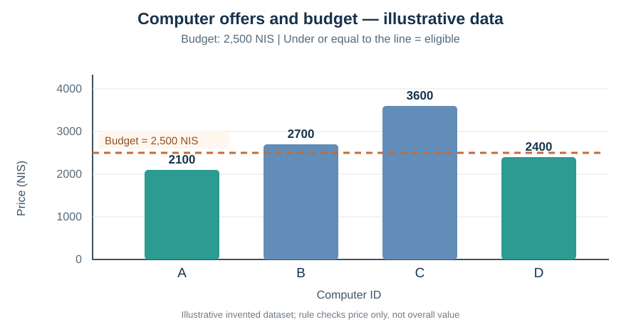
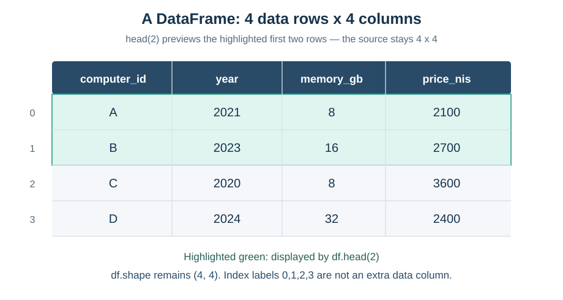

# מפגש 3 — מי עומד בתנאי? מהמחיר הבודד לטבלת נתונים
**יחידה 3 — ניתוח נתונים ולמידת מכונה | כיתה י׳ | ספר תלמיד מורחב**

## סיפור הפתיחה: דודו אחראי לתקציב, אבל מה פירוש "עד"?

במפגש הקודם דודו סידר את ההצעות למחשבים משומשים ברשימות. השבוע המועדון קיבל תקציב לרכישת מחשב אחד, ומנהל המועדון ביקש: **"מצא מחשב שמחירו אינו עולה על 2,500 ש״ח"**.

דודו ראה את ההצעות. חברו טען ש"עד 2,500" פירושו *פחות מ־2,500*, ולכן מחשב שעולה בדיוק 2,500 לא מתאים. דודו טען שהמחיר הזה מתאים. מי צודק? איך נכתוב כלל שאי אפשר לפרש בשתי דרכים?

זו **החלטה לפי כלל ידוע מראש**. המחשב לא צריך ללמוד את הכלל מן הנתונים — אנו קובעים אותו, והוא בודק אותו. אחר כך נראה איך מייצגים כמה מחשבים **בטבלה אחת**, בלי לאבד את ההתאמה בין מחיר, שנת ייצור וזיכרון.

**חשבו לפני הקוד:** הציעו מחיר שבו הביטויים "פחות מ־2,500" ו"עד 2,500 כולל" יניבו תשובות שונות.

## 1. כתיבת כלל מתמטי ברור

נסמן p — מחיר הצעה בשקלים; B — התקציב המרבי בשקלים. התנאי הוא:

\[
p\le B
\]

קוראים את הסימן כך: "קטן או שווה". מחיר מתאים אם הוא *מתחת לתקציב או שווה בדיוק לתקציב*. התנאי p<B מחמיר יותר: מחיר ששווה לתקציב אינו נכלל.

**נבדוק ידנית בתקציב B=2500 ₪:**

| מחיר p | האם p≤2500? | מתאים? | האם p<2500? |
|---:|---|---|---|
| 2100 | אמת | כן | אמת |
| 2400 | אמת | כן | אמת |
| 2500 | אמת | כן | שקר |
| 2700 | שקר | לא | שקר |

המחיר 2500 הוא **מקרה הגבול**. זו אינה תחזית או הסתברות; כל שורה מתקבלת מבדיקת כלל שהגדרנו.

### השמה לעומת בדיקת שוויון

ב־Python הסימן = משמש **להשמת ערך** במשתנה: budget_nis = 2500.

הסימן == משמש **לבדיקת שוויון**. הביטוי price_nis == 2500 מחזיר **True** או **False**. ערכים אלה נקראים ערכים *בוליאניים*. True אינו אומר שהקנייה כדאית; הוא אומר שתנאי מסוים התקיים.

~~~python
price_nis = 2400
budget_nis = 2500
print(price_nis <= budget_nis)   # True
~~~

## 2. מה עושה if, ולמה צריך הזחה?

~~~python
price_nis = 2400
budget_nis = 2500
if price_nis <= budget_nis:
    print("Within budget")
print("Check finished")
~~~

המחשב בודק את התנאי. רק אם תוצאתו True הוא מבצע את **הפקודה המוזחת**. הפקודה האחרונה אינה מוזחת ולכן תתבצע לאחר הבדיקה בכל מקרה.

| מחיר ₪ | תוצאת התנאי | האם יודפס Within budget? | האם יודפס Check finished? |
|---:|---|---|---|
| 2400 | True | כן | כן |
| 2700 | False | לא | כן |

הנקודתיים מסיימות את כותרת if; **ההזחה** קובעת אילו הוראות תלויות בתנאי. אם התנאי שקר, **הקוד אינו נפסק**: ממשיכים לפקודה שאחרי גוף ה־if.

## 3. משלבים את הרשימה והלולאה ממפגש 2

כבר למדנו לשמור מחירים ברשימה ולעבור עליהם באמצעות for. כעת נוסיף if.

~~~python
prices_nis = [2100, 2700, 3600, 2400]
budget_nis = 2500
for price_nis in prices_nis:
    if price_nis <= budget_nis:
        print(price_nis)
~~~

**לפני הרצה הכינו טבלת מעקב:**

| מעבר | ערך price_nis | תנאי | האם יודפס? |
|---|---:|---|---|
| 1 | 2100 | True | 2100 |
| 2 | 2700 | False | לא |
| 3 | 3600 | False | לא |
| 4 | 2400 | True | 2400 |

היו **ארבעה מעברים בלולאה** ורק **שתי הדפסות**. מחיר שלא הודפס *לא נמחק מהרשימה*. מדדנו התאמה לתקציב, לא את איכות המחשב.

## 4. מה הגרף מראה — ומה הוא לא מראה?

בגרף קו התקציב נמצא בגובה 2500 ₪. העמודות של A ושל D נמוכות ממנו ומתאימות; B ו־C חורגים ממנו. הציר האנכי מציין **מחיר בשקלים**, ולא ציון איכות או סיכוי להצליח.

אם מחשב היה עולה בדיוק 2500 ₪, העמודה שלו הייתה מגיעה לקו וההחלטה עם תנאי "קטן או שווה" הייתה **מתאים**. אי אפשר לדעת מן הגרף איזה מחשב כדאי יותר: חסר מידע על המעבד, מצב החומרה והאחריות. **נתוני הדוגמה מומצאים להוראה.**

## 5. למה עוברים מרשימות ל־DataFrame?

במפגש 2 שמרנו בנפרד רשימות מזהים, שנים ומחירים. הבעיה: אם נסדר רק רשימה אחת, נאבד את ההתאמה בין מאפיינים של אותו מחשב. טבלה מציגה את כל הפרטים של כל תצפית **בשורה אחת**:

| מזהה | שנת ייצור | זיכרון GB | מחיר ₪ |
|---|---:|---:|---:|
| A | 2021 | 8 | 2100 |
| B | 2023 | 16 | 2700 |
| C | 2020 | 8 | 3600 |
| D | 2024 | 32 | 2400 |

**תצפית** היא מחשב אחד, כלומר שורה. **שדה** הוא סוג מידע, כלומר עמודה. כאן יש ארבע **שורות נתונים** וארבע **עמודות נתונים**.

DataFrame הוא מבנה נתונים טבלאי מספריית **Pandas**. הוא לא מודל למידת מכונה; הוא כלי לארגון נתונים והכנתם לחקר.

## 6. בונים את הטבלה הראשונה בפייתון

הקוד הבא מציג צורת נתונים חדשה: *מילון של עמודות*. המפתחות הם שמות העמודות; הערכים הם רשימות. אין צורך ללמוד היום את כל פעולות המילון; נבין רק את המבנה הדרוש לטבלה.

~~~python
import pandas as pd

computer_data = {
    "computer_id": ["A", "B", "C", "D"],
    "year": [2021, 2023, 2020, 2024],
    "memory_gb": [8, 16, 8, 32],
    "price_nis": [2100, 2700, 3600, 2400]
}
computers_df = pd.DataFrame(computer_data)
display(computers_df)
~~~

הפקודה import pandas as pd מייבאת את Pandas ומעניקה לה את הכינוי pd. הפעולה pd.DataFrame בונה את הטבלה. כל הרשימות צריכות לתאר אותו מספר תצפיות: אם רשימת המחירים קצרה בשורה אחת, אי אפשר לבנות ממנה כראוי את הטבלה הזו.

## 7. מה ההבדל בין shape לבין head?

~~~python
print(computers_df.shape)
display(computers_df.head(2))
print(computers_df.shape)
~~~

התוצאה הראשונה היא **(4, 4)**: מספר **שורות**, ואחריו מספר **עמודות**. הסימנים 0,1,2,3 שמופיעים משמאל בעת הצגת DataFrame הם אינדקסי השורות; הם **אינם עמודה חמישית**.

הפעולה head(2) מחזירה **תצוגה של שתי השורות הראשונות**, כך שנוכל להציץ בטבלה ארוכה. היא אינה מוחקת את השורות הבאות. לפיכך גם אחרי ההצצה הטבלה המקורית עדיין בעלת צורה **(4, 4)**.

**שאלת חוקר:** אם שתי שורות מתארות מחשבים עם אותו נפח זיכרון ואותו מחיר, האם אלה בהכרח כפילויות? לא. אלה עשויים להיות שני מחשבים שונים. זיהוי כפילות דורש הבנת משמעות הרשומה ומזהה מתאים.

## 8. למה זה חשוב בעולם ניתוח הנתונים וה־AI?

לפני שיוצרים מודל, צריך לזהות מהי כל תצפית, מהי היחידה של כל שדה והאם הנתונים שייכים זה לזה. לדוגמה, חוקר עשוי להשתמש בשנת הייצור ובזיכרון כ**מאפיינים**, ולהגדיר את המחיר כ**יעד** שינסה בעתיד לחזות. מזהה מחשב הוא קודם כול מזהה; אין להניח אוטומטית שכדאי להשתמש בו כמאפיין חיזוי.

תנאי תקציב הוא **כלל החלטה שכתבנו מראש**. יצירת DataFrame היא **ארגון מידע**. אף אחת מהפעולות הללו אינה התאמת מודל מן הנתונים, ולכן איננו מציגים היום אחוזי דיוק, אימון או חלוקת Train/Test.

## 9. מעבדה עצמאית — מעבירים ידע, לא מעתיקים תוצאה

במחברת התלמיד תעבדו על נתונים **אחרים**:
- תנאי תקציב 3000 ₪ ורשימת מחירים [1800,3200,3000,4200,2600]. תכינו טבלת מעקב, תסבירו את הגבול ותתקנו הזחה.
- ארבעה מחשבים P1–P4; תבנו DataFrame ותציגו shape, שמות העמודות ו־head(3).
- תכתבו כרטיס מאגר עם יחידות, מקור, מאפיינים, יעד אפשרי ומגבלה.

הסימן ? בתאי הקוד הוא מקום **להשלמת קוד Python ממשי**. תא שנותר בו ? אינו מוכן להרצה. המורה יכול לתת גם את המעבדה המקורית, שבה אין שלד פתרון, למי שמסוגל להתמודד לבד.

## 10. 45 דקות עבודה בפרויקט — הצעד הראשון לחקר

הציעו **שתי שאלות חקר** מן העולם שמעניין אתכם, ובחרו אחת להמשך. לכל הצעה ציינו: למי פתרון השאלה יעזור; מהי יחידת התצפית; איזה מידע קיים *לפני* האירוע שרוצים לחזות; מהו היעד; מאין ניתן לאסוף נתונים ומהי מגבלה אפשרית.

דוגמה לניסוח שאלה אפשרית: "האם מידע על גיל מחשב, זיכרון ומפרט טכני עשוי לסייע בחיזוי מחיר מחשב משומש?" זו **הצעה לנושא**, לא תשובה מוכחת. בפרויקט עוד נצטרך לבדוק איכות נתונים וללמוד איך לבצע הערכה הוגנת.

## כרטיס יציאה

תקציב 3000 ₪ והצעה בדיוק 3000 ₪: הסבירו למה תנאי קטן־או־שווה מחזיר True ותנאי קטן־ממש מחזיר False. הסבירו גם למה head(2) אינה מוחקת שורות ומהי התצפית בטבלת המחשבים. **השיבו במילים ובדוגמה, לא רק בקוד.**

**המשך הרצף:** במפגש 4 נפגוש מאגר נתונים בקובץ CSV, נתבונן במקור המידע ובטיפוסי נתונים ונלמד לסקור את איכות המאגר.

