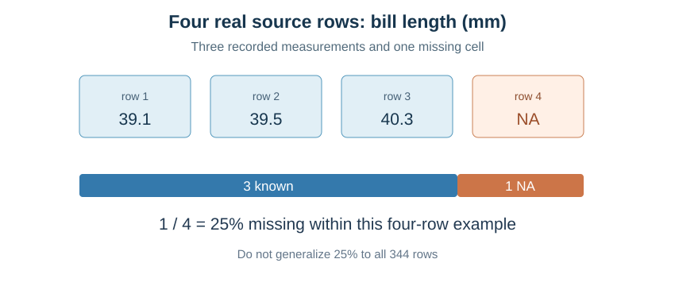
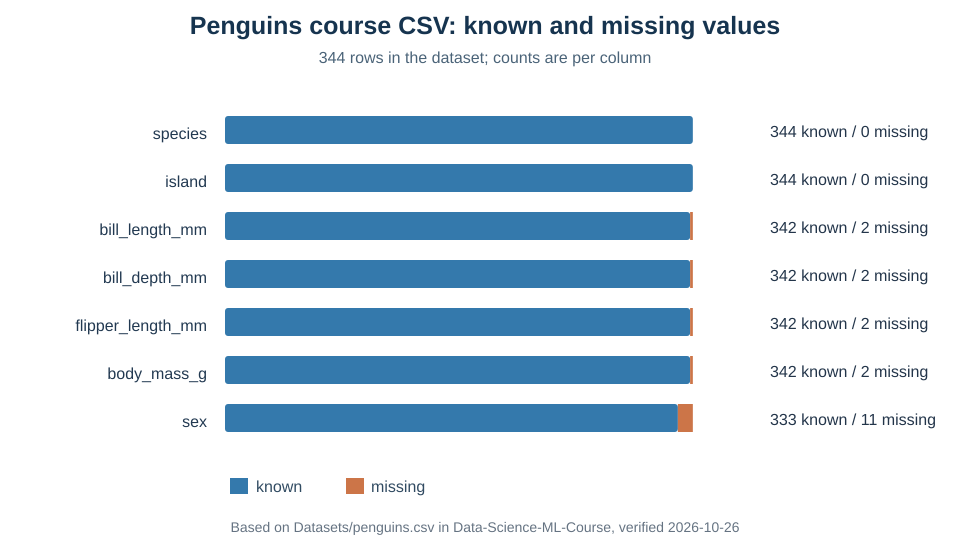

# מפגש 4 — האם אפשר לסמוך על קובץ נתונים?
**כיתה י׳ | יחידה 3, ניתוח נתונים ולמידת מכונה | ספר תלמיד מעמיק**

## הסיפור: הודעה מחוקרי פינגווינים

דודו והמועדון הטכנולוגי מצאו ברשת קובץ מדידות של פינגווינים מאנטארקטיקה. אחד החברים מכריז: "מצאתי מאות שורות, בואו נאמן מודל שמנבא מסת פינגווין!" חברתו שואלת קודם: **מי אסף את הנתונים? מה נמדד? מהם היחידות? מה פירוש NA בתוך מדידה? האם הקובץ מתאים לשאלה?**

כך מתחיל תפקידו של מנתח נתונים: לפני חיזוי, מבינים **מקור → מבנה → יחידות → איכות → מגבלות**. היום לא מאמנים מודל. לומדים לקרוא את הנתונים ולדעת מה עדיין איננו יודעים.

## 1. המידע על המקור האמיתי

המאגר Palmer Penguins מתאר מדידות פינגווינים באזור ארכיפלג Palmer באנטארקטיקה. מדידות המקור נאספו בידי Kristen Gorman ו־Palmer Station LTER. חבילת palmerpenguins הונגשה בידי Horst, Hill ו־Gorman (2020), DOI: 10.5281/zenodo.3960218.

**קישורים:**
- מקור: https://github.com/allisonhorst/palmerpenguins
- קובץ הקורס: https://github.com/samiabo75/Data-Science-ML-Course/blob/main/Datasets/penguins.csv
- CSV ישיר לקריאה בפייתון: https://raw.githubusercontent.com/samiabo75/Data-Science-ML-Course/main/Datasets/penguins.csv

בגרסת הקורס שנבדקה ב־26.10.2026 נמצאו **344 שורות נתונים ושבע עמודות**. גרסאות מסוימות של Palmer Penguins מכילות גם עמודת year, אך היא אינה נכללת בקובץ הקורס. לכן כרטיס חקר צריך לכלול קישור מדויק וגרסה.

## 2. CSV אינו DataFrame

CSV הוא קובץ טקסט: שורת כותרות ואחריה שורות של תצפיות, כשבדרך כלל פסיקים מפרידים בין השדות. דוגמה אמיתית מתחילת קובץ הקורס:

~~~text
species,island,bill_length_mm,bill_depth_mm,flipper_length_mm,body_mass_g,sex
Adelie,Torgersen,39.1,18.7,181,3750,male
Adelie,Torgersen,39.5,17.4,186,3800,female
~~~

שורת הכותרת מתארת שמות שדות. כל שורת נתונים מתארת מדידות של פינגווין אחד. **DataFrame** היא טבלה המיוצרת בזיכרון המחשב לאחר קריאת הקובץ באמצעות Pandas.

## 3. מילון השדות ויחידותיהם

| שם שדה | פירוש | יחידה |
|---|---|---|
| species | מין הפינגווין | קטגוריה |
| island | אי המדידה | קטגוריה |
| bill_length_mm | אורך המקור | מ״מ |
| bill_depth_mm | עומק המקור | מ״מ |
| flipper_length_mm | אורך סנפיר | מ״מ |
| body_mass_g | מסת גוף | גרם |
| sex | הזוויג המתועד | קטגוריה |

**תצפית:** שורה המתארת פינגווין. **מאפיין:** למשל אורך סנפיר. **יעד אפשרי:** body_mass_g אם נרצה לחזות מסה. שאלת חקר עתידית: האם מדידות מקור וסנפיר יכולות לסייע לחיזוי מסה? זו שאלה בלבד — עדיין לא נבנה מודל ולא נבדק קשר.

## 4. נוסחה ראשונה — כמה מדידות חסרות?

בארבע הרשומות הראשונות של קובץ הקורס מופיעים אורכי מקור **39.1, 39.5, 40.3, NA** מ״מ. המילה NA אומרת שהמדידה חסרה בקובץ, **לא שהיא אפס**.

נסמן n מספר הרשומות, c מספר המדידות הידועות ו־m מספר החסרים:

\[
m=n-c, \qquad \operatorname{MissingRate}=\frac{m}{n}\times 100\%.
\]

**חישוב ידני:**
1. יש ארבע רשומות, לכן n=4.
2. יש שלושה ערכים ידועים, לכן c=3.
3. מספר חסרים m=4−3=1.
4. אחוז חסרים = 1/4×100 = **25%**.

הפירוש המדויק: **25% מהערכים בארבע הרשומות האלה חסרים בעמודה זו**. אין פירוש הדבר ש־25% מכל 344 הרשומות חסרים!

## 5. נוסחה שנייה — ממוצע המדידות הידועות

\[
\bar x_{\rm known}=\frac{\sum_{\rm known}x_i}{c}
=\frac{39.1+39.5+40.3}{3}
=\frac{118.9}{3}\approx39.63\,\mathrm{mm}.
\]

כלומר: ממוצע **שלוש המדידות הידועות** הוא כ־39.63 מ״מ.

אם נשנה את החסר באופן שרירותי לאפס ונחלק בארבע, נקבל 118.9/4=**29.725 מ״מ**. זו תוצאה שונה שאין הצדקה לייחס למדידות האמיתיות. למידת מכונה דורשת להחליט בהמשך כיצד לטפל בחסרים, אך **אין ממלאים נתונים בשיעור זה**.

## 6. אותו חישוב ב־Python, אחרי פתרון ידני

~~~python
import pandas as pd

tiny_df = pd.DataFrame({"bill_length_mm": [39.1, 39.5, 40.3, None]})
print(tiny_df.shape)
print(tiny_df["bill_length_mm"].count())
print(tiny_df["bill_length_mm"].mean())
~~~

צפו: ממדים (4,1), מספר מדידות ידועות 3, ממוצע כ־39.63. **shape** מחשבת את גודל הטבלה; **count** בעמודה סופרת רק ערכים שאינם חסרים; **mean** מחשבת ממוצע ערכים ידועים.

שימו לב: שורה עם חסר עדיין קיימת בתוך הטבלה. לכן מספר השורות עשוי להיות גדול מה־count של עמודה מסוימת.

## 7. טעינת CSV אמיתי ב־Colab

~~~python
import pandas as pd
dataset_url = "https://raw.githubusercontent.com/samiabo75/Data-Science-ML-Course/main/Datasets/penguins.csv"
penguins_df = pd.read_csv(dataset_url)
print(penguins_df.shape)
display(penguins_df.head())
~~~

אם הקובץ לא השתנה, התוצאה היא (344,7). **URL מסוג Raw** מספק את תוכן הקובץ; דף github.com עם המילה blob הוא דף תצוגת האתר. אם חיבור הרשת נכשל, הורידו את ה־CSV, העלו אותו ל־Colab, ואז השתמשו בנתיב הקובץ שהועלה; למשל ‎/content/penguins.csv. אל תניחו שקובץ מהמחשב מופיע אוטומטית בענן.

## 8. להבין מה אומרות פקודות הסקירה

| פקודה | מה היא מלמדת | מה אינה מוכיחה |
|---|---|---|
| df.shape | שורות, עמודות | שהקובץ מהימן |
| df.columns | שמות שדות | שהיחידות ידועות |
| df.head(6), df.tail(2) | התחלה וסוף הטבלה | שמוצגות כל הקטגוריות |
| df.info() | טיפוסים ומספר ערכים שאינם חסרים | שאין טעויות מדידה |
| df.describe() | סטטיסטיקה תיאורית לעמודות מספריות כברירת מחדל | סיבתיות וייצוגיות |
| df["species"].unique() | אילו שמות מינים מופיעים בקובץ | מדגם שלם של כל פינגוויני העולם |

### מה יש ב־info?
במאגר הקורס יש 344 רשומות. ארבע עמודות המדידה הבאות — אורך מקור, עומק מקור, אורך סנפיר ומסת גוף — מכילות **342 ערכים ידועים כל אחת**; ב־sex יש **333**. species ו־island מכילות 344 כל אחת.

### מה יש ב־describe?
**count** הוא מספר המדידות הידועות בעמודה; **mean** הוא ממוצע; **min/max** קצוות; **std** סטיית תקן מדגמית; **25%/50%/75%** רבעונים. בשיעור הזה נפרש את השמות, ואת חישובי הפיזור והרבעונים נעמיק בהמשך.

| שדה | ערכים ידועים | חסרים מתוך 344 |
|---|---:|---:|
| species | 344 | 0 |
| island | 344 | 0 |
| bill_length_mm | 342 | 2 |
| bill_depth_mm | 342 | 2 |
| flipper_length_mm | 342 | 2 |
| body_mass_g | 342 | 2 |
| sex | 333 | 11 |

אין לחבר את כל החסרים בעמודות ולהציגם כמספר פינגווינים שונים: אותה רשומה יכולה להכיל כמה ערכים חסרים.

### האם הצצה לכל הקובץ?
בשורות הראשונות מופיע Adelie ובאחרונות Chinstrap. בדיקת **unique** של העמודה species חושפת גם Gentoo. זו הדגמה מדוע head ו־tail הן רק הצצות, ולא תחליף לבדיקה של כל שדה.

## 9. כתיבת כרטיס מקור מקצועי

לפני בניית מודל בעתיד נדרוש: שם המקור והיוצרים; קישור/גרסה; מי נאסף ומתי ככל שידוע; יחידת תצפית; שבעת השדות ויחידותיהם; מספר רשומות; היקף חוסרים; יעד אפשרי ושני מאפיינים; מגבלת ייצוגיות או שימוש.

אפשר להציע יעד עתידי body_mass_g ומאפיינים bill_length_mm ו־flipper_length_mm. לא נכניס את היעד כקלט לחיזוי אותו יעד. **זהו תכנון לשלב עתידי בלבד**.

## 10. מעבדה ופרויקט

**מעבדת התלמיד:** טוענים לבד את CSV האמיתי, מציגים shape, columns, head(6), tail(2), info, describe ו־unique; מנסחים כרטיס מקור, וכתובים במפורש מה אי אפשר להסיק. אין מחיקה, השלמה או אימון מודל.

**45 דקות פרויקט:** חוזרים לשאלת החקר ממפגש 3 ומוצאים מאגר מועמד, מגדירים תצפית, יעד, מאפיינים, יחידות וקישור מקור, ומתעדים מגבלה. לא מבצעים עדיין חקר מודל אישי שעלול להשפיע על הערכה עתידית.

**כרטיס יציאה:** אם יש 344 שורות אבל count של מדידת מקור הוא 342 — כמה ערכים חסרים? האם 25% החסרים בארבע רשומות מתארים את כל המאגר? האם הרבה תצפיות מבטיחות מחקר אמין? נמקו.

