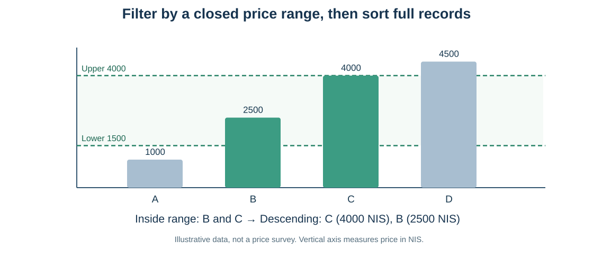

# מפגש 6 — מסננים, מדרגים וחוקרים: ממחשבים ליהלומים
**יחידה 3 · כיתה י׳ · ספר תלמיד מעמיק · 90 דקות לימוד ו־45 דקות פרויקט**

## הסיפור: דודו קיבל בקשה חדשה
מנהלת המועדון רוצה למצוא הצעות מחשב **בין 1,500 ל־4,000 ש״ח, כולל הקצוות**, ואז לראות תחילה את היקרה שבהן. דודו כבר למד לסנן לפי תנאי אחד. עכשיו עליו לבדוק **שני תנאים באותה שורה**, ורק לאחר מכן למיין את הרשומות. חברו מנסה למיין את המחירים בנפרד משמות המחשבים. מדוע התוצאה עלולה להיות שגויה? מפני שכל מחיר חייב להישאר מחובר למחשב שממנו הגיע.

**המסלול הקוגניטיבי שלנו:** סיפור → תנאי מילולי → נוסחה וטבלת אמת → סינון → מיון רשומות שלמות → גרף → קוד Python → עבודה עצמאית במאגר חדש → מסקנה ומגבלה.

## 1. ארבע הצעות מחשבים (דוגמה מומצאת)
| מחשב | זיכרון GB | מחיר ₪ |
|---|---:|---:|
| A | 16 | 1000 |
| B | 8 | 2500 |
| C | 32 | 4000 |
| D | 16 | 4500 |

לפני שמריצים קוד, סמנו בטבלה את ההצעות שמחירן מתאים לתחום הסגור שביקשה המנהלת.

## 2. נוסחה: מה פירוש שני תנאים יחד?
נסמן \(p_i\) מחיר מחשב בשורה i, ו־\(L=1500\), \(U=4000\) הגבולות בשקלים. התנאי הוא:

\[
L\leq p_i\leq U
\]

כלומר מחירו **לפחות** 1,500 ש״ח **וגם** אינו עולה על 4,000 ש״ח.

\[
I_i=\mathbf{1}[p_i\geq L]\land\mathbf{1}[p_i\leq U]
\]

הסימן \(\land\) פירושו **וגם** (AND). הערכים 1/0 מייצגים התאמה/אי־התאמה; ב־Python אלה True/False. **אין אלה הסתברויות או מדדי דיוק.**

### פתרון ידני בטבלת מעקב
| מזהה | מחיר | \(p_i\ge1500\) | \(p_i\le4000\) | שניהם |
|---|---:|---|---|---|
| A | 1000 | False | True | False |
| B | 2500 | True | True | True |
| C | 4000 | True | True | True |
| D | 4500 | True | False | False |

המסכה המשולבת היא **False, True, True, False**. נבחרו B ו־C. גם C שווה לגבול העליון ולכן **נכלל**.

**שאלת חשיבה:** אילו השתמשנו בקטן ממש במקום קטן או שווה בגבול העליון, מה היה משתנה? C היה יוצא מהתוצאה. ההבדל בין סף פתוח לסגור אינו עניין של טעם — הוא מגדיר איזה מידע נכלל.

### טבלת אמת: וגם לעומת או
| תנאי 1 | תנאי 2 | AND | OR |
|---|---|---|---|
| False | False | False | False |
| False | True | False | True |
| True | False | False | True |
| True | True | True | True |

במשימה שלנו נדרש AND; OR יענה לשאלה אחרת. OR מוצג כהרחבה בלבד, לא כנושא מרכזי.

## 3. אותו חישוב בפייתון — מסכה אחר מסכה
~~~python
import pandas as pd

computers_df = pd.DataFrame({
    "computer_id": ["A", "B", "C", "D"],
    "memory_gb": [16, 8, 32, 16],
    "price_nis": [1000, 2500, 4000, 4500]
})

above_lower = computers_df["price_nis"] >= 1500
below_upper = computers_df["price_nis"] <= 4000
both_mask = above_lower & below_upper
selected_df = computers_df[both_mask]
display(selected_df)
~~~

למה **&** ולא **and**? מפני ש־Pandas מחזירה *סדרה בוליאנית* — תוצאת אמת/שקר לכל שורה. הסימן & משלב את שתי הסדרות איבר־איבר. המילה and של Python אינה מתאימה לפעולה כזאת.

גם בקוד מקוצר חייבים להקיף כל השוואה בסוגריים:

~~~python
selected_df = computers_df[
    (computers_df["price_nis"] >= 1500) &
    (computers_df["price_nis"] <= 4000)
]
~~~

המקור נשאר **(4,3)**; התוצאה המסוננת היא **(2,3)**. לא נמחקו נתונים מן המקור.

## 4. ממיינים *רשומות*, לא רק מחירים

~~~python
ranked_df = selected_df.sort_values("price_nis", ascending=False)
display(ranked_df)
~~~

אחרי הסינון נשארו B (2,500 ש״ח, 8GB) ו־C (4,000 ש״ח, 32GB). מיון יורד צריך להציג קודם **C — 4,000 — 32GB**, ואחריו **B — 2,500 — 8GB**. כך הזיכרון נשאר צמוד למחשב הנכון.

- מיון עולה (ברירת מחדל) — הנמוך תחילה.
- מיון יורד בעזרת ascending=False — הגבוה תחילה.
- המיון אינו משנה את מספר השורות, ואינו מעיד לבדו על איכות.
- כששני מחירים שווים אין להסיק עדיפות עסקית בין הרשומות רק ממיקומן; צריך כלל הכרעה נוסף.
- האינדקס עשוי להישאר כמו במקור, ואין להסיק שאינדקס הוא דירוג.

## 5. אחוז נבחרים ופרשנות נכונה
\[
\text{Selection Rate}=\frac{k}{n}\times100\%=\frac{2}{4}\times100\%=50\%.
\]

כלומר **מחצית מארבע ההצעות המומצאות בדוגמה** עומדות בטווח. זו אינה מסקנה על כלל שוק המחשבים, אינה הסתברות לקנייה מוצלחת ואינה Accuracy של מודל.

## 6. העברה למאגר אמיתי — Penguins
במפגש 4 בדקנו מקור וערכים חסרים; במפגש 5 למדנו מסכה של תנאי אחד. עכשיו המשימה היא להפעיל שתי מסכות על אותו קובץ:

- לבחור **Adelie וגם אורך סנפיר לפחות 190 מ״מ**;
- לבחור אורך מקור **מ־40 עד 45 מ״מ כולל**;
- למיין רשומות שלמות לפי מסת הגוף ולבדוק קצוות.

מאגר הקורס: https://raw.githubusercontent.com/samiabo75/Data-Science-ML-Course/main/Datasets/penguins.csv

**שימו לב לחסרים:** ערך NaN במדידה מספרית אינו עומד בהשוואת סף, אבל אין בכך הוכחה שהמדידה קצרה מן הסף. במיון מספרי ב־Pandas, חסרים מופיעים כברירת מחדל בסוף גם במיון יורד; לכן הצגת שלוש שורות *אחרונות* של טבלה ממוינת אינה בהכרח הצגה של שלוש המדידות הקטנות ביותר.

## 7. העברה מקצועית נוספת — Diamonds
כעת התלמיד כבר לא עונה רק על "איך כותבים &?" אלא גם על "האם אותה דרך עובדת בשדה אחר ובמאגר אחר?".

מאגר Diamonds המתועד בספריית ggplot2 מכיל 53,940 תצפיות ועשרה שדות. משימת ההשתלמות משתמשת בקישור:
https://raw.githubusercontent.com/arielb30/datasets/main/diamonds.csv

**תמיד בודקים את מבנה הקובץ שנטען בפועל**; עצם הדמיון לשם מאגר מוכר אינו מבטיח גרסה זהה.

| שדה | פירוש | יחידה |
|---|---|---|
| carat | משקל יהלום | קראט; 1 קראט = 0.2 גרם |
| cut | דירוג חיתוך | קטגוריה כגון Ideal |
| color | דירוג צבע | קטגוריה |
| clarity | דירוג ניקיון | קטגוריה |
| price | מחיר היסטורי מתועד | דולר ארה״ב |
| x, y, z | מידות גאומטריות | מ״מ |
| depth, table | פרופורציות | אחוזים |

המשימה היא למצוא **Ideal וגם משקל לפחות קראט אחד**, למיין לפי price בסדר יורד ולהציג חמש רשומות; אחר כך למצוא יהלומים במשקל **0.5–0.7 קראט כולל** ולמיין לפי מחיר עולה.

**המחקר הזה אינו חיזוי:** סינון לפי מחיר או מיון מחירים קיימים אינם מלמדים איך לנבא מחיר של יהלום חדש. המחירים בקובץ אינם בהכרח מחירים עדכניים, וחמשת היקרים ביותר הם בחירת קצה מכוונת — לא מדגם מייצג. אם יש בקובץ מידה x=0, בודקים את מקור השגיאה האפשרית ולא מוחקים בלי הצדקה.

## 8. 45 דקות פרויקט אישי — דוח איכות תכנוני
הכינו על בסיס המאגר האישי שכבר בחרתם: שאלה על תת־קבוצה; תנאי כניסה אחד או שניים שניתן לנסח מראש; מיון שעשוי לחשוף קצה חשוב; יחידות; הסבר למגבלה של הבחירה. **אין לבצע עדיין חקר אישי שמכוון בחירת מאפיינים על קבוצת Test שמורה**. אם טרם חולקה קבוצת הבדיקה בהנחיית המורה, מנסחים תוכנית ולא מקבלים החלטות על המודל מתוך ניתוח של כל המאגר.

## כרטיס יציאה — חושבים כמו חוקר
מדוע התוצאה משתנה כאשר מחליפים <= ב־<? למה ממיינים DataFrame שלמה ולא רק רשימת מחירים? למה אי אפשר לכתוב and בין שתי Series? למה חמש הרשומות היקרות ביותר אינן מדגם מייצג? לכל תשובה צרפו הסבר או דוגמה מספרית מן השיעור.

