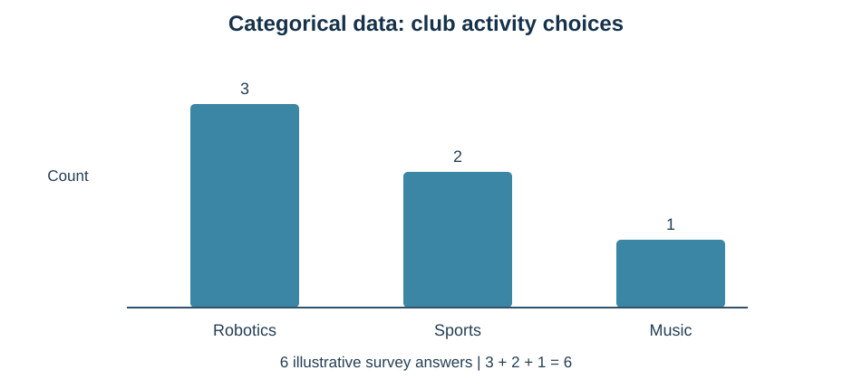
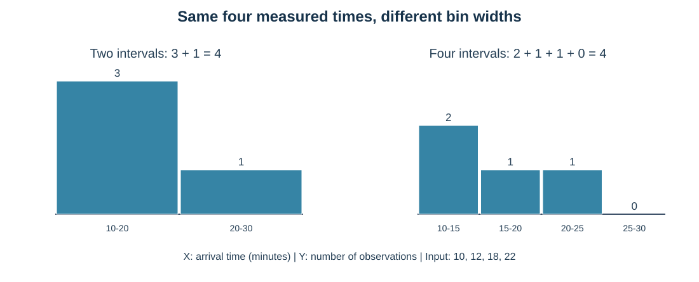
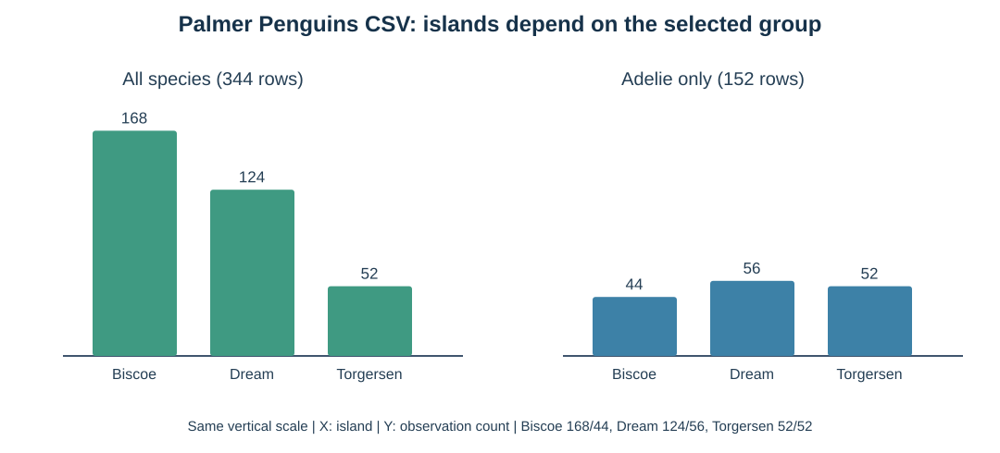

# מפגש 7 — איך הופכים נתונים לסיפור שאפשר לבדוק?
**ספר תלמיד מעמיק | יחידה 3 — כיתה י׳ | 90 דקות הוראה ותרגול + 45 דקות פרויקט**

## סיפור פתיחה: שני דוחות שנראים שונים
מועדון הטכנולוגיה ארגן בחירת פעילות. שש תשובות נרשמו: רובוטיקה, ספורט, רובוטיקה, מוזיקה, ספורט, רובוטיקה. תלמידה מציעה לצייר תרשים עמודות. תלמיד אחר רוצה להציג את זמני ההגעה של ארבעה תלמידים: 10, 12, 18 ו־22 דקות. האם זה אותו סוג נתונים? האם נכון להשתמש באותו תרשים?

**הבעיה האמיתית:** פעילות היא *שם של קבוצה*; זמן הוא *גודל שנמדד*. מנתח נתונים אינו מתחיל בבחירת צבע או פונקציית Python. קודם מזהים יחידת תצפית, משמעות שדה ושאלת מחקר. כך נוכל לבחור גרף שיספר אמת, לא תמונה יפה שמטעה.

בהמשך השיעור חוקרי פינגווינים יציגו שני גרפים: בכלל המאגר Biscoe מכיל הכי הרבה תצפיות, אבל בקרב Adelie דווקא Dream מוביל. האם השתנו הנתונים? **לא — השתנתה קבוצת התצפיות שנבחרה.** זוהי חשיבה מחקרית שאנו רוצים לפתח.

## 1. איזה סוג משתנה עומד מולנו?
| סוג | משמעות | דוגמה | תרשים מתאים |
|---|---|---|---|
| קטגוריאלי שמי (Nominal) | קבוצות ללא סדר טבעי | סוג פעילות, שם אי, מין פינגווין | תרשים עמודות של ספירות |
| קטגוריאלי סדרי (Ordinal) | קבוצות בסדר, ללא מרווח מספרי מחייב | דירוג נמוך/בינוני/גבוה | עמודות לפי סדר הדרגות |
| כמותי בדיד (Discrete) | מספר פריטים נספרים | מספר תלמידים שבחרו רובוטיקה | ספירה שלמה |
| כמותי רציף (Continuous) | מדידת גודל לאורך טווח | אורך סנפיר במ״מ, מסה בגרמים, זמן בדקות | היסטוגרמה של תחומי ערכים |

**זהירות:** מזהה תלמיד שמור כמספר, אבל אין סיבה לחשב לו ממוצע. זהו קוד קטגוריאלי/מזהה. מדידת אורך שנרשמה כמספר שלם עדיין מייצגת אורך רציף (שעוגל ליחידת המדידה). סוג המשתנה נקבע לפי משמעותו, ולא רק לפי dtype.

## 2. שכיחות של קטגוריה — פותרים ביד לפני קוד
נניח שקיבלנו את שש התשובות הבאות (נתונים מומצאים להוראה):

| תלמיד | פעילות |
|---|---|
| 1 | רובוטיקה |
| 2 | ספורט |
| 3 | רובוטיקה |
| 4 | מוזיקה |
| 5 | ספורט |
| 6 | רובוטיקה |

נסמן מספר התצפיות ב־n ואת שכיחות הקטגוריה j ב־f_j. הכלל המתמטי:

\[
f_j=\sum_{i=1}^{n}\mathbf{1}[x_i=j].
\]

קוראים את הנוסחה: עוברים על כל התצפיות; מוסיפים 1 כאשר השדה שווה לשם הקבוצה המבוקשת, ו־0 אחרת. זו אותה חשיבה של תנאים שלמדנו קודם.

**פתרון ידני:** רובוטיקה נמצאת בשורות 1,3,6 ולכן שכיחותה 3. ספורט בשורות 2,5 ולכן שכיחותו 2. מוזיקה בשורה 4 ולכן שכיחותה 1. בדיקת הסכום: 3+2+1=6, בדיוק מספר התשובות.

**שכיחות יחסית** (הרחבה קצרה):
\[
p_j=\frac{f_j}{n},\qquad 100p_{\mathrm{robotics}}=\frac{3}{6}\times100=50\%.
\]
50% מהתשובות **בדוגמה המומצאת** בחרו רובוטיקה. לא ניתן להסיק מכך שחצי מתלמידי בית הספר אוהבים רובוטיקה.

כיצד קוראים את הגרף? X הוא **שמות הפעילויות**, Y הוא **מספר תשובות**. המרחק בין שמות הפעילויות אינו גודל פיזיקלי; העמודות מופרדות כדי להמחיש קטגוריות.

~~~python
import pandas as pd
import seaborn as sns
import matplotlib.pyplot as plt

club_df = pd.DataFrame({
    "activity": ["Robotics", "Sports", "Robotics", "Music", "Sports", "Robotics"]
})
print(club_df["activity"].value_counts())

plt.figure(figsize=(7, 4))
sns.countplot(data=club_df, x="activity")
plt.xlabel("Activity (category)")
plt.ylabel("Number of answers")
plt.title("Club survey: six answers")
plt.tight_layout()
plt.show()
~~~

הפקודה value_counts() סופרת קטגוריות בטבלה; Countplot מציגה אותן חזותית. שתיהן מתייחסות כאן לאותה סדרת תשובות.

## 3. היסטוגרמה — מודדים לאורך ציר מספרים
זמני הגעה בדקות (שוב, דוגמה מומצאת): 10, 12, 18, 22. האם כל זמן הוא "קטגוריה" בשם 10 או 12? לא — אנחנו רוצים לדעת כמה מדידות נמצאות **בתחומי זמן**.

נגדיר שני תחומים:
\[
[10,20),\qquad[20,30).
\]

הסוגר השמאלי כולל את 10. הסוגר הימני העגול אומר 20 **אינו** נכלל בתחום הראשון, אלא בתחום הבא.

נוסחת שכיחות התחום:
\[
h_j=\sum_{i=1}^{n}\mathbf{1}[a_j\le x_i<b_j].
\]

**פתרון ידני:** לתחום [10,20) נכנסים 10,12,18 ⇒ 3 מדידות. לתחום [20,30) נכנס 22 ⇒ 1. בדיקה: 3+1=4, בדיוק ארבעת זמני ההגעה.

### עכשיו משנים רק את ה־bins
נחלק את אותם ארבעה נתונים לארבעה תחומים צרים:

| תחום בדקות | הערכים שנכללים | מספר תצפיות |
|---|---|---:|
| [10,15) | 10,12 | 2 |
| [15,20) | 18 | 1 |
| [20,25) | 22 | 1 |
| [25,30) | אין | 0 |

בדיקת סכום: 2+1+1+0=4. לא נוספו תצפיות; חלוקת ציר X השתנתה. לכן **שינוי bins משנה את הציור, אך לא את קובץ הנתונים**. לכל גרף יש לפרש את רוחב התחומים ואת מספר המדידות הידועות.

~~~python
arrival_minutes = [10, 12, 18, 22]
plt.figure(figsize=(7, 4))
plt.hist(arrival_minutes, bins=[10, 20, 30])
plt.xlabel("Arrival time (minutes)")
plt.ylabel("Number of observations")
plt.title("Four arrivals in two bins")
plt.tight_layout()
plt.show()
~~~

בחרנו גבולות מפורשים כדי שהתלמיד יוכל לבדוק בדיוק אותם תחומים ידנית. בפונקציה numpy.histogram התחום האחרון כולל גם את הקצה הימני שלו; אין בדוגמה שלנו מדידה שערכה 30, ולכן התוצאה זהה לכלל התחומים הפתוחים מימין שהצגנו.

## 4. Countplot לעומת Histogram — ההבדל שצריך לזכור
**Countplot:** X הוא *שמות קבוצות*, Y הוא *מספר רשומות בכל קבוצה*. המרווח בין עמודות אינו יחידת מדידה.

**Histogram:** X הוא *תחומי גודל מספרי עם יחידה*, Y הוא *מספר מדידות בכל תחום* כאשר משתמשים בברירת המחדל של histplot עם stat="count". העמודות רציפות באופן עקרוני כי התחומים סמוכים לאורך אותו ציר מספרי.

כאן למדנו חלוקה לתחומים **שווים ברוחבם**. אם רוחבי התחומים שונים, גובה לעומת שטח דורש טיפול נוסף; עדיין לא מלמדים צפיפות הסתברות או PDF.

## 5. תרגול על מקור אמיתי — Palmer Penguins
קובץ הקורס:
https://raw.githubusercontent.com/samiabo75/Data-Science-ML-Course/main/Datasets/penguins.csv

המאגר מכיל 344 רשומות ושבעה שדות. השאלות המעשיות שונות:

- כמה תצפיות מכל **אי** נרשמו בכלל המאגר? X הוא שם האי (קטגוריה).
- כמה תצפיות מכל אי נרשמו **בקרב Adelie בלבד**? X עדיין קטגוריאלי, אך קבוצת התצפיות השתנתה.
- כיצד מתפלגים **אורכי סנפיר**? X הוא אורך במ״מ, ולכן צריך היסטוגרמה.

יש **342 מדידות אורך סנפיר ידועות** מתוך 344 רשומות. שתי מדידות חסרות לא יופיעו בהיסטוגרמת הערכים הידועים. לכן סכום ספירות התחומים של היסטוגרמה המכסה את מלוא הטווח הוא 342 — גם אם נעבור מ־8 ל־16 תחומים. שינוי bins לא ממלא חסרים ואינו מוחק רשומות מן המקור.

דוגמת קוד שמראה את סוג הגרף (מעבדת התלמיד דורשת פירוש עצמאי):
~~~python
dataset_url = "https://raw.githubusercontent.com/samiabo75/Data-Science-ML-Course/main/Datasets/penguins.csv"
penguins_df = pd.read_csv(dataset_url)
plt.figure(figsize=(7, 4))
sns.histplot(data=penguins_df, x="flipper_length_mm", bins=8)
plt.xlabel("Flipper length (mm)")
plt.ylabel("Number of known measurements")
plt.title("Penguins flipper lengths")
plt.tight_layout()
plt.show()
~~~

## 6. מה מותר להסיק מגרף ומה לא?
גרף ספירה אומר מה מופיע **בקובץ ובקבוצה שבחרנו**. הוא אינו מדידה של כל הפרטים בטבע, אינו מוכיח סיבתיות ואינו מבטיח מדגם מייצג.

היסטוגרמה מתארת את התפלגות **המדידות הידועות**. היא אינה מוכיחה שמדובר בהתפלגות נורמלית, אינה מראה איזה פרט בדיוק יצר כל עמודה ואינה מחשבת חיזוי. יש להיזהר גם בהשוואה בין גרפים עם גדלי קבוצות שונים או טווחי ציר Y שונים.

זוהי המחשה שהתפלגות הקטגוריות משתנה כשמשנים את קבוצת המחקר. הנתונים לא השתנו; בחירת התצפיות שינתה את השאלה.

## 7. בדרך למעבדה עצמאית
| שאלה | סוג משתנה ב־X | כלי | Y | מגבלה |
|---|---|---|---|---|
| כמה בחרו בכל פעילות? | קטגוריאלי | Countplot | תשובות | שש תשובות בלבד |
| איך מתפלגים זמני הגעה? | כמותי | Histogram | מדידות בכל תחום | ארבע מדידות בלבד |
| כמה תצפיות מכל אי בקרב Adelie? | קטגוריאלי אחרי סינון | Countplot | רשומות | קבוצה מסוננת |
| איך מתפלגים אורכי סנפיר? | כמותי רציף | Histogram | מדידות ידועות בתחום | שתי מדידות חסרות |

**חלק א במעבדה:** סוגי משתנים, Countplot של האיים בקרב Adelie, השוואה למקור כולו, צירים, ממצא ומגבלה.

**חלק ב במעבדה:** Histogram של אורכי סנפיר ב־8 וב־16 bins, פירוש שינוי רוחב התחום ושמירת מספר המדידות, תיעוד מקור ויחידות.

לכל שלב: נבאו מה יוצג, הריצו, השוו לחישוב הידני, וכתבו מסקנה אחת עם מגבלה.

## 8. 45 דקות פרויקט — שני כרטיסי גרף
ממשיכים במאגר ובשאלת החקר האישיים. מכינים שני **כרטיסי גרף מתוכננים**: שאלה, שדה, סוג משתנה, יחידה, קבוצת תצפיות, צירי X/Y, ממצא שנוכל לבדוק ומגבלה. אם אין במאגר משתנה מתאים לסוג מסוים — מנמקים מדוע אין לייצר גרף לא מתאים.

אין להשתמש בקבוצת Test שמורה כדי לבחור מאפיינים, לנקות נתונים או להחליט על מודל לפני הערכה עצמאית. כשחלוקה טרם הוגדרה, העבודה בפרויקט היא תכנון מתועד בלבד.

## כרטיס יציאה
מה ההבדל בין 344 שורות לבין 342 מדידות ידועות של אורך סנפיר? מה משתנה בין שתי חלוקות bins של אותם ארבעה נתונים? מהי המשמעות של ציר Y ב־Countplot ובהיסטוגרמה? מדוע אי אפשר לטעון שהאי Biscoe מכיל הכי הרבה פינגווינים בטבע?