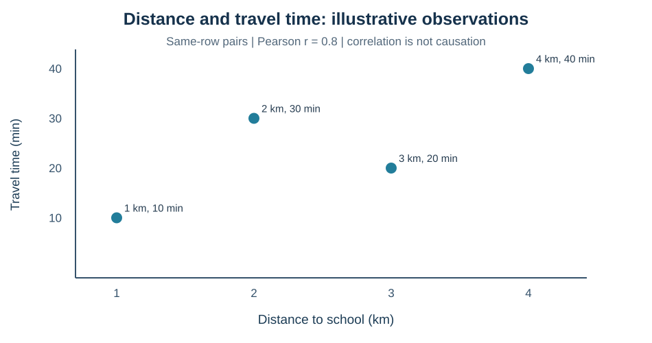
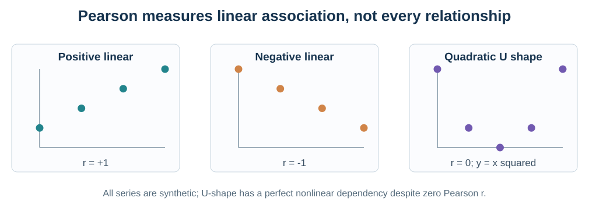

# מפגש 9 — האם שני משתנים קשורים? Scatterplot ומתאם Pearson
**כיתה י׳ · יחידה 3 · ספר תלמיד מעמיק · 90 דקות הוראה ותרגול + 45 דקות פרויקט**

## סיפור: מי שגר רחוק מגיע מאוחר?
ארבעה תלמידים מתעדים מרחק לבית הספר וזמן נסיעה. אחד מהם טוען: "אם אדע את המרחק, אדע בדיוק כמה דקות תימשך הנסיעה." תלמידה אחרת אומרת: "מה לגבי פקקים, מסלול האוטובוס ושעת היציאה?" כדי לברר נבדוק *קשר* בין שני משתנים — אך לא נניח מראש סיבה או חיזוי מושלם.

הנתונים הבאים **מומצאים להוראה**, לא סקר בבית הספר:

| נסיעה | מרחק x (ק״מ) | זמן y (דקות) |
|---|---:|---:|
| א׳ | 1 | 10 |
| ב׳ | 2 | 30 |
| ג׳ | 3 | 20 |
| ד׳ | 4 | 40 |

כל שורה היא **זוג מדידות של אותה נסיעה**. הנקודה (2,30) היא מרחק 2 ק״מ וזמן 30 דקות באותה תצפית. **אסור למיין x ו־y בנפרד**; זה יקלקל את הזיווג ויכול ליצור קשר מדומה.

## 1. קודם תרשים, אחר כך נוסחה

בציר X נציג מרחק בק״מ וב־Y זמן בדקות. קיים כיוון כללי עולה, אולם ב׳ אורכת יותר זמן מג׳ למרות שהמרחק שלה קצר יותר. לכן **לא כל הנקודות נמצאות על ישר**. תרשים פיזור עוזר לראות את צורת הקשר, קבוצות וחריגים אפשריים.

שאלת ביניים: האם בנתונים האלה נמצא קשר בין המרחק לזמן? האם התרשים מוכיח שהמרחק הוא הגורם היחיד לזמן? נמקו.

## 2. מתאם Pearson: מגדירים את השאלה שהמספר עונה עליה
מתאם Pearson המסומן r מתאר את **הכיוון והעוצמה של קשר ליניארי** בין שני משתנים מספריים, כאשר לכל אחד מהם שונות חיובית.

\[
r=\frac{\sum_{i=1}^{n}(x_i-\bar{x})(y_i-\bar{y})}
{\sqrt{\sum_{i=1}^{n}(x_i-\bar{x})^2\sum_{i=1}^{n}(y_i-\bar{y})^2}}
\]

**פירוש כל סמל:**
- \(n\): מספר הזוגות שבהם שתי המדידות ידועות.
- \(x_i,y_i\): המרחק והזמן של *אותה* נסיעה i.
- \(\bar{x},\bar{y}\): ממוצע המרחקים וממוצע הזמנים.
- המונה מחבר **מכפלות סטיות**; המכנה מחלק בעוצמת הפיזור של שני המשתנים.

r נמצא בין −1 ל־1, ו**אין לו יחידות** — הק״מ והדקות מתבטלים. r חיובי מצביע על מגמה ישרה עולה, r שלילי על מגמה יורדת, ואפס מתאר היעדר קשר *ליניארי* במדגם. r אינו אחוז דיוק ואינו הסתברות. אם לאחד המשתנים אין פיזור כלל, המכנה אפס ו־r **אינו מוגדר**.

## 3. פתרון Pearson ביד — חישוב אמיתי צעד אחר צעד
**שלב א — ממוצעים:**
\[
\bar{x}=(1+2+3+4)/4=2.5\;\text{ק״מ}
\quad
\bar{y}=(10+30+20+40)/4=25\;\text{דקות}
\]

**שלב ב — כל המכפלות והריבועים:**

| נסיעה | \(x_i-2.5\) | \(y_i-25\) | מכפלה | סטיית x בריבוע | סטיית y בריבוע |
|---|---:|---:|---:|---:|---:|
| א׳ | −1.5 | −15 | 22.5 | 2.25 | 225 |
| ב׳ | −0.5 | 5 | −2.5 | 0.25 | 25 |
| ג׳ | 0.5 | −5 | −2.5 | 0.25 | 25 |
| ד׳ | 1.5 | 15 | 22.5 | 2.25 | 225 |
| **סכום** | 0 | 0 | **40** | **5** | **500** |

**שלב ג — מציבים:**
\[
r=\frac{40}{\sqrt{5\cdot 500}}=\frac{40}{50}=0.8
\]

**שלב ד — מפרשים בזהירות:** בארבע הנסיעות המומצאות יש קשר ליניארי חיובי אך לא מושלם. *אין* לומר ש־80% מהנסיעות חזויות נכון, ש־80% מהזמן נגרמים מהמרחק, או שהתוצאה מייצגת את כל תלמידי העיר.

## 4. מאמתים ב־Python, אבל רק אחרי חישוב ידני

~~~python
import pandas as pd
import matplotlib.pyplot as plt

trips_df = pd.DataFrame({
    "distance_km": [1, 2, 3, 4],
    "time_min": [10, 30, 20, 40]
})
print(trips_df["distance_km"].corr(trips_df["time_min"]))
plt.scatter(trips_df["distance_km"], trips_df["time_min"])
plt.xlabel("Distance (km)")
plt.ylabel("Travel time (minutes)")
plt.title("Illustrative trips")
plt.show()
~~~

הפלט הוא 0.8 (או סטייה זעירה עקב ייצוג מספרי). שאלה: מה בחישוב הידני גורם ל־r להיות חיובי, ומה גורם לו להיות קטן מ־1?

## 5. שלושה דפוסים שונים — למה הצורה חשובה?
**חיובי מושלם:** x=[1,2,3,4] ו־y=[10,20,30,40] נותנים r=1.

**שלילי מושלם:** x=[1,2,3,4] ו־y=[40,30,20,10] נותנים r=−1.

**תלות לא ליניארית עם r=0:** x=[−2,−1,0,1,2], y=[4,1,0,1,4]. כאן \(y=x^2\) בדיוק, ובכל זאת Pearson נותן אפס.

נחשב גם את הדוגמה האחרונה ביד: \(\bar x=0\), \(\bar y=2\). במונה מתקבל:
\[
(-2)(4-2)+(-1)(1-2)+0(0-2)+1(1-2)+2(4-2)
=-4+1+0-1+4=0.
\]
המכנה חיובי (סכומי ריבועים 10 ו־14), ולכן r=0. המסקנה: **אפס Pearson לא מוכיח שאין קשר ולא מוכיח אי־תלות**.

## 6. העברה מהדוגמה לנתוני Penguins אמיתיים
הקובץ המדעי בקורס נמצא כאן:
https://raw.githubusercontent.com/samiabo75/Data-Science-ML-Course/main/Datasets/penguins.csv

הגרסה שבמאגר כוללת 344 שורות ו־7 שדות. אורך סנפיר נמדד במ״מ ומסת גוף בגרמים. בבדיקה על **כל קובץ הקורס בלבד** נמצאו 342 זוגות ידועים של אורך סנפיר ומסה ו־r≈0.8712; אורך מקור ומסה גם הם 342 זוגות ידועים אך r≈0.5951. אלה **מספרי מקור להשוואת מהדורות** — לא תוצאות המעבדה לאחר חלוקת הנתונים.

### למה תרגיל המחקר עובד רק על development?
במעבדה תקבלו חלוקה שחזורית של הקובץ באמצעות random_state=17 לשתי קבוצות: development (פיתוח) ו־heldout (בדיקה שמורה). כדי להימנע מ**דליפת מידע**, נחשב מתאם, נבחן גרפים ונשקול מאפיינים **בתוך development בלבד**. את heldout לא נפתח כדי להחליט באיזה זוג לבחור.

הקשר שמתקבל לאחר החלוקה עשוי להיות שונה מהמספר שעל הקובץ המלא — זה תקין. פעולת חלוקה לא מעלה דיוק "באופן קסום"; היא מאפשרת הערכה הוגנת בהמשך.

### מספר זוגות ידועים ולא רק מספר שורות
אם חסר אחד משני ערכי המדידה באותה שורה, השורה לא תשתתף בחישוב המתאם בין השניים. נוצר זוג מדידות ידועות באמצעות:

~~~python
pair = development[["bill_length_mm", "body_mass_g"]].dropna()
print("Known pairs:", len(pair))
print("Pearson r:", pair["bill_length_mm"].corr(pair["body_mass_g"]))
~~~

הפעולה מסננת את **הזוג הנבדק** ואינה משנה את המקור. ב־Heatmap כל תא במטריצת המתאמים מתאר שני שדות אחרים; אין לפרש את כולו כ"הוכחה למודל טוב". קבוצות מינים שונות או נקודות חריגות יכולות להשפיע על הקשר הכולל.

## 7. המסר המחקרי והקשר לעולם ה־AI
*קשר* — תיאור סטטיסטי של זוג משתנים. *סיבתיות* — טענה על מה גורם למה, שדורשת תכנון וביסוס נוספים. *חיזוי* — שימוש במודל כדי להעריך יעד על תצפיות חדשות, שטרם ביצענו.

מתאם גבוה יכול להעלות **השערה** שמאפיין ראוי לבדיקה בעתיד, אך אינו מבטיח שיפור ביצועי ML. גם קשר ריבועי חזק עשוי להתפספס במדד Pearson. לבחירת מאפיינים על פי יעד משתמשים בנתוני הפיתוח/אימון בלבד, ולא בנתוני הבדיקה שנשמרו להערכת המודל.

## 8. פרויקט 45 דקות — כרטיס שאלת קשר
לפרויקט האישי הכינו כרטיס ובו: שתי מדידות שאולי קשורות, יחידות, טווח וזמינותן בזמן חיזוי, שאלה מדעית, גורם חלופי שיכול להסביר קשר, ומה תהיה מגבלת הסקה. אם עדיין לא הוגדרה חלוקת פיתוח ובדיקה, אל תחשבו מתאמים על כלל נתוני הפרויקט כדי לבחור מאפיינים — **הגישו תוכנית מחקר בלבד**.

## שאלות יציאה
1. מהי הנקודה (2,30) ומה היחידות בכל ציר?
2. הראו בתרשים מדוע r חיובי אך לא מושלם.
3. איך r=0 יכול להתקבל עבור y=x²?
4. מדוע אי־אפשר לקרוא ל־0.8 "80% דיוק"?
5. מה ההבדל בין מתאם על development לבין בחירת מאפיין לאחר עיון ב־heldout?

**לפני הגשה:** כתבו ממצא כמותי, פירוש ו**מגבלה** — ולא רק צילום פלט.