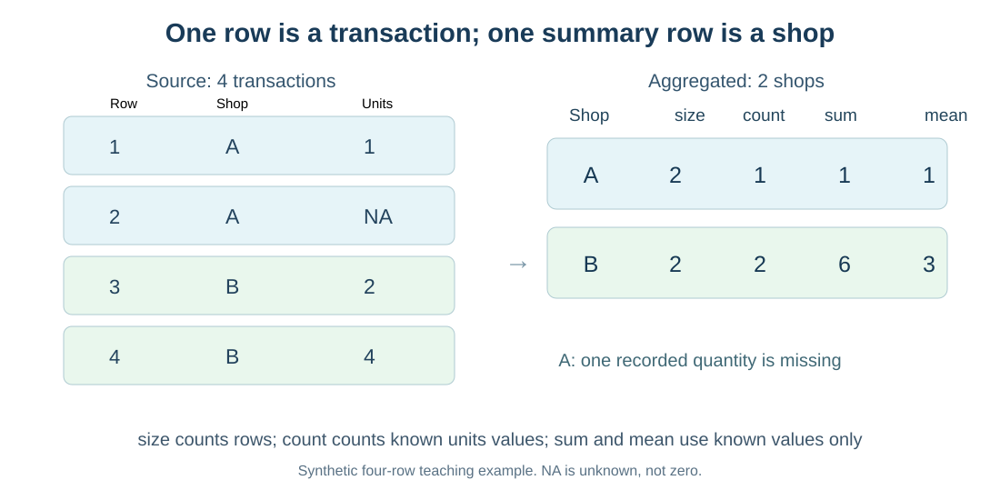
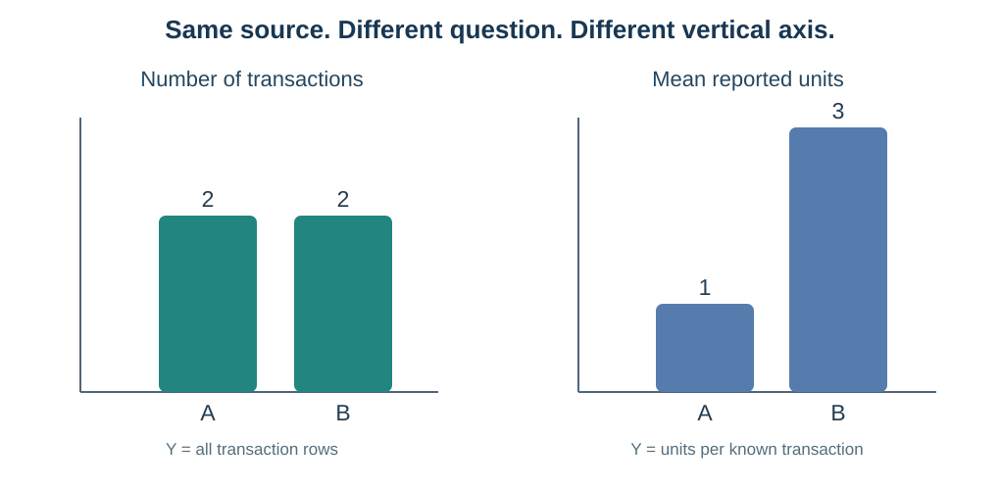

# מפגש 10 — מאוסף עסקאות לתשובה עסקית: GroupBy ואגרגציות
**יחידה 3 · כיתה י׳ · ספר התלמיד | 90 דקות למידה ותרגול + 45 דקות פרויקט**

## סיפור: איזה דוכן בקיוסק מצליח יותר?

במועדון בבית הספר יש שני דוכנים, A ו־B. מנהלת המועדון שואלת: "באיזה דוכן היו יותר עסקאות? איפה נמכרו יותר יחידות? באיזה דוכן מכרו יותר יחידות בממוצע לעסקה?" דודו עונה: "זו אותה שאלה — צריך רק לספור." האם הוא צודק?

לפני שנכתוב אפילו שורת Python אחת, נבחין בין **תצפית (שורה, עסקה אחת)**, **קבוצה (דוכן)**, **שדה מדידה (units, יחידות שנמכרו)** ו**ערך חסר (כמות שלא נרשמה)**. קבוצות מאפשרות להשוות דוכנים, איים, כיתות או קטגוריות מוצרים. התוצאה היא **סיכום קבוצתי**, לא טבלת העסקאות המקורית.

## 1. ארבע עסקאות לדוגמה — נתונים מומצאים במכוון

| מספר עסקה | דוכן (shop) | כמות יחידות (units) |
|---|---|---:|
| 1 | A | 1 |
| 2 | A | חסר |
| 3 | B | 2 |
| 4 | B | 4 |

רשומת העסקה השנייה קיימת; **הכמות שלה אינה ידועה**. חסר אינו אפס, ואין להניח שבאותה עסקה נמכרו 0 יחידות. כל ערכי הטבלה מומצאים ללימוד בלבד.

**השאלות שלנו:** (א) כמה שורות יש בכל דוכן? (ב) בכמה שורות יש כמות ידועה? (ג) מה סכום הכמויות הידועות? (ד) מה הממוצע של הכמויות הידועות?

## 2. מגדירים ארבע פעולות — ומחשבים ביד

נסמן לקבוצה \(g\) את מספר השורות \(n_g\), ואת מספר המדידות הידועות \(k_g\). המדידות הידועות הן \(u_1,\dots,u_{k_g}\), ביחידות מוצר.

\[
\operatorname{size}(g)=n_g,\qquad
\operatorname{count}(g)=k_g
\]

\[
\operatorname{sum}(g)=\sum_{j=1}^{k_g}u_j,\qquad
\overline{u}_g=\frac{\sum_{j=1}^{k_g}u_j}{k_g}\quad (k_g>0)
\]

**חשוב:** \(\operatorname{size}\) סופרת *את כל השורות* בקבוצה, גם אם כמות חסרה; \(\operatorname{count}\) על units סופרת רק *כמויות ידועות*; \(\operatorname{sum}\) מסכמת כמויות ידועות; ו־\(\operatorname{mean}\) מחלקת את הסכום במספר הכמויות הידועות.

### חישוב מלא לדוכן A

- שורות: עסקאות 1 ו־2, לכן size=2 **עסקאות**.
- כמות ידועה אחת בלבד — 1, לכן count=1 **מדידה ידועה**.
- סכום כמויות ידועות: sum=1 **יחידה**.
- ממוצע כמות מדווחת: mean=1/1=1 **יחידה לעסקה בעלת נתון ידוע**.

### חישוב מלא לדוכן B

- עסקאות 3 ו־4, לכן size=2.
- שתי כמויות ידועות — 2 ו־4, לכן count=2.
- סכום כמויות ידועות: sum=2+4=6 יחידות.
- ממוצע הכמויות הידועות: mean=6/2=3 יחידות לעסקה בעלת נתון ידוע.

| דוכן | size — מספר עסקאות | count — כמויות ידועות | sum — יחידות ידועות | mean — יחידות לעסקה מדווחת |
|---|---:|---:|---:|---:|
| A | 2 | 1 | 1 | 1 |
| B | 2 | 2 | 6 | 3 |

מסקנה מוגבלת: **מספר העסקאות בשתי הקבוצות זהה**, אך בנתונים שנרשמו מספר היחידות הידועות בדוכן B גבוה יותר. עדיין איננו יודעים כמה יחידות באמת נמכרו בדוכן A בעסקה שהכמות שלה חסרה.

## 3. מה קורה כאשר אין אף ערך ידוע בקבוצה?

בדוגמה שבה לדוכן C שתי שורות ובשתיהן units חסר, יתקבלו size=2 ו־count=0. **ממוצע אינו מוגדר** כי לא ניתן לחלק סכום במספר אפס של ערכים ידועים, ולכן Pandas תחזיר NaN. כברירת מחדל Pandas עשויה להחזיר **0** כאשר מפעילים sum על קבוצה שכל המדידות בה חסרות — אך זהו חישוב ברירת מחדל, **לא עדות לכך שלא נמכרו יחידות**. אפשר לציין במפורש \`sum(min_count=1)\` כדי לקבל NaN במקרה שאין אף מדידה ידועה.

זהו מקרה גבול שחשוב לתאר במילים, ולא להסביר באמצעות תמונה מטעה.

## 4. Pandas: פירוק לקבוצות ואז פעולה

~~~python
import pandas as pd

sales_df = pd.DataFrame({
    "shop": ["A", "A", "B", "B"],
    "units": [1, None, 2, 4]
})

units_by_shop = sales_df.groupby("shop")["units"]

print(units_by_shop.size())
print(units_by_shop.count())
print(units_by_shop.sum())
print(units_by_shop.mean())
~~~

נקרא את הביטוי **מבפנים החוצה**: \`sales_df\` היא טבלת העסקאות; \`groupby("shop")\` מחלקת לפי דוכן; \`["units"]\` בוחרת את מדידת הכמות; \`mean()\` או פעולה אחרת מסכמת כל קבוצה בנפרד. **שורה בתוצאה מתארת דוכן — לא עסקה אחת.**

מי שכבר הבין כל פעולה לחוד יכול לאסוף אותן לטבלת סיכום:

~~~python
summary_df = units_by_shop.agg(["size", "count", "sum", "mean"])
display(summary_df)
~~~

זהו **קיצור נוח**, לא אלגוריתם נוסף. נמשיך לקרוא את התוצאה בכל פעם עם יחידות וגבולות המסקנה.

## 5. שני גרפים שאסור להחליף ביניהם

**גרף ספירה** עונה "כמה עסקאות היו?" — לדוכן A שתי עסקאות ולדוכן B שתיים. ציר Y חייב לציין *מספר עסקאות*, ולא יחידות מוצר.

**גרף ממוצעים** עונה "כמה יחידות ידועות נמכרו בממוצע לעסקה מדווחת?" — A=1, B=3. ציר Y חייב לציין *יחידות לעסקה בעלת מדידה ידועה*.

מכאן נלמד להבחין:
- **Countplot** סופרת תצפיות בקטגוריה, גם אם השדה המספרי units חסר.
- **Barplot** יכולה להציג ממוצע של שדה מספרי לכל קטגוריה. כדי לדעת מהו גובה העמודה צריך לקרוא את ה־estimator, ולא לנחש.
- \`errorbar=None\` משמיטה פסי שגיאה לצורך המחשה לימודית, ואינה הוכחה שמדידות הקבוצה זהות או שאין אי־ודאות.

## 6. למה ממוצע של ממוצעים עלול להטעות?

לשם כך נעבור עכשיו ל**תרגיל עצמאי אחר** בן שש עסקאות, לפי מטלת ההשתלמות. הנה רק השאלה המחקרית, בלי תוצאות הפתרון: אם לכל חנות מספר שונה של עסקאות עם כמויות ידועות, האם הממוצע של כל הכמויות הידועות שווה לממוצע הפשוט של *ממוצעי החנויות*?

הנוסחה לממוצע הכולל על כל \(K\) הערכים הידועים היא:
\[
\bar u_{\mathrm{all}}=\frac{\sum_g k_g\bar u_g}{\sum_g k_g}
\]

זוהי **ממוצע משוקלל**: כל קבוצה תורמת בהתאם למספר הכמויות הידועות בה. לעומתו, ממוצע פשוט של ממוצעי קבוצות נותן לכל קבוצה משקל שווה, גם אם אחת מבוססת על שתי מדידות ואחרת על עשרים. בקבוצות מאוזנות שתי התוצאות עשויות להשתוות; אין להניח זאת מראש. במעבדה תחשבו ותסבירו את הפער בעזרת נתוני ההשתלמות.

## 7. מעבר לנתונים אמיתיים: Palmer Penguins

במאגר הקורס יש **344 רשומות** של פינגווינים, ו־**342** מדידות ידועות של אורך סנפיר. השדות הם \`island\` (אי — קטגוריה שמית) ו־\`flipper_length_mm\` (אורך סנפיר — מדידה מספרית במ״מ). נתוני המקור מדעיים, ולא נתונים שהמצאנו.

**נתונים שנבדקו מתוך קובץ הקורס** — נשתמש בהם כנתוני רקע להבנת דוח הסיכום, אך התלמיד צריך לחשב עצמאית במחברת:

| אי | מספר תצפיות | אורכי סנפיר ידועים | ממוצע אורך סנפיר |
|---|---:|---:|---:|
| Biscoe | 168 | 167 | 209.71 מ״מ |
| Dream | 124 | 124 | 193.07 מ״מ |
| Torgersen | 52 | 51 | 191.20 מ״מ |

המידע מצביע על כך שבמדגם הזה Biscoe מכיל הכי הרבה תצפיות והסנפיר הממוצע בו ארוך יותר. **האי לא הוכח כגורם** לאורך הסנפיר; ייתכן שהדבר קשור להרכב המינים שנדגמו באיים. לא כל פינגווין מ־Biscoe חייב להיות בעל סנפיר ארוך מכל פינגווין באי אחר.

במחברת התלמיד תפיקו **Countplot** של island ו־**Barplot** של ממוצע flipper_length_mm. שתי התמונות ייראו שונות מפני שהן עונות על שאלות שונות. בדקו צירים, יחידות ומספר המדידות לפני הפרשנות.

קישור הגרסה: https://raw.githubusercontent.com/samiabo75/Data-Science-ML-Course/main/Datasets/penguins.csv

## 8. מה בין GroupBy ובין למידת מכונה?

GroupBy אינה מאלפת מודל ואינה יוצרת תחזית. היא מספקת **תיאור מסכם** שמאפשר לשאול שאלות חדשות, לבדוק איכות נתונים ולהבין הבדלים בין קבוצות. אם בעתיד נשתמש בממוצע קבוצתי להשלמת ערכים חסרים או כמאפיין לחיזוי, נחשב את הערכים המתאימים **רק מנתוני האימון** ונחיל אותם אחר כך באופן מבוקר, כדי לא לדלוף מידע ממבחן או מהעתיד אל המודל. בשיעור זה **לא** מתכנתים pipeline או מודל.

## 9. מעבדה ופרויקט

בתרגול העצמאי שתי משימות עיקריות, בדיוק לפי המחברות המקוריות:
1. **Penguins:** איים, ספירת תצפיות, מספר אורכי סנפיר ידועים, ממוצע, שני גרפים והסתייגות.
2. **עסקאות אחרות:** השוואת size/count/sum/mean, טבלת agg, פירוש מספר עסקאות מול כמות יחידות והשוואת ממוצע כולל לממוצע ממוצעי קבוצות.

**45 דקות פרויקט מוגנות:** צרו שלוש **שאלות השוואה קבוצתיות** על המאגר שלכם, ולכל אחת ציינו מפתח קיבוץ, שדה מדידה, אגרגציה מתאימה, יחידה, מגבלה ותזמון זמינות הנתון. אם טרם נשמרה קבוצת בדיקה לפרויקט, כתבו **תוכנית השוואות** ולא בצעו בחירה בפועל שתשפיע על מודל בהמשך.

## כרטיס יציאה
1. מדוע בדוכן A מתקבלים size=2 ו־count=1?
2. מה מייצג כל פסיק בממוצע 6/2 בדוכן B?
3. מתי sum=0 בקבוצה שכל המדידות בה חסרות עלול להטעות?
4. איזה גרף מתאים למספר פינגווינים בכל אי, ואיזה לאורך סנפיר ממוצע?
5. האם "ממוצע גבוה" מאפשר להסיק משהו על **כל** תצפית? הסבירו.

**בדיקת הבנה:** לכל מספר כתבו מה נספר או סוכם, מהי היחידה, כמה ערכים ידועים עמדו בבסיסו ומה אסור להסיק.