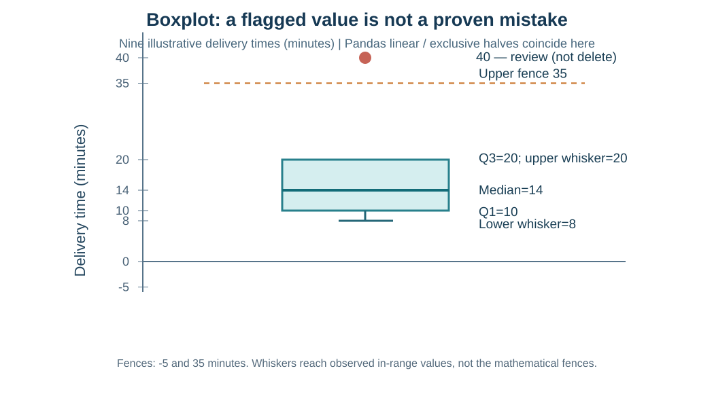

# מפגש 11 — לפני שמוחקים נתון: Boxplot, רבעונים ובקרת איכות
**יחידה 3 · כיתה י׳ · ספר תלמיד מדורג · 90 דקות הוראה ותרגול + 45 דקות פרויקט**

## הסיפור: הזמנה אחת הגיעה אחרי זמן ארוך במיוחד
דודו עובד בשירות משלוחים של קיוסק. זמן משלוח ממוצע אינו מספיק כדי לדעת מהו זמן טיפוסי ומה נחשב חריג. נתון חריג יכול להיות פקק אמיתי, משלוח שהתעכב — או הקלדה שגויה. מנהל העסק מבקש למחוק כל משלוח חריג כדי שדוח הזמנים "ייראה טוב יותר". **האם זו החלטה מדעית?** לא, בלי בירור ויומן החלטות. נלמד לזהות נקודה שמצריכה בדיקה ולהגן על המידע המקורי.

כאן המספרים **מומצאים להוראה**. במעבדת התלמיד נעבור לדוגמה אחרת ואחר כך למאגר מדעי אמיתי.

## 1. תשע מדידות זמן משלוח — כל ערך מייצג משלוח
זמני משלוח, בדקות, מסודרים בסדר עולה:

| מקום | 1 | 2 | 3 | 4 | 5 | 6 | 7 | 8 | 9 |
|---|---:|---:|---:|---:|---:|---:|---:|---:|---:|
| זמן בדקות | 8 | 10 | 10 | 12 | 14 | 16 | 20 | 20 | 40 |

יש תשע מדידות, לא תשע דקות. הזמן 40 דקות הוא משלוח שנמדד לכאורה. **אל תמחקו אותו** לפני שבדקתם את המדידה, את היחידות ואת ההקשר.

## 2. כיצד מחשבים חציון ורבעונים ביד?
**חציון Q2:** הערך החמישי מתוך תשעה הוא 14 דקות.

בשיעור הזה נשתמש תחילה ב**שיטת חצאי הרשימה, ללא החציון בקבוצה אי־זוגית** (exclusive halves):
- החצי התחתון: 8, 10, 10, 12 — החציון שלו \((10+10)/2=10\) דקות, ולכן Q1=10.
- החצי העליון: 16, 20, 20, 40 — החציון שלו \((20+20)/2=20\) דקות, ולכן Q3=20.
- טווח בין־רבעוני: \(IQR=Q3-Q1=20-10=10\) דקות.

**הגדרות:** Q1 הוא הרבעון התחתון, Q2 החציון ו־Q3 הרבעון העליון; IQR מודד את רוחב 50% האמצעיים בקירוב, ביחידות המקור. אלו מדדי מיקום ופיזור **ולא** הסתברויות.

### האם כל תוכנת מחשב משתמשת באותה שיטת רבעונים?
**לא.** Pandas \`Series.quantile(0.25)\` משתמשת כברירת מחדל באינטרפולציה ליניארית, שעלולה להיות שונה משיטת חצאי הרשימה, במיוחד בדגימות קטנות. **בדוגמת תשע המדידות הזאת שני החישובים נותנים במקרה Q1=10 ו־Q3=20**; אין להסיק שכל הדוגמאות יהיו כך.

בהמשך תרגיל המעבדה על חמש מדידות יש לחשב **במפורש לפי \`interpolation="linear"\`**, כמוגדר במחברות ההשתלמות. לדוגמה, עבור הרשימה [2,4,6,8,20], Pandas מחזירה Q1=4 ו־Q3=8, ואילו בשיטת חצאי הרשימה ללא החציון נקבל Q1=3 ו־Q3=14. **זו הבחנה בין הגדרות, לא באג ב־Pandas**. אין להשוות פתרון משיטה אחת לגרף שנבנה בשיטה אחרת בלי לציין זאת.

## 3. כלל 1.5×IQR — גבולות לבדיקה, לא עונש אוטומטי

\[
L=Q1-1.5\cdot IQR,\qquad U=Q3+1.5\cdot IQR
\]

**פירוש הסמלים:** L הגבול התחתון, U הגבול העליון, Q1/Q3 הרבעונים, ו־IQR ההפרש ביניהם. המספר 1.5 קובע **כלל סימון מקובל לצורכי חקר**, לא חוק טבע הקובע שגיאה.

חישוב לדוגמה שלנו:

\[
L=10-1.5\cdot10=-5\ \text{דקות}
\]
\[
U=20+1.5\cdot10=35\ \text{דקות}
\]

40 גדול מ־35, ולכן הוא **מסומן לבדיקה**. אין פירוש הדבר שהזמן שגוי. זמן משלוח שלילי לא הגיוני במקרה שלנו מבחינה עסקית, אבל הגבול הסטטיסטי L=−5 **אינו** כלל תקינות פיזיקלי או עסקי. אלו שני סוגי בדיקה שונים.

## 4. Boxplot — לומדים לקרוא כל רכיב

בקופסה התחתית נמצאת ב־Q1=10, הקו הפנימי הוא Q2=14, והקצה העליון הוא Q3=20. **השפמים אינם בהכרח גבולות ה־IQR**: לפי הגדרת Tukey/Seaborn בשימוש כאן הם מגיעים לתצפיות הקיצוניות ביותר *שאינן מחוץ לגבולות L,U*. בדוגמה השפם התחתון הוא 8 והעליון הוא 20. הערך 40 מוצג כנקודה נפרדת.

**ההבדל הקריטי:** הגבול העליון המחושב הוא 35 דקות, אבל השפם העליון מסתיים ב־20 דקות, כי אין תצפית בין 20 ל־35. אסור לשרטט שפם ב־35 רק מפני שזה הגבול.

קופסה גבוהה יותר מתארת IQR גדול יותר, **לא** מספר תצפיות גדול יותר. גרף קופסה כשלעצמו אינו מוכיח נורמליות או סיבתיות.

## 5. אותו דבר בקוד Python — עם שיטת רבעונים מפורשת

~~~python
import pandas as pd
import seaborn as sns
import matplotlib.pyplot as plt

delivery_df = pd.DataFrame({
    "minutes": [8, 10, 10, 12, 14, 16, 20, 20, 40]
})
q1 = delivery_df["minutes"].quantile(0.25, interpolation="linear")
q2 = delivery_df["minutes"].median()
q3 = delivery_df["minutes"].quantile(0.75, interpolation="linear")
iqr = q3 - q1
low = q1 - 1.5 * iqr
high = q3 + 1.5 * iqr
print(q1, q2, q3, iqr, low, high)

sns.boxplot(data=delivery_df, y="minutes", whis=1.5)
plt.ylabel("Delivery time (minutes)")
plt.show()
~~~

**לפני ההרצה** חזו את ששת המספרים; **אחרי ההרצה** בדקו שהחישוב הידני (10,14,20,10,−5,35) מתקבל. כאשר התוצאות אינן תואמות, בדקו **איזו שיטת רבעונים** נבחרה לפני שמחליטים שמשהו שגוי.

## 6. מה קורה אם מדובר בטעות הקלדה?
נניח שאחרי בירור מול יומן השליח מתברר שהזמן היה **24 דקות ולא 40 דקות**. רק עכשיו יש בסיס לתקן **בעותק**, לתעד מאיפה התקבל האישור, ולשמור את המקור. אם אין ראיה מספקת, נשאיר את ה־40 מסומן לבדיקה. אם יומן השליח מאשר עיכוב אמיתי, עלינו לשמור אותו — גם אם הוא משפיע על הממוצע.

יומן איכות קצר כולל: מזהה רשומה, שדה, ערך מקורי, חשד, ראיית אימות, פעולה (השארה/תיקון/סימון חסר/המתנה), תאריך וההשפעה על מספר הרשומות. **מחיקת נתון רק כדי לשפר דיוק מודל אסורה כדרך מחקרית.**

## 7. איכות נתונים: זהות אינה שוויון בשני שדות
שתי הזמנות יכולות להכיל אותו מספר פריטים ואת אותו המחיר ולמרות זאת להיות **שתי הזמנות שונות**. לעומת זאת, אם \`order_id\` אמור להיות ייחודי, הופעה כפולה של אותו מזהה דורשת בירור:
- אם שתי שורות בעלות אותו מזהה **זהות בכל השדות**, ייתכן שזו כפילות ייבוא, ואפשר להסיר עותק **רק אחרי בדיקת ההנחה וכתיבת יומן**.
- אם אותו מזהה מופיע עם פרטים **סותרים**, \`drop_duplicates(keep="first")\` עלול למחוק מידע חשוב — יש לעצור ולברר.
- **משך משלוח שלילי** אינו מתקבל על הדעת תחת הגדרת משך בדקות. בחוזה הנתונים של המעבדה נקבע במפורש שגם 0 דקות אינו ערך תקין; במערכת אחרת משך 0 עשוי להיות אפשרי, ולכן לא קובעים כלל בלי הגדרה.

### לא עובדים על המקור
~~~python
work = raw.copy(deep=True)
same_ids = work.duplicated(subset=["order_id"], keep=False)
display(work[same_ids])
~~~

הפקודה \`duplicated\` **מסמנת** שורות חשודות. היא לא מוחקת. כאשר מחליטים על שינוי, עושים אותו ב־\`work\` ולא ב־\`raw\`.

## 8. מעבדת התלמיד — שני חלקי ההשתלמות
**חלק א׳:** מדגם אחר בן חמש מדידות, חישוב רבעונים **לפי Pandas linear**, שרטוט Boxplot, הסבר גבולות לעומת שפמים, ו־Boxplot של אורך סנפיר לפי species ב־Palmer Penguins. יש להוסיף יחידות מ״מ ומגבלת הסקה.

**חלק ב׳:** קובץ עסקאות מומצא **שונה מדוגמת המורה**. תבדקו כפילויות לפי order_id ובנפרד לפי items+unit_price, תיצרו עותק, תתקנו רק כפילות ייבוא זהה לפי מדיניות, ותסמנו משכים לא תקינים כחסרים בלי לדרוס מקור. התיעוד הוא חלק מהפתרון, לא נספח שולי.

## 9. חיבור ל־AI ושמירת נתוני בדיקה
נתוני אימון מלוכלכים עלולים לשבש למידת מכונה, אבל **ניקוי לא מתועד** עלול לשבש אותה עוד יותר. כאשר מכינים נתונים לפרויקט חיזוי: מגדירים חוקים עסקיים שאינם תלויים בתוצאות היעד; לא משתמשים ב־Test כדי לבחור ספי חריגים מותאמים לנתוני האימון; לא משפרים בדיעבד כללי מחיקה אחרי שראו את ציון הבחינה; שומרים גרסת מקור ויומן.

התרגול הכיתתי עצמו **אינו אימון מודל**, ואין צורך ללמד כעת Pipeline או מבחני מובהקות.

## 10. פרויקט — 45 דקות וכרטיס יציאה
הגישו *יומן איכות תכנוני* ובו מקור וגרסה, שדה אחד בעל בדיקת סבירות, מפתח זהות לכל תצפית, דוגמה לערך שדורש בירור, ואיך תשמרו גרסה מקורית. אם טרם נקבעה קבוצת Test, אל תשתמשו בניתוח כל הנתונים כדי לכוונן כללי ניקוי שיושוו בהמשך לאותה קבוצת Test.

**שאלות הגנה:** מה ההבדל בין גבול עליון לשפם עליון? למה 40 מסומן אך לא בהכרח שגוי? מה השינוי בשיטה כש־Pandas נותנת רבעונים שונים מחצאי הרשימה? האם שתי עסקאות עם אותם items ו־unit_price הן בהכרח כפולות? מהו תיעוד שבלעדיו לא תמחוק רשומה?

