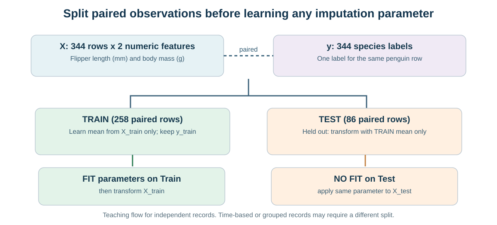
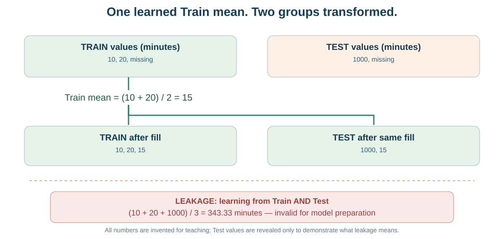

# מפגש 12 — מבחן הוגן למכונה: יעד, חלוקה והשלמת חסרים
**ספר תלמיד מעמיק | יחידה 3, כיתה י׳ | 90 דקות לימוד ותרגול + 45 דקות פרויקט**

## סיפור: למידה למבחן עם דף פתרונות פתוח
דודו פתר שאלות כאשר דף התשובות מולו. הוא הצליח בתרגול, אך האם זה אומר שיצליח בשאלה חדשה? לא בהכרח. כך גם במערכת AI: אם השתמשנו בנתוני הבדיקה כדי להכין את נתוני האימון, המבחן אינו עצמאי.

**משימת המחקר שלנו:** בעתיד נרצה לסווג פינגווין חדש לפי שתי מדידות. היום רק נבחר יעד ומאפיינים, נחלק נתונים נכון ונטפל בחסרים בלי דליפה. לא מאמנים מודל ולא מודדים Accuracy.

## 1. מהן X ו־y?
| תפקיד | שדה | משמעות | יחידה |
|---|---|---|---|
| יעד y | species | מין הפינגווין: Adelie/Chinstrap/Gentoo | קטגוריה |
| מאפיין X1 | flipper_length_mm | אורך סנפיר | מ״מ |
| מאפיין X2 | body_mass_g | מסת גוף | גרם |
| שדה שאינו דרוש | sex | תיאור נוסף | קטגוריה |

כל שורה שייכת לאותו פינגווין בטבלת X ובסדרת y. אם ממיינים או מחלקים X ו־y בנפרד, הזיווג עשוי להיהרס. אם כוללים את species בתוך X, כבר נתנו למודל את התשובה. לשורת אימון מפוקחת חייבת להיות תווית יעד ידועה; אסור להמציא species חסר לפי התווית השכיחה.

### מאגר הקורס נבדק במקור
בקובץ Penguins יש 344 שורות ו־7 עמודות. חסרים: species=0, island=0, flipper_length_mm=2, body_mass_g=2, bill_length_mm=2, bill_depth_mm=2, sex=11. לכן אחרי בדיקת היעד עדיין יש 344 תצפיות, X בצורת 344×2 ו־y באורך 344. **חוסר בשדה sex אינו סיבה למחוק שורה כאשר איננו משתמשים ב־sex.** גם חסרים במאפיינים אינם מחייבים מחיקה לפני בחירת שיטת טיפול.

## 2. שלוש קבוצות, שלוש מטרות
**Train (אימון):** מן המדידות האלה לומדים פרמטרי השלמה, ובהמשך גם פרמטרי המודל.

**Validation (אימות):** משווים חלופות ותהליכים בתוך מאגר הפיתוח/האימון. נלמד בהמשך להפיק תהליך אימות מתאים, למשל באמצעות חלוקת משנה או Cross Validation בתוך Train. אין צורך ליצור Validation נפרדת במעבדה הזו.

**Test (בדיקה סופית):** נשמרת בצד להערכה עצמאית לאחר בחירת כל השיטות. לא לומדים ממנה ממוצעי השלמה, לא בוחרים מאפיינים על פיה ולא משנים שיטות בגלל ביצועיה.

במעבדה מחלקים Train/Test עם test_size=0.25, random_state=17, stratify=y. מתקבלים 258 תצפיות Train ו־86 Test. הפרמטר random_state נועד לשחזור, לא לשיפור דיוק. stratify שומר בקירוב את היחס בין שלושת המינים בקבוצות. עבור נתונים תלויי זמן או מדידות חוזרות של אותו אדם, ייתכן שצריך חלוקה שאינה אקראית — בהתאם לשאלת המחקר.

## 3. חישוב ידני: מי רשאי לחשב את הממוצע?
נתוני הדוגמה **מומצאים** ונמדדים בדקות. אין קשר בין המספרים האלה לבין האורכים והמסות של Penguins.

| רשומה | קבוצה | זמן בדקות |
|---|---|---:|
| T1 | Train | 10 |
| T2 | Train | 20 |
| T3 | Train | חסר |
| E1 | Test | 1000 |
| E2 | Test | חסר |

### צעד ראשון — ערכים ידועים ב־Train בלבד
יש 3 שורות אימון, אבל **2 מדידות ידועות בלבד**. לכן:

\[
\mu_{\mathrm{train}}=\frac{10+20}{2}=15\ \text{דקות}.
\]

### צעד שני — ממלאים את החסר באימון
Train לאחר השלמה: **[10, 20, 15]**.

### צעד שלישי — מיישמים את אותו פרמטר על בדיקה
Test לאחר השלמה: **[1000, 15]**. 1000 אינו נכנס לחישוב הממוצע. הוא ממחיש באופן קיצוני מה יקרה אילו Test השפיע על תהליך הלמידה; אין כאן המלצה להתייחס ל־1000 כמשך נסיעה סביר.

### דוגמה לשגיאה: השלמה לפני חלוקה
אם נחשב ממוצע מכל הערכים הידועים בשתי הקבוצות, נקבל:

\[
\mu_{\mathrm{wrong}}=\frac{10+20+1000}{3}=\frac{1030}{3}\approx343.33\ \text{דקות}.
\]

כך מידע מתוך Test שינה את הערך המשמש להכנת Train. זו **דליפת מידע (Data Leakage)**. כאן גילינו את ערכי Test לצורך הדגמה בכיתה בלבד; בפרויקט מחקר אין לבחון בהם חלופות.

## 4. הנוסחה והסמלים
\[
\mu_{\mathrm{train}}=\frac{\sum_{i\in K_{\mathrm{train}}}x_i}{|K_{\mathrm{train}}|}.
\]
הסמל x_i הוא המדידה הידועה של שורת אימון i; K_train הוא אוסף השורות שבהן המדידה ידועה; |K_train| מספר המדידות הידועות (ולא מספר כל שורות האימון). הממוצע נמדד באותן יחידות כמו השדה. אם אין אף מדידה ידועה באימון, הממוצע אינו מוגדר, ונדרשת מדיניות חלופית מתועדת.

## 5. Python — הבנת הקוד לפני הרצה
~~~python
import pandas as pd
train = pd.DataFrame({"minutes": [10., 20., None]})
test = pd.DataFrame({"minutes": [1000., None]})
mean_train = train["minutes"].mean()
train_ready = train.fillna({"minutes": mean_train})
test_ready = test.fillna({"minutes": mean_train})
print(mean_train)
print(train_ready["minutes"].tolist())
print(test_ready["minutes"].tolist())
~~~

פלט צפוי: 15.0; ‏[10,20,15]; ‏[1000,15]. החישוב נעשה פעם אחת באימון; מילוי ה־Test משתמש באותו פרמטר, **לא מחשב ממוצע חדש מתוך Test**.

כשנשתמש בכלים מתקדמים, המילה fit תתאר את למידת הפרמטר מן האימון, ו־transform את יישומו. fit_transform על Train יכול להיות מתאים; על Test יש להשתמש ב־transform בלבד. כרגע נמחיש את העיקרון באמצעות Pandas פשוט, ללא חובה ללמוד מחלקת Imputer.

## 6. עוברים לתרגיל העצמאי על Penguins
**בחוברת המקור של התלמיד:** יעד species, שני מאפיינים flipper_length_mm ו־body_mass_g, חלוקה של X ו־y **באותה קריאה** לפי seed=17 ו־stratify=y, חישוב training_means מתוך X_train בלבד, והפעלתם על X_train וגם X_test. ספריית Scikit-learn מספקת את train_test_split:

~~~python
from sklearn.model_selection import train_test_split
X_train, X_test, y_train, y_test = train_test_split(
    X, y, test_size=0.25, random_state=17, stratify=y
)
training_means = X_train.mean()
X_train_ready = X_train.fillna(training_means)
X_test_ready = X_test.fillna(training_means)
~~~

הקטע מניח שטענתם כבר את Penguins ויצרתם X ו־y. במחברת העצמאית תשלימו את כל השלבים ולא תעתיקו את תוצאות המורה. **אין להפריד X ו־y בשתי חלוקות בלתי תלויות.** מדידות חסרות אינן נמחקות ממקור הקורס, אלא מטופלות בשני עותקים מוכנים.

## 7. מה ניתן להסיק ומה לא?
אם הסרתם חסרים מהמאפיינים לפי כלל אימון תקין, אפשר לומר שיצרתם **קלט מוכן יותר לחיזוי עתידי**. אי אפשר לומר שכבר יצרתם מודל טוב, כי לא בוצעו אימון, ניבוי או בדיקת ביצועים. השלמה בממוצע עלולה לטשטש שונות ולכן אינה תמיד השיטה הטובה ביותר; את הבחירה בין חלופות מבצעים בעתיד במסגרת אימות על נתוני האימון, ולא באמצעות Test.

**שלוש טעויות לניתוח בלי להריץ:** (1) מילוי כל X לפני חלוקה; (2) חישוב ממוצע X_test להשלמת Test; (3) המצאת תווית species כאשר יעד חסר. הסבירו מה הבעיה בכל אחת.

## 8. פרויקט — 45 דקות מוגנות
צרו כרטיס הכנת נתונים: שאלת חיזוי, יעד ותכונות עם יחידות, שדות שיהיו זמינים בזמן החיזוי, כלל שורות עם יעד חסר, אסטרטגיית פיצול, סכנת כפילות/זמן ותוכנית טיפול בחסרים. אם טרם נקבעה קבוצת בדיקה מוגנת לפרויקט, **תכננו בלבד** — אל תשתמשו במתאמים או בממוצעי כל המאגר לבחירת השיטה. אם כבר ראיתם Test, תעדו את החשיפה; שינוי seed אינו הופך מבחן שנחשף לבלתי תלוי.

## כרטיס יציאה
למה שדה sex חסר אינו מחייב מחיקת שורה במשימה שלנו? למה מחלקים (10+20) ב־2 ולא ב־3? מה מאפשר stratify=y? מדוע אסור להשתמש ב־fit_transform על Test? האם השלמת חסרים היא כבר למידת מכונה מלאה?