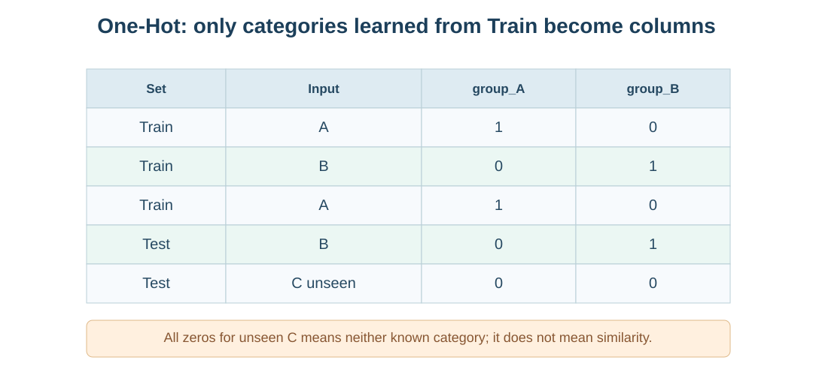
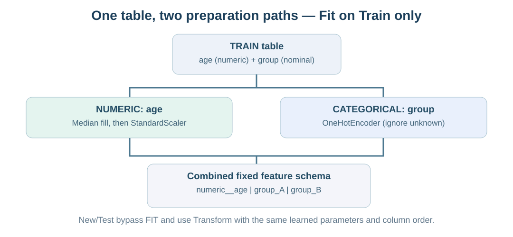

# מפגש 14 — משמות לעמודות: קידוד קטגוריות והכנה משולבת
**ספר תלמיד דידקטי | כיתה י׳ · יחידה 3 | 90 דקות הוראה + 45 דקות פרויקט**

## סיפור: האם המחשב הכחול רחוק מן האדום?
באפליקציה להשוואת מחשבים דודו רושם מחיר בשקלים, זיכרון ב־GB וצבע. תלמיד מציע אדום=1, כחול=2 וירוק=3, ומסיק שירוק רחוק מאדום פי שניים מכחול. **זו מסקנה חסרת בסיס**: בצבע אין סדר טבעי, והמספרים הם רק תוויות שנבחרו באקראי.

שדה **שמי (Nominal)** הוא למשל צבע או island של פינגווין, ללא סדר טבעי. שדה **סדור (Ordinal)** הוא למשל נמוך/בינוני/גבוה: יש סדר, אך אין בהכרח מרחקים מספריים שווים בין הדרגות. מיפוי סדור 0/1/2 שומר סדר, אך עלול להכניס הנחה נוספת כשמחשבים מרחקים.

## דוגמה ידנית: One-Hot Encoding
Train מכיל A,B,A. לומדים שתי עמודות group_A ו־group_B. לכל קטגוריה k, התא הוא 1 אם הערך שווה ל־k ו־0 אחרת:
\[
I_k(x)=\begin{cases}1&x=k\\0&x\ne k.\end{cases}
\]

| שורה | קטגוריה | group_A | group_B |
|---|---|---:|---:|
| Train 1 | A | 1 | 0 |
| Train 2 | B | 0 | 1 |
| Train 3 | A | 1 | 0 |
| Test 1 | B | 0 | 1 |
| Test 2 | C שלא נראתה | 0 | 0 |

במדיניות handle_unknown="ignore" קטגוריה C שלא נראתה באימון מקבלת [0,0]. **זה אינו אומר שהיא דומה ל־A או ל־B או שהיא ערך חסר**. קטגוריה D חדשה גם הייתה מקבלת [0,0], ולכן המדיניות מאבדת הבחנה בין סוגים חדשים. בדוגמה זו לא הסרנו עמודת בסיס (drop=None).

## Fit / Transform — שומרים סכמה
Fit על Train לומדת אילו קטגוריות קיימות ואת סדר העמודות. Transform משתמשת באותה סכמה עבור Train ו־Test. אין Fit חדש על Test ואסור להוסיף עמודה בזכות קטגוריה שהתגלתה רק בבדיקה.

~~~python
from sklearn.preprocessing import OneHotEncoder
enc = OneHotEncoder(handle_unknown="ignore", sparse_output=False)
enc.fit([["A"], ["B"], ["A"]])
print(enc.categories_)
print(enc.transform([["B"], ["C"]]))
~~~

הפלט הצפוי הוא שתי קטגוריות שנלמדו A,B, ולשתי השורות החדשות הווקטורים [0,1] ו־[0,0]. המספרים אינם הסתברויות ואינם מרחק גאוגרפי.

## המעבדה: Penguins — קידוד island
במאגר הקורס 344 תצפיות ו־7 שדות; species הוא יעד הסיווג, island הוא מאפיין שמי. בקובץ יש שלושה איים: Biscoe, Dream ו־Torgersen. **במטלת התלמיד** מחלקים X=island ו־y=species יחד לפי test_size=0.25, random_state=17 ו־stratify=y; מתקבלים 258 Train ו־86 Test. מתאימים OneHotEncoder על Train בלבד ומפעילים על שתי הקבוצות. מציגים עמודות וקבוצות ששמרו על אותו מספר **שורות**. One-Hot עשוי להגדיל **מספר עמודות**, לא מספר פינגווינים.

בנוסף תפתרו ללא פתרון מוכן את דוגמת הצורות: Train=circle,square,circle; Test=triangle,square. לאיזה וקטור תהפוך triangle? הסבירו מדוע.

## שילוב מספרים וקטגוריות: ColumnTransformer
כאשר יש גיל (age) ומספר קבוצת משתמש (group), אין להפעיל את אותה הכנה על שניהם. יש שני מסלולים:
1. מסלול numeric: משלימים את age לפי **חציון Train**, ואז מתקננים לפי ממוצע וסטיית תקן שנלמדו באימון.
2. מסלול categorical: מפעילים OneHotEncoder על group, ולומדים קטגוריות מתוך Train בלבד.
3. ColumnTransformer מחבר את הפלטים לפי סדר קבוע. אפשר לקרוא את שמות העמודות באמצעות get_feature_names_out. לא בונים כאן מודל חיזוי.

### חישוב ידני — דוגמת מורה (שונה ממעבדת התלמיד)
Train: age=[10,20,חסר], group=[A,B,A]. חציון ערכי age הידועים הוא 15. אחרי השלמה age=[10,20,15]. הממוצע של שלוש המדידות המושלמות הוא 15, וסטיית התקן עם ddof=0:
\[
\sigma=\sqrt{\frac{(10-15)^2+(20-15)^2+(15-15)^2}{3}}
=\sqrt{50/3}\approx4.0825.
\]
ערכי הגיל המתוקננים: [−1.2247,+1.2247,0]. העמודות של group הן group_A ו־group_B.

| שורה | numeric__age | categorical__group_A | categorical__group_B |
|---|---:|---:|---:|
| 10,A | −1.225 | 1 | 0 |
| 20,B | +1.225 | 0 | 1 |
| חסר,A | 0 | 1 | 0 |
| New: 15,C | 0 | 0 | 0 |

המקור מכיל שני מאפיינים (age, group), ואילו הפלט **שלושה מאפיינים**. ה־0 של age משמעו גיל השווה לממוצע לאחר תקנון; ה־0 של group_C מציין שהקטגוריה אינה אחת המוכרות. גם כשאותו מספר מופיע בשתי עמודות, משמעותו שונה.

~~~python
from sklearn.compose import ColumnTransformer
from sklearn.pipeline import Pipeline
from sklearn.impute import SimpleImputer
from sklearn.preprocessing import StandardScaler, OneHotEncoder
prepare = ColumnTransformer([
    ("numeric", Pipeline([
        ("fill", SimpleImputer(strategy="median")),
        ("scale", StandardScaler())]), ["age"]),
    ("categorical", OneHotEncoder(
        handle_unknown="ignore", sparse_output=False), ["group"])
])
~~~
אחרי יצירת train ו־new יש לבצע prepare.fit_transform(train), ואחריה prepare.transform(new) **ללא התאמה נוספת**.

**בתרגיל העצמאי** משתמשים בנתונים אחרים: age=[5,15,חסר], group=[C,D,D], ו־new=(10,E). אתם תחשבו, תבנו ותנמקו; הפתרון המספרי נמצא בקובץ מורה בלבד.

## מגבלות והקשר ל־AI
- שמות קטגוריות אינם מספרי סדר, גם אם אפשר לייצגם בספרות.
- One-Hot אינו ממיר קטגוריה חדשה למשהו הדומה לכל הקטגוריות האחרות.
- Test אינו מלמד את אוצר הקטגוריות או חציון/ממוצע התקנון.
- ColumnTransformer **מכין נתונים בלבד**; הוא לא מאמן KNN, לא עושה GridSearch ולא מודד Accuracy.
- במפגש 15 נלמד כיצד המרחק בין תצפיות מושפע מבחירת הייצוג.

## פרויקט — 45 דקות וכרטיס יציאה
ערכו כרטיס סכמה של המאגר האישי: מהם X ו־y? אילו שדות שמיים/סדוריים/מספריים? מהי היחידה? אילו הכנות יתבצעו אחרי Split ומאילו נתוני Train הן ילמדו? אילו עמודות ייווצרו וכיצד תשמרו סדר קבוע? מה יקרה לקטגוריה שלא הייתה באימון? אם Test אינה מוגנת, הכינו **תכנון** ולא סכמה שהותאמה לכל הקובץ.

שאלות הגנה: מדוע A=1 B=2 אינו סדר בעל משמעות? מדוע [0,0] אינו דמיון? למה מספר העמודות גדל? מה לומדים מכל מסלול? האם כבר אימנו מודל?