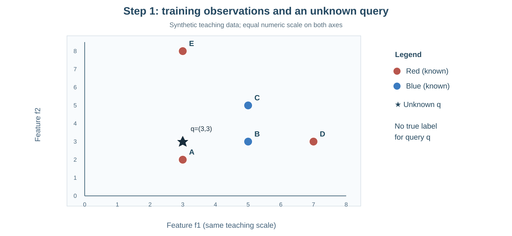
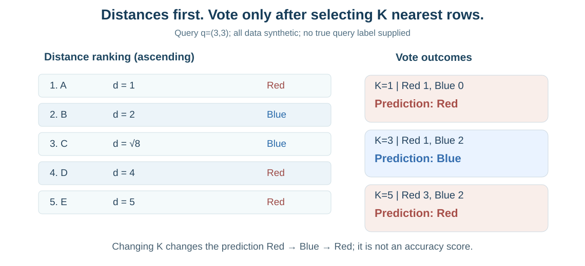
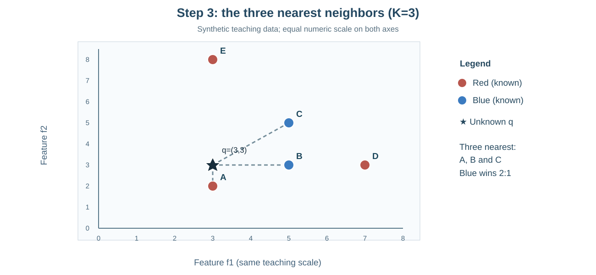

# מפגש 15 — מי השכן הקרוב? KNN ביד, מרחק, דירוג והצבעה
**יחידה 3 · ספר תלמיד מפורט · כיתה י׳ · 90 דקות הוראה/תרגול + 45 דקות פרויקט**

## סיפור: מערכת שמציעה פעילות למשתתף חדש
במרכז נוער מנהלים מערכת המלצות לפעילות. למשתתפים ותיקים יש שני ציונים מספריים — עניין במוזיקה ועניין בספורט — ולידם רשומה הפעילות המועדפת (Red או Blue, שמות מדומים). מגיע משתתף חדש: יש לו שני ציונים, אך עדיין לא ידועה הפעילות שיבחר. **אפשר להיעזר במשתתפים דומים כדי להציע פעילות**, אבל איך קובעים מי דומה? וכיצד הופכים שלושה שכנים להצעה אחת?

היום נבנה את מנגנון KNN ידנית, ואז נאמת בפייתון. זהו **סיווג**, לא גילוי אמת: תחזית אינה מדידת דיוק. הנתונים בדוגמה הזאת **מומצאים**, והצירים משתמשים באותו סרגל הוראתי.

## 1. קלט, יעד וקטור ומרחק
כל תצפית באימון היא נקודה \((f_1,f_2)\) עם תווית ידועה. \(X\) מכיל **רק** את \(f_1,f_2\); \(y\) מכיל את תווית הפעילות. מזהה הרשומה אינו מאפיין; גם תווית הפעילות אינה חלק מהמרחק.

דוגמת כניסה, מתוך החומר המקורי:
\[
d\big((0,0),(3,4)\big)=\sqrt{(3-0)^2+(4-0)^2}
=\sqrt{9+16}=5.
\]

**מדוע שורש?** המרחק האוקלידי הוא אורך הקטע בין הנקודות. לפי משפט פיתגורס, ריבוע האורך הוא סכום ריבועי ההפרשים בצירים ניצבים.

**נוסחה כללית לשני מאפיינים:**
\[
d(p,q)=\sqrt{(p_1-q_1)^2+(p_2-q_2)^2}.
\]
\(p\) היא נקודת אימון, \(q\) נקודת שאילתה חדשה, \(p_1,q_1\) הערכים של התכונה הראשונה ו־\(p_2,q_2\) של השנייה. תוצאת המרחק אינה הסתברות או ציון Accuracy. אם יחידות הצירים שונות — למשל ₪ ו־GB — הסכימה הזו בלי שינוי קנה מידה בעייתית; לכן מפגשים 12–14 עסקו בהכנת מאפיינים בלי ללמוד מ־Test.

## 2. חמש תצפיות אימון ושאילתה אחת
הנתונים **המומצאים** הם נתוני ההדגמה של מחברת המקור, וכולם באותו סרגל מספרי.

| מזהה | \(f_1\) | \(f_2\) | תווית \(y\) |
|---|---:|---:|---|
| A | 3 | 2 | Red |
| B | 5 | 3 | Blue |
| C | 5 | 5 | Blue |
| D | 7 | 3 | Red |
| E | 3 | 8 | Red |

נקודת השאילתה החדשה היא \(q=(3,3)\). **אין לה תווית אמת ידועה.** קודם מסמנים אותה בגרף, ורק אחר כך מסווגים.

## 3. פתרון ידני — כל מרחק עם הצבה
נשתמש בנוסחה \(d=\sqrt{(f_1-3)^2+(f_2-3)^2}\).

| תצפית | חישוב מלא | מרחק |
|---|---|---:|
| A | \(\sqrt{(3-3)^2+(2-3)^2}=\sqrt{0+1}\) | **1** |
| B | \(\sqrt{(5-3)^2+(3-3)^2}=\sqrt{4+0}\) | **2** |
| C | \(\sqrt{(5-3)^2+(5-3)^2}=\sqrt{4+4}\) | **\(\sqrt8\approx2.828\)** |
| D | \(\sqrt{(7-3)^2+(3-3)^2}=\sqrt{16}\) | **4** |
| E | \(\sqrt{(3-3)^2+(8-3)^2}=\sqrt{25}\) | **5** |

כך מתקבל **דירוג לפי מרחק עולה**: A → B → C → D → E. זו עובדה המבוססת על חישוב, לא על מראה הצבעים בגרף. ככל שהמרחק קטן יותר, הנקודה קרובה יותר לפי *ההגדרה המספרית שנבחרה*.

## 4. בוחרים \(K\) שכנים ומבצעים הצבעת רוב
האות K מסמנת **מספר שכנים שנבחרו**, ולא ערך המרחק. עבור K חוקי מתקיים \(1\le K\le n_{\mathrm{train}}\), כאשר \(n_{\mathrm{train}}\) הוא מספר דוגמאות האימון. בדוגמתנו יש **חמש** דוגמאות; K=7 אינו חוקי.

| K | מי מצביע? | Red | Blue | תחזית |
|---:|---|---:|---:|---|
| 1 | A | 1 | 0 | **Red** |
| 3 | A, B, C | 1 | 2 | **Blue** |
| 5 | A, B, C, D, E | 3 | 2 | **Red** |

זו **הצבעת רוב לא משוקללת**: כל שכן תורם קול אחד. K=1 רגיש במיוחד לשכן יחיד; K גדול עשוי לכלול שכנים רחוקים ולטשטש מבנה מקומי. **הגדלת K אינה מבטיחה איכות טובה יותר**, והשינוי אינו חייב להיות מונוטוני. נבחר K באופן מבוקר על נתוני אימות במסגרת Train, לא על סמך Test סופית.

## 5. מלכודת תיקו — גם K אי־זוגי אינו מבטיח הכרעה
אם שלושה שכנים הם בעלי התוויות A, B ו־C, לכל תווית קול יחיד: **תיקו משולש למרות K=3**. במקרה של שתי מחלקות בלבד, K אי־זוגי מונע תיקו בהצבעת רוב לא משוקללת, אך בריבוי מחלקות הוא **לא מבטיח** זאת. גם במרחקים שווים בדיוק על גבול K צריך להחליט כיצד לבחור מי נכלל; בדוגמת חמש הנקודות שלנו כל המרחקים **שונים**.

ב־Pandas הפעולה mode() יכולה להחזיר **יותר מתווית אחת**. אסור לבחור אוטומטית את התווית הראשונה ולטעון שהיה רוב. בתרגיל עם תיקו חייבים לציין מדיניות הכרעה מוסכמת מראש, או להחזיר מצב "אין הכרעה" להסבר. איננו חייבים לבנות מנגנון מתקדם במפגש הזה.

## 6. קוד Python פשוט: חישוב, דירוג והצבעה
קודם חוזים את טבלת המרחקים ואת שלוש התחזיות; אחר כך מריצים:

~~~python
import pandas as pd

training_df = pd.DataFrame({
    "id": ["A", "B", "C", "D", "E"],
    "f1": [3, 5, 5, 7, 3],
    "f2": [2, 3, 5, 3, 8],
    "label": ["Red", "Blue", "Blue", "Red", "Red"]
})
query_f1 = 3
query_f2 = 3

distance_df = training_df.copy()
distance_df["distance"] = (
    (distance_df["f1"] - query_f1) ** 2 +
    (distance_df["f2"] - query_f2) ** 2
) ** 0.5

ranked_df = distance_df.sort_values("distance")
print(ranked_df[["id", "label", "distance"]])
print(ranked_df.head(3)["label"].mode())
~~~

\`distance_df\` הוא עותק: **אין להוסיף distance למקור** באופן בלתי מכוון. תשובות K שונות לפי מספר השכנים. פעולת mode נותנת את התווית או התוויות הנפוצות בקרב השכנים שנבחרו; במקרה של תיקו היא אינה מחזירה מנצח יחיד.

## 7. איך רואים מרחק במישור?

מיקום נקודות A–E והכוכב q=(3,3) נקבע מהנתונים בטבלה; שלוש הנקודות הקרובות A,B,C מסומנות בקווים. **שימו לב:** ציור מעוות ביחס צירים עלול לגרום למרחקים להיראות שונים ממה שחושב. ב־Matplotlib נקבע axis("equal") כדי שיחידה בכל ציר תתפוס אורך מסך שווה.

## 8. מעבדת תלמיד — משימה אחרת, עצמאית
כעת אתם תפתרו **את הנתונים המקוריים של מעבדת התלמיד**, השונים מדוגמת המורה:
- חישוב ידני של המרחק בין (2,1) ל־(5,5).
- נקודת שאילתה חדשה (2,2), והנקודות P1…P5 עם תוויות A/B במחברת המעבדה.
- יצירת training_df ועותק distance_df, חישוב מרחק לכל שורה, דירוג, הצבעה עבור K=1,3,5.
- דיון: האם K=7 חוקי כאשר יש חמש תצפיות? האם מותר להציג Accuracy כשאין תווית אמת לשאילתה? האם K אי־זוגי תמיד מסיים תיקו בריבוי מחלקות?
- משימת רשות על תיקו של A,B,C. **לא להמיר את תרגיל התלמיד לנתוני A–E מדוגמת המורה.**

## 9. חיבור ל־AI ולמגבלות מסווג
KNN הוא אלגוריתם למידה מפוקחת: יש תצפיות אימון עם תוויות, אבל המנגנון הבסיסי משמר אותן ומשווה אליהן נקודה חדשה בזמן חיזוי. במפגש זה מיישמים **ידנית**, לפני בניית פונקציות ב־Python (מפגש 16) ולפני שימוש בספריית Scikit-learn למסווג (מפגש 17). אין צורך לבצע fit של KNeighborsClassifier כאן.

**אין להכריז על Accuracy:** קיבלנו תחזית לשאילתה חדשה שאין לה תווית אמת, ולא השווינו תחזיות לתוויות אמיתיות של קבוצת מבחן. אפילו אם התחזית נראית הגיונית, היא עדיין תחזית. ההקשר של דליפת מידע ממפגשים 12–14 נשמר: פרמטרי השלמה, קידוד וסקיילינג נלמדים רק מן Train המתאים.

## 10. פרויקט — 45 דקות וכרטיס יציאה
בחרו **שני מאפיינים מספריים** בפרויקט שלכם, הגדירו יחידות והאם יש צורך בנרמול/תקנון שנלמד מן האימון. סמנו תצפית חדשה והציעו שתי תצפיות דומות עם תוויות ידועות. בנו טבלת *תכנון* למרחק ולבחירת K, בלי לבחור K לפי תוצאות Test ובלי לטעון לציון הצלחה. אם השדות בפרויקט קטגוריאליים, יש לתכנן את הקידוד ואת משמעות המרחק לפני חישוב מספרי.

**כרטיס יציאה:** מה תפקיד y? מהי נוסחת המרחק ולמה השורש? מה ההבדל בין K=1 ל־K=3? למה אין Accuracy לשאילתה ללא אמת? האם K אי־זוגי מונע תמיד תיקו? מה עשה שינוי קנה המידה למרחקים?