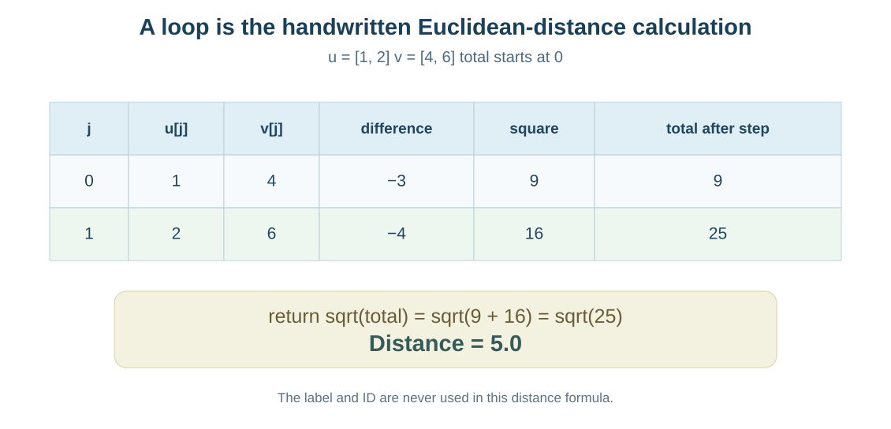
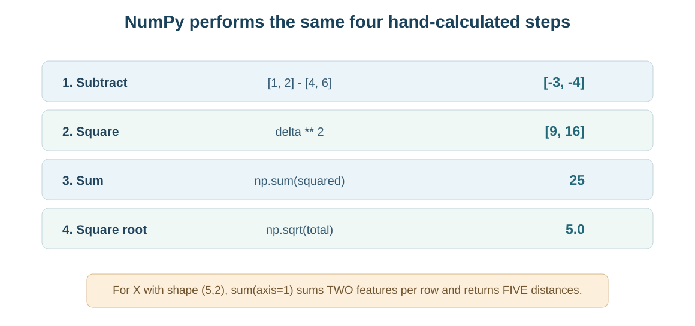
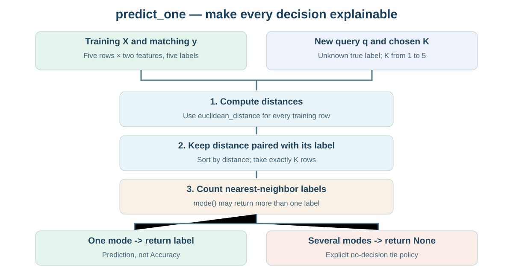

# מפגש 16 — בונים KNN בעצמנו: פונקציות, NumPy ובדיקת ספרייה
**יחידה 3 · כיתה י׳ · 90 דקות הוראה ותרגול + 45 דקות פרויקט**

## סיפור: מישהו שאל איך האפליקציה מחליטה
דודו הציג במפגש הקודם מערכת שמציעה פעילות לפי משתתפים דומים. הוא יודע לחשב ביד מי שלושת השכנים הקרובים, אך כששואלים אותו **איך המחשב עשה זאת**, הוא מציג פלט בלי הסבר. היום נבנה אלגוריתם קטן שאפשר לפתוח, לבדוק ולשנות. הוא לא "קופסה שחורה": כל שלב משקף פעולה שחישבנו במפגש 15.

**שאלת השיעור:** איך עוברים מחמש שורות בטבלת מרחקים לפונקציה שמקבלת נקודה חדשה ומחזירה תחזית, ואיך מגלים מקרים שבהם הפונקציה שלנו וספרייה מוכנה לא חייבות להתנהג באותה צורה?

## 1. מחזירים ערך או רק מדפיסים?
~~~python
def square(x):
    return x * x

answer = square(4)
print(answer)  # 16
~~~
**return** מחזיר ערך לקוד שקרא לפונקציה; **print** רק מציג למסך. פונקציה שמדפיסה מרחק בלי להחזיר אותו אינה מאפשרת להשתמש במרחק הזה בקלות למיון שכנים. הפרמטרים הם קלטים; המשתנה המוחזר הוא תוצאה שניתן לשמור ולחשב עליה.

## 2. מחשבים מרחק בשני ממדים ביד, לפני לולאה
נשתמש בשתי נקודות בדוגמת המקור, במדידות על אותו סרגל הוראתי:
\[
u=(1,2),\qquad v=(4,6).
\]
\[
d(u,v)=\sqrt{(1-4)^2+(2-6)^2}
=\sqrt{(-3)^2+(-4)^2}=\sqrt{9+16}=\sqrt{25}=\mathbf5.
\]

| מיקום j | u[j] | v[j] | הפרש | ריבוע הפרש | סכום מצטבר |
|---:|---:|---:|---:|---:|---:|
| 0 | 1 | 4 | −3 | 9 | 9 |
| 1 | 2 | 6 | −4 | 16 | 25 |

**שאלה סוקרטית:** למה מתחילים total=0? מדוע לא מחברים רק את ההפרשים −3 ו־−4? מדוע מוציאים שורש רק לאחר סכימת כל הריבועים?

## 3. אותה נוסחה בשתי דרכים — for ו־NumPy
~~~python
def euclidean_distance(u, v):
    total = 0.0
    for j in range(len(u)):
        diff = float(u[j]) - float(v[j])
        total = total + diff ** 2
    return total ** 0.5

print(euclidean_distance([1, 2], [4, 6]))  # 5.0
~~~

יש שני קלטים באותו מספר מאפיינים. המשתנה j הוא **אינדקס**, שמתחיל ב־0; total הוא סכום ריבועי ההפרשים. אם מספרי המאפיינים אינם שווים, הקוד הבסיסי אינו מיועד להשוואה: גרסת המורה כוללת בדיקת אורך שמחזירה הודעת שגיאה ברורה.

אותו חישוב באמצעות ספריית NumPy:
~~~python
import numpy as np
u = np.array([1., 2.])
v = np.array([4., 6.])
delta = u - v              # [-3., -4.]
squared = delta ** 2        # [9., 16.]
total = np.sum(squared)     # 25.0
distance = np.sqrt(total)   # 5.0
~~~

המונח **וקטורי** אומר שהפעולה נכתבת על מערך של ערכים, ולא בלולאה מפורשת לכל אינדקס. זה **אינו** משנה את נוסחת המרחק. כאשר X היא מטריצת תצפיות (שורות) ו־q היא נקודה חדשה:
~~~python
distances = np.sqrt(((X - q) ** 2).sum(axis=1))
~~~
הסימון **axis=1** פירושו לסכם על פני *עמודות המאפיינים בכל שורת תצפית*, כך שמתקבל מרחק אחד **לכל שורת אימון**. אין לסכם על פני שורות התצפיות; זה היה נותן גודל אחר. כש־X בעלת צורה (5,2) ו־q בעלת צורה (2,), NumPy משדרת את q לכל חמש השורות — התוצאה בעלת צורה (5,).

## 4. איך מממשים חיזוי לשכן הקרוב?
נציג רק את **נתוני דוגמת המורה** ממפגש 15, כדי שמטלת התלמיד תישאר עצמאית.

| מזהה | f1 | f2 | label |
|---|---:|---:|---|
| A | 3 | 2 | Red |
| B | 5 | 3 | Blue |
| C | 5 | 5 | Blue |
| D | 7 | 3 | Red |
| E | 3 | 8 | Red |

השאילתה היא q=(3,3), והתווית שלה **לא ידועה**. מהמפגש הקודם: המרחקים לפי A–E הם 1, 2, √8, 4, 5; הסדר A→B→C→D→E. עבור K=3 השכנים הם A, B, C עם תוויות Red, Blue, Blue, ולכן תחזית Blue ברוב של שניים מול אחד.

### רצף האלגוריתם
1. עבור כל שורת אימון מחשבים מרחק ל־q.
2. **מצמידים את המרחק לתווית מאותה השורה**. אסור למיין רשימת מרחקים ולשכוח איזה label שייך למרחק.
3. ממיינים לפי מרחק עולה; בוחרים בדיוק K שורות, ולא מצביעים לפי כל הדוגמאות.
4. סופרים קולות מכל תווית בין K הנבחרים.
5. אם יש מנצחת יחידה, מחזירים אותה בעזרת return. אם יש תיקו, מפעילים מדיניות ידועה מראש — למשל להחזיר None עם הודעת "אין הכרעה".

### קוד פונקציה מדורג ב־Pandas
~~~python
import pandas as pd

def predict_one(train_X, train_y, query, k):
    if k < 1 or k > len(train_X):
        raise ValueError("K must be from 1 to the number of training rows")

    distances = []
    for row in train_X:
        distances.append(euclidean_distance(row, query))

    neighbors = pd.DataFrame({
        "distance": distances,
        "label": train_y
    })
    nearest = neighbors.sort_values("distance", kind="stable").head(k)
    modes = nearest["label"].mode()

    if len(modes) != 1:
        return None  # מדיניות שקופה: אין הכרעה
    return modes.iloc[0]
~~~

**למה DataFrame כאן?** לכל מרחק נשארת תווית מאותה שורת מקור גם אחרי המיון. המיון היציב קובע מהו סדר השורות כשיש *מרחקים שווים*, אך אם התוויות שונות בדיוק בגבול K עדיין נדרש כלל בחירה מוסכם — בספרייה עשויה להיות התנהגות אחרת. במקרה המסוים של q=(3,3) כל מרחקי האימון שונים.

## 5. בודקים התאמה לספריית Scikit-learn
בתרגיל המקור נדרשת **השוואה** ל־KNeighborsClassifier. זו אינה העברת האחריות לחיזוי לספרייה: התלמיד כותב תחילה פונקציה עצמאית, ואחר כך משתמש בספרייה כבדיקת תוצאה.

~~~python
from sklearn.neighbors import KNeighborsClassifier
library = KNeighborsClassifier(
    n_neighbors=3, weights="uniform", metric="euclidean"
)
library.fit(X_train, y_train)
print(library.predict([[3., 3.]]))
~~~

בהדגמת המורה צפויה Blue ב־K=3. **כאן בלבד** משתמשים במסווג המוכן לביקורת המימוש העצמאי; לימוד מסודר של ה־API ואימון/הערכה ייעשה במפגש 17. הספרייה אינה חייבת לאמץ את מדיניות ה־None שלנו במקרה תיקו.

### מגבלה שחשוב לומר לפני השוואת הפלטים
שני מימושים יכולים להחזיר תוויות שונות **גם אם חישובי המרחק שלהם נכונים**, כאשר יש תיקו קולות או מרחקים שווים בגבול K: למדיניות הכרעה ולסדרי מיון תפקיד משמעותי. לכן בוחרים תחילה בדיקות עם **מנצחת יחידה** ועם קבוצת שכנים מוגדרת היטב; לא מכריזים שאחד המימושים "שגוי" רק בגלל תוצאת תיקו שונה.

## 6. כמה שאילתות ונתונים בשני ממדים
בדוגמת ההשתלמות אפשר לעבור בלולאת for על שתי שאילתות [[3,3],[6,4]], ולשמור שתי תחזיות:
~~~python
two_queries = np.array([[3., 3.], [6., 4.]])
predictions = []
for q in two_queries:
    predictions.append(predict_one(X_train, y_train, q, 3))
print(predictions)
~~~

בשאילתה (6,4), שתי נקודות עשויות להיות במרחק זהה; עבור K=3 בדוגמת המורה ההכרעה נשענת על שלוש תוויות שנבחרו, ואין להחליף אותה אוטומטית לכללי הכרעה של K=1. צריך **לבדוק** ולא להניח שברירת המחדל של הספרייה והמימוש הידני בהכרח זהים בכל מקרה.

## 7. מעבדת תלמיד — נתונים אחרים
התרגול העצמאי מבוסס על **הקלט המקורי של Meeting-16**:
- X_train עם חמש נקודות P1–P5 המקבילות ל־[[2,1],[4,2],[4,4],[6,2],[2,7]] ותוויות [B,A,A,B,A].
- כתיבת euclidean_distance בעזרת for ו־return; בדיקת [0,0] מול [3,4].
- כתיבת predict_one המקבלת Train, y, query ו־K וממיינת מרחק ותווית יחד.
- הצגת התחזיות של q=(2,2) עבור K=1,3,5, עם נימוק ועם השוואה לספרייה.
- **שתי שאילתות נוספות** ברצף עם for; השוואת מרחקי לולאה לווקטור NumPy; בדיקות תיקו/גבולות ושמירת X ו־y.
- שלוש שאלות פירוש: למה return חשוב יותר מהדפסת תשובה? מה עושים בתיקו? האם תחזית שאינה מלווה בתווית אמת מאפשרת Accuracy?

אין פתרונות של P1–P5 בספר ההכנה למצגת. פתרונות המורה קיימים בנפרד.

## 8. AI, דליפה וגבולות ההסקה
זו דוגמת נתונים **מומצאת**, ללא אימות על נתונים חדשים מתויגים, ולכן אין Accuracy. אם מאפיינים בסולמות שונים, סדר השכנים יכול להשתנות — יש ללמוד Scaler מתוך Train בלבד (מפגש 13). אם מאפיינים כוללים קטגוריות, צריך קידוד עקבי מתוך Train (מפגש 14). בנתוני פרויקט אמיתי נדרש פיצול אמין ושמירת Test (מפגש 12). אין להציג את פונקציות Python כאובייקט estimator המוכן ל־GridSearchCV או לטעון שהוא מכיל את כל בדיקות הקלט הנדרשות בייצור.

## פרויקט אישי — 45 דקות
תכננו **תחזית אחת ניתנת להסבר** מתוך הפרויקט: בחרו תכונות X ותווית y, יחידות, שתי דוגמאות מתויגות לפחות, פעולת מרחק ונימוק ל־K חוקי, מה מחזירה פונקציה ומה תהיה מדיניות תיקו. אם הפרויקט עדיין אינו מכיל נתוני אימון/בדיקה תקפים, מגישים תכנון עם דוגמה מומצאת מסומנת, ולא מציגים Accuracy.

## כרטיס יציאה
מה מוחזר מפונקציית המרחק, ומה יודפס? מה משמעות axis=1? מדוע חייבים למיין מרחק יחד עם label? האם K=3 מבטיח מנצחת יחידה בשלוש מחלקות? מתי השוואה לספרייה אינה השוואה הוגנת?