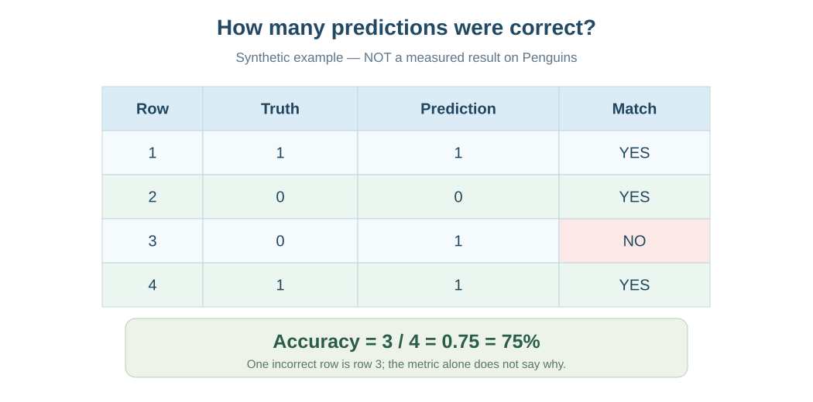
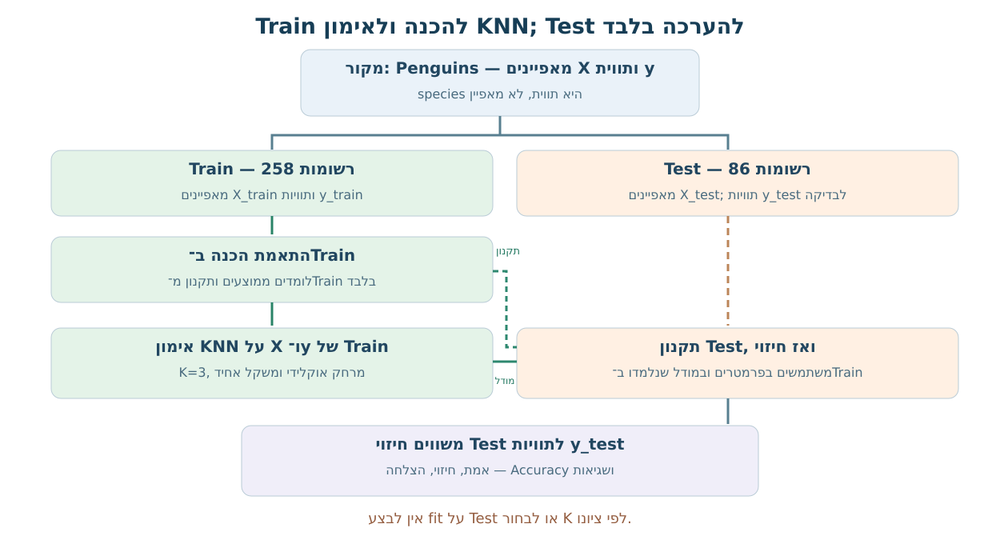
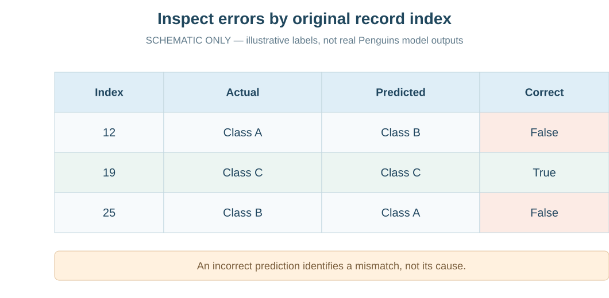

# מפגש 17 — KNN בספרייה: אימון, חיזוי והערכת טעויות
**ספר תלמיד מעמיק | כיתה י׳ | יחידה 3 | 90 דקות הוראה + 45 דקות פרויקט**

## סיפור: המחשב חזה מין פינגווין, אך האם צדק?
במפגש הקודם בנינו KNN בעצמנו. כעת ניתן למודל מדידות של פינגווינים אמיתיים ונבקש ממנו לנבא את המין species. לשם כך נשתמש בתכונות X; התוויות האמיתיות y נשמרות בנפרד. מחשב יכול לחזות גם בלי שהחיזוי נכון. **התחזית היא הצעה; ההערכה בודקת את נכונותה מול אמת שנשמרה.**

## חישוב ידני — ארבע דוגמאות מומצאות
| תצפית | אמת y_true | תחזית y_pred | correct |
|---|---:|---:|---|
| 1 | 1 | 1 | נכון |
| 2 | 0 | 0 | נכון |
| 3 | 0 | 1 | שגוי |
| 4 | 1 | 1 | נכון |

\[
Accuracy=\frac{\text{מספר תחזיות נכונות}}{\text{מספר תצפיות בדיקה}}
=\frac{3}{4}=0.75=75\%.
\]
**פירוש:** המונה הוא 3 נכונות, המכנה הוא 4 תצפיות שנבדקו, ו־0.75 היא פרופורציה, לא 0.75%. זו **דוגמה מומצאת**, לא ביצועי מודל Penguins. השורה השגויה היא תצפית 3: אמת 0 וחיזוי 1. Accuracy לבדה אינה מראה איזו שורה שגויה.

~~~python
from sklearn.metrics import accuracy_score
y_true = [1, 0, 0, 1]
y_pred = [1, 0, 1, 1]
print(accuracy_score(y_true, y_pred))  # 0.75
~~~

## שישה שלבים של KNN אמיתי
**1 — טעינת נתונים:** קובץ Penguins בקורס מכיל 344 שורות, 7 עמודות, והיעד species. קריאת GitHub חייבת להגיע לקישור Raw CSV ולא לדף blob.

**2 — בחירת מאפיינים ויעד:** הדגמת המורה משתמשת ב־flipper_length_mm (אורך סנפיר במ״מ) וב־body_mass_g (מסת גוף בגרמים). מעבדת התלמיד משתמשת ב־bill_length_mm וב־bill_depth_mm (אורך ועומק מקור במ״מ). X מכיל שתי מדידות; y מכיל species. אין להכניס species לתכונות.

**3 — פיצול משותף:** train_test_split(X,y,test_size=0.25,random_state=42,stratify=y) משמר התאמה בין X לבין y. בחלוקת 344 תצפיות — 258 ב־Train ו־86 ב־Test. בהדגמת המורה seed=42; בתלמיד seed=17. random_state מאפשר לשחזר, לא משפר דיוק בעצמו. stratify שומר בקירוב את הרכב המינים.

**4 — השלמה ותקנון:** מחשבים ממוצעי חסרים של X_train בלבד, משלימים את X_train ואת X_test בעזרת אותם ממוצעים. מתאימים StandardScaler ל־Train שהושלם, ומבצעים transform לשתי הקבוצות. אסור לעשות fit של scaler על Test או על כל הקובץ לפני הפיצול.

**5 — אימון וחיזוי:**
~~~python
model = KNeighborsClassifier(n_neighbors=3, weights="uniform",
                             metric="euclidean")
model.fit(X_train_scaled, y_train)
predictions = model.predict(X_test_scaled)
~~~
n_neighbors=3 הוא K; uniform מעניק לכל שכן קול שווה; euclidean הוא מרחק פיתגורס. fit מקבל X_train ו־y_train; predict מקבל **רק X_test**, ולעולם לא את y_test. ב־KNN האימון שומר מידע ודוגמאות הדרושים לחיזוי באמצעות שכנים.

**6 — הערכה:**
~~~python
comparison = pd.DataFrame(
    {"actual": y_test, "predicted": predictions},
    index=y_test.index
)
comparison["correct"] = comparison["actual"] == comparison["predicted"]
correct_count = int(comparison["correct"].sum())
accuracy_hand = correct_count / len(y_test)
accuracy_lib = accuracy_score(y_test, predictions)
errors = comparison[comparison["correct"] == False]
~~~
מכיוון ש־y_test שומרת אינדקסים מקוריים, חשוב לשמור את אותו אינדקס בשורות ההשוואה. מערך predictions שומר את סדר שורות X_test. אל תיצרו Series עם אינדקס 0..85 ואז תשוו אותה ישירות ל־y_test בעלת אינדקסים מקוריים — Pandas מיישרת לפי אינדקס ועלולה לייצר השוואה שגויה או שגיאה.

## כיצד חוקרים טעויות?
הציגו errors.head(3) והסבירו מהי תווית האמת ומה נחזתה בכל מקרה. אם יש רק טעות אחת, מציגים אחת; אם אין טעויות, מציינים אפס — לא ממציאים נתונים. אפשר לשלוף את שתי המדידות של שורה שגויה באמצעות האינדקס המקורי. **אין להסיק שזו תצפית חריגה, מדידה שגויה או בעיית תיוג בלי בדיקה נוספת**. טעויות מהוות תצפיות לניתוח, לא הסבר סיבתי בפני עצמן.

## מה Accuracy כן אומר ומה לא?
הוא מתאר את שיעור התחזיות הנכונות ב־86 תצפיות הבדיקה שנבחרו פעם אחת, תחת מודל ומערכת הכנה שהוגדרו מראש. הוא **אינו** מוכיח דיוק זהה בטבע, אינו מתאר מי נפגע מסוג טעות מסוים ואינו מצדיק בחירת K על סמך ציון Test.

**אזהרה חשובה:** הדגמת המורה והמעבדה העצמאית שינו *גם* זוג מאפיינים *וגם* seed. לכן הפרש בציוני Accuracy ביניהן **אינו ניסוי מבוקר** להעדפת תכונות. בחירת מאפיינים ו־K תיעשה באמצעות Validation/CV בהמשך הקורס, בתוך נתוני הפיתוח, ולא לפי Test הסופית.

## משימת תלמיד עצמאית
עבדו על bill_length_mm ו־bill_depth_mm בלבד, יעד species, test_size=.25, random_state=17, stratify=y, השלמת חסרים מממוצעי Train, StandardScaler.fit ב־Train בלבד, K=3 קבוע, fit/predict, טבלת actual/predicted/correct, Accuracy ידני ו־accuracy_score, ותיעוד עד שלוש שגיאות. ספר זה **אינו מציג את תוצאת ה־Accuracy או את השגיאות של המעבדה**; מחשבים אותן במחברת ומסבירים במילים.

## פרויקט 45 דקות
כרטיס מודל ראשון: שם מקור הנתונים, מהי תצפית, אילו X ואיזה y, מדיניות חסרים, פיצול, סטנדרטיזציה מ־Train, K שהוגדר לפני בדיקה, איך נמדד Accuracy, דוגמת שגיאה קיימת ומגבלות. אם אין בפרויקט נתונים מתויגים מספיק, מכינים תכנון ולא דיוק מומצא.

## שאלות הגנה
איזה מידע מקבל fit? למה predict לא מקבל y_test? מה המכנה ב־Accuracy? מה מבדיל שגיאה מדודה מטענה על סיבת השגיאה? מה יקרה אם נשנה K אחרי שראינו את תוצאת Test? האם שינוי seed וגם המאפיינים מאפשר השוואה הוגנת?