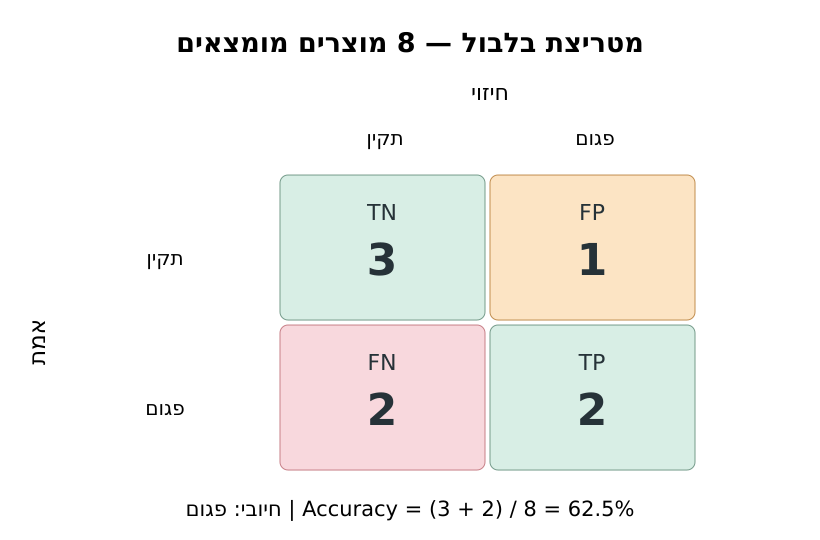

# מקור מצגת — מפגש 18: מטריצת בלבול וסוגי טעויות
**מסמך מקור מקצועי ל־NotebookLM | 8–10 שקפים | רקע בהיר | RTL לטקסט, LTR לקוד ולנוסחאות.**
יש להציג מקור/המחשה, לא לטעון שנוצרה מצגת מוגהת.

## סיפור — למה Accuracy לא מספר הכול?
מפעל ממיין מוצרים לפגומים/תקינים. שתי טעויות: אזעקת שווא (מוצר תקין שנפסל) והחמצה (מוצר פגום שעבר). איזו חמורה יותר? תלוי במחיר הטעות ובמטרת הסיווג.

## הנתונים המדויקים להדגמה (מומצאים)
`actual = ["OK","OK","OK","OK","Defect","Defect","Defect","Defect"]`
`predicted = ["OK","OK","Defect","OK","OK","OK","Defect","Defect"]`.
המחלקה החיובית היא Defect. סדר התוויות `["OK","Defect"]`; שורות אמת ועמודות חיזוי.

ספירות: TN=3, FP=1, FN=2, TP=2; מטריצה `[[3,1],[2,2]]`. סכום כל התאים 8; האלכסון 5. `Accuracy = (3+2)/8 = 0.625 = 62.5%`.



## מעבר מדורג ל־Python
```python
from sklearn.metrics import confusion_matrix, accuracy_score
actual = ["OK","OK","OK","OK","Defect","Defect","Defect","Defect"]
predicted = ["OK","OK","Defect","OK","OK","OK","Defect","Defect"]
print(confusion_matrix(actual, predicted, labels=["OK","Defect"]))
print(accuracy_score(actual, predicted))
```
פלט: `[[3,1],[2,2]]` ו־0.625. הסבר: אין כאן אימון מודל; אלה זוגות אמת וחיזוי מומצאים להבנת המטריצה.

## המלצה לעשרה שקפים
1. סיפור מפעל ותיאור שתי טעויות אפשריות; לא לחשוף מיד תשובה.
2. חזרה על `predict`, `y_test`, `Accuracy` ממפגש 17.
3. שמונה זוגות אמת/חיזוי; תלמיד ממיין שני זוגות.
4. הגדרת חיובי=Defect, משמעות TN/FP/FN/TP.
5. בניית 2×2 בהדרגה — שורות אמת ועמודות חיזוי.
6. ספירת כל זוג פעם אחת והשלמת המטריצה: [[3,1],[2,2]].
7. חישוב ידני של Accuracy והדיון במה שהמדד מחמיץ.
8. קוד Python וקישור מפורש בין קלט, מטריצה ופלט.
9. מטריצת שלושה מיני Penguins: הסבר עקרוני של שורה/עמודה/תא, **ללא הצגת פתרון המעבדה**.
10. שאלת יציאה: האם אותו Accuracy מבטיח אותו סוג טעויות? מעבר למפגש 19.

## איסורים דידקטיים
אין להציג את התשובות המספריות למעבדת התלמיד (מסווג קבוע ל־10 מוצרים). אין להמציא תוצאות אמיתיות מ־Penguins; אין להחליף סדר צירים; אין ללמד Precision/Recall/F1 כאן. הימנעו מעומס מילולי ומטעויות כתיב.

## מקורות
מחברות המקור בתיקיית `Meeting-18`, כולל `Guided-Lesson.ipynb`, `Student-Lab.ipynb` ו־`Teacher-Solution.ipynb`; ומפת המצגת `Presentation-Brief.md` המתייחסת ל־Performance Indicators updated.pptx.


---
## תוספת בקרת עומק — תסריט הפקה שקף־אחר־שקף (27.10.2026)
**9 שקפים בהירים; רעיון מרכזי אחד לשקף; זהו תסריט מקור ולא קובץ מצגת שהופק.**

### שקף 1 — מפעל בודק שמונה מוצרים: איזו טעות עולה יותר? שאלת פתיחה בלי פתרון.
**שאלת מורה:** מה התלמיד יוכל לנבא לפני חשיפת התוצאה? **בדיקת הבנה:** האם התלמיד מסביר את המספרים/הנוסחה במילים ולא רק קורא את השקף?

### שקף 2 — שמונה זוגות אמת וחיזוי — מסמנים OK ו־Defect, מציגים תחזית לפני ספירה.
**שאלת מורה:** מה התלמיד יוכל לנבא לפני חשיפת התוצאה? **בדיקת הבנה:** האם התלמיד מסביר את המספרים/הנוסחה במילים ולא רק קורא את השקף?

### שקף 3 — קובעים Defect כחיובי, שורות אמת ועמודות חיזוי; מציבים בכל תא את משמעות TN/FP/FN/TP.
**שאלת מורה:** מה התלמיד יוכל לנבא לפני חשיפת התוצאה? **בדיקת הבנה:** האם התלמיד מסביר את המספרים/הנוסחה במילים ולא רק קורא את השקף?

### שקף 4 — ספירה ידנית: TN=3, FP=1, FN=2, TP=2; מציבים 3+1+2+2=8.
**שאלת מורה:** מה התלמיד יוכל לנבא לפני חשיפת התוצאה? **בדיקת הבנה:** האם התלמיד מסביר את המספרים/הנוסחה במילים ולא רק קורא את השקף?

### שקף 5 — ממחישים [[3,1],[2,2]] ב־confusion-matrix-binary-eight.svg; צבע לא משנה את זהות הצירים.
**שאלת מורה:** מה התלמיד יוכל לנבא לפני חשיפת התוצאה? **בדיקת הבנה:** האם התלמיד מסביר את המספרים/הנוסחה במילים ולא רק קורא את השקף?

### שקף 6 — Accuracy=(TN+TP)/N=(3+2)/8=62.5%; מבחינים במונה ובמכנה.
**שאלת מורה:** מה התלמיד יוכל לנבא לפני חשיפת התוצאה? **בדיקת הבנה:** האם התלמיד מסביר את המספרים/הנוסחה במילים ולא רק קורא את השקף?

### שקף 7 — Python: confusion_matrix(actual,predicted,labels=['OK','Defect']); בדיקת התאמה לחישוב ידני.
**שאלת מורה:** מה התלמיד יוכל לנבא לפני חשיפת התוצאה? **בדיקת הבנה:** האם התלמיד מסביר את המספרים/הנוסחה במילים ולא רק קורא את השקף?

### שקף 8 — משנים תחזית אחת של מוצר תקין ובודקים כיצד FP גדל ואחוז ההצלחה משתנה, בלי לערב פתרון תלמיד.
**שאלת מורה:** מה התלמיד יוכל לנבא לפני חשיפת התוצאה? **בדיקת הבנה:** האם התלמיד מסביר את המספרים/הנוסחה במילים ולא רק קורא את השקף?

### שקף 9 — חיבור קצר למטריצה 3×3 ב־Penguins; שאלה מסכמת: מה אומר תא מחוץ לאלכסון?
**שאלת מורה:** מה התלמיד יוכל לנבא לפני חשיפת התוצאה? **בדיקת הבנה:** האם התלמיד מסביר את המספרים/הנוסחה במילים ולא רק קורא את השקף?

### מחוון דידקטי למורה
לכל שקף הציגו לכל היותר רעיון אחד, איור/טבלה או נוסחה אחת, ומשימת חשיבה קצרה; בעת חישוב ידני פירקו קלט, מונה, מכנה, פעולה ופירוש. תנו זמן לחיזוי התלמידים לפני הצגת הפלט. כל ערך מומצא חייב להיות מסומן 'המחשה סינתטית'. עברית RTL, ביטויי קוד ומתמטיקה LTR. כותרות קצרות, קו ניגודיות גבוה, גופנים גדולים, ללא צילומי קוד עמוסים. **כלל מקור ייחודי:** לא ללמד Precision/Recall/F1 לפני מפגש 19; אין לחשוף מקרה 10 המוצרים של התלמיד.

**הכנה למעבדה:** סיימו עם שאלה פתוחה התואמת ל־Student-Lab ול־Student-Fill-Blanks-Audited, בלי המפתח שלהן. מסמך זה אינו תחליף להרצה/הגהה חזותית של קובץ המצגת אחרי הפקתו.
