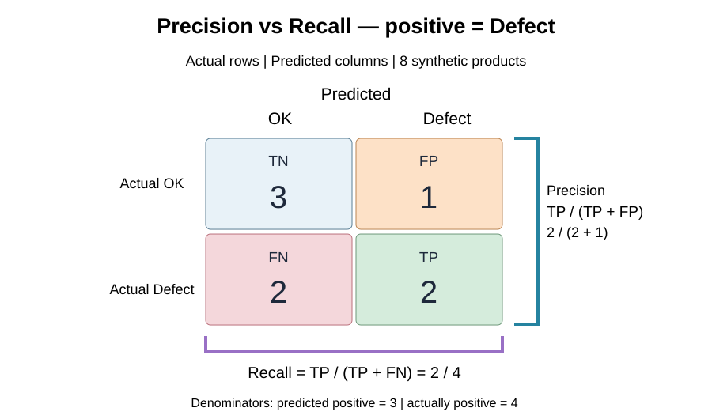

# מפגש 19 — Precision, Recall ו־F1: כמה אפשר לסמוך על זיהוי?
**יחידה 3 | ספר תלמיד | 90 דקות למידה ותרגול + 45 דקות פרויקט**

## הסיפור: מסנן ההודעות של בית הספר
מערכת מסווגת הודעות כ־Spam (זבל) או Important (חשובות). כשמסמנים הודעה חשובה כזבל — תלמיד עלול להחמיץ עדכון. וכשהמערכת מחמיצה ספאם — התיבה מתמלאת בהודעות לא רצויות. שתי הטעויות שונות, ולכן שיעור הצלחה כולל (Accuracy) אינו כל הסיפור.

**שאלת חקר:** מתוך כל ההודעות שסומנו כזבל, כמה באמת זבל? ומתוך כל הודעות הזבל הקיימות, כמה אותרו? שימו לב: לשתי השאלות **מכנים שונים**.

## חזרה ממפגש 18
מטריצת בלבול מציבה אמת בשורות וחיזוי בעמודות. לצורך דוגמה זו החיובי הוא `Defect` (מוצר פגום), כמו במחברות ההוראה המקוריות. `TP` הוא פגום שזוהה; `FP` תקין שסומן כפגום; `FN` פגום שהוחמץ; `TN` תקין שזוהה. השמות אינם קובעים ש״חיובי״ הוא דבר טוב.

## דוגמת לוח — לפני הספרייה
בדוגמה המודרכת המקורית: `actual=["OK","OK","OK","OK","Defect","Defect","Defect","Defect"]`; `predicted=["OK","OK","Defect","OK","OK","OK","Defect","Defect"]`. אלה **נתוני הוראה מומצאים**, לא ביצועי Penguins.

| אמת \ חיזוי | OK | Defect | סך אמת |
|---|---:|---:|---:|
| OK | TN=3 | FP=1 | 4 |
| Defect | FN=2 | TP=2 | 4 |
| סך חיזוי | 5 | 3 | 8 |



### Precision — עד כמה אמינות התחזיות החיוביות?
\[
P=\frac{TP}{TP+FP}=\frac{2}{2+1}=\frac23\approx0.667=66.7\%.
\]
המכנה `TP+FP=3` הוא **כל מה שסומן כפגום**. מתוך שלושה מסומנים, שניים באמת פגומים. יחידת המדד היא יחס/אחוז, לא מספר מוצרים.

### Recall — כמה מהחיוביים האמיתיים נתפסו?
\[
R=\frac{TP}{TP+FN}=\frac{2}{2+2}=\frac24=0.5=50\%.
\]
המכנה `TP+FN=4` הוא **כל המוצרים הפגומים באמת**. מתוך ארבעה פגומים, שניים התגלו; שניים הוחמצו.

### F1 — מדד משולב
\[
F_1=\frac{2PR}{P+R}=\frac{2TP}{2TP+FP+FN}
=\frac{4}{4+1+2}=\frac47\approx0.5714.
\]
F1 הוא **ממוצע הרמוני** של P ו־R, ולא ממוצע חשבוני רגיל. הוא אינו משקלל ישירות עלויות עסקיות, ו־TN אינו מופיע בנוסחתו.

### Accuracy — לחיבור לשיעור הקודם
\[
Accuracy=\frac{TP+TN}{TP+TN+FP+FN}=\frac{2+3}{8}=62.5\%.
\]
כל ארבעת המדדים מתייחסים **לאותן שמונה דוגמאות** אך שואלים שאלות שונות.

## אימות בקוד
```python
from sklearn.metrics import confusion_matrix, precision_score, recall_score, f1_score
actual = ["OK","OK","OK","OK","Defect","Defect","Defect","Defect"]
predicted = ["OK","OK","Defect","OK","OK","OK","Defect","Defect"]
cm = confusion_matrix(actual, predicted, labels=["OK","Defect"])
print(cm)
print(precision_score(actual, predicted, pos_label="Defect", zero_division=0))
print(recall_score(actual, predicted, pos_label="Defect", zero_division=0))
print(f1_score(actual, predicted, pos_label="Defect", zero_division=0))
# Expect: [[3,1],[2,2]], 2/3, 1/2, 4/7
```

## מקרה קצה: אין תחזיות חיוביות
נניח 8 תקינים ו־2 פגומים אמיתיים, והמודל תמיד חוזה OK. Accuracy עשוי להיות 80%, אף שפגומים אינם מזוהים. במקרה זה `TP+FP=0`, ולכן Precision הוא **0/0 ואינו מוגדר מתמטית**. ההוראה `zero_division=0` ב־Scikit-learn **בוחרת להציג 0** — אין פירושה ש־0/0 שווה לאפס. Recall במקרה זה הוא `0/2=0` ומוגדר.

## מעבר לסיווג רב־מחלקתי — Penguins
במחברת המודרכת נשארים עם אותו KNN של מפגשים 17–18: `flipper_length_mm` ו־`body_mass_g`, חלוקה 25%, `random_state=42`, `stratify=y`, השלמת חסרים ו־StandardScaler מאימון בלבד ו־K=3. לא משנים K לפי Test.

במטריצה של שלושה מינים בוחרים מין אחד מול היתר: **Chinstrap** במחברת המורה, אבל **Adelie** במעבדת התלמיד המקורית. עבור מין יעד: `TP` התא האלכסוני שלו; `FN` שאר תאי השורה; `FP` שאר תאי העמודה; `TN` כל היתר. לא מאמנים כאן מודל חדש. בדוח `classification_report`, `support` מציין את מספר תצפיות האמת של המחלקה; `macro avg` ממוצע שווה בין מחלקות ו־`weighted avg` משוקלל לפי support.

## המעבדה העצמאית — אין לחשוף פתרון
המעבדה המקורית משתמשת **ב־12 מוצרים** ובזוגות אמת/חיזוי אחרים מהדגמת המורה. התלמיד בונה מטריצה, מחשב Accuracy/P/R/F1 ביד ובספרייה, בודק מקרה קצה של חיזוי OK תמיד, ואז מחשב מדדים ל־Adelie מול היתר ב־Penguins וקורא דוח סיווג. **המספרים הסופיים של תרגיל 12 המוצרים אינם ניתנים כאן.**

## עצירות חשיבה
1. מה ההבדל בין השאלות ״כמה מהמסומנים״ ובין ״כמה מהקיימים״?
2. איזה מדד חשוב במיוחד כשהחמצת מקרה חיובי יקרה?
3. מדוע F1 אינו יכול לומר לנו לבדו מה מחיר הטעויות?
4. מדוע אין לשנות K לאחר שראינו את מדדי Test?
5. אם המחלקה החיובית השתנתה, מה חייבים לעדכן בפרשנות?

## פרויקט — 45 דקות מוגנות
הגדירו מהי המחלקה שהכי חשוב לזהות, מה יקר יותר — FP או FN — ואת המדד המרכזי שתדווחו, לצד המטריצה ומדד נוסף. אם אין נתונים מתויגים אמיתיים, אין להמציא ערכי ביצוע: כתבו תכנית מדידה בלבד.
