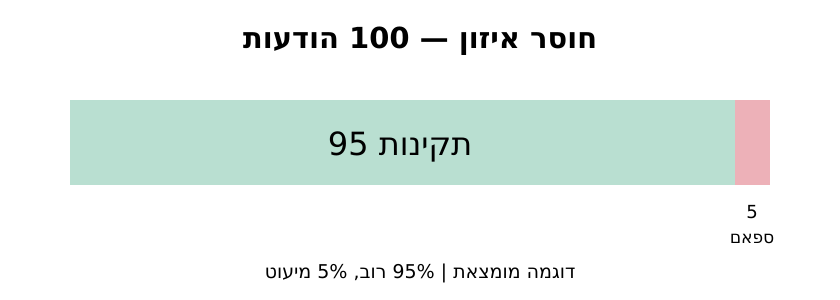
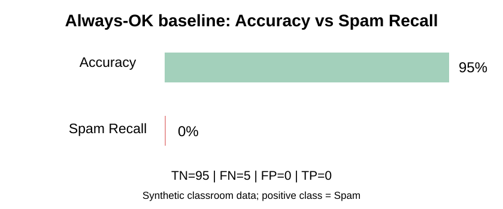

# מפגש 20 — חוסר איזון במחלקות וקו בסיס
**יחידה 3 · ספר התלמיד · 90 דקות הוראה ותרגול ו־45 דקות פרויקט**

## סיפור פתיחה: מסנן ספאם שמקבל 95% ונכשל בתפקידו
נניח שמתוך 100 הודעות, 95 תקינות ורק 5 ספאם. מסנן שמכריז "תקין" על כולן זוכה ל־95% Accuracy. האם הייתם מרוצים? כל חמש הודעות הספאם חמקו! אין זו טעות חישוב: זהו מקרה שבו המדד אינו תואם למטרת המשתמש.

**שאלת חקר:** איך נבדוק אם מסווג באמת מוסיף ערך, ולא רק מנחש תמיד את המחלקה הנפוצה?

## 1. מהו חוסר איזון?
מחלקות אינן מיוצגות במספר דוגמאות דומה. בדוגמת המורה 95% תקין ו־5% ספאם; זו **דוגמה מומצאת**, לא מדידה על מאגר ממשי. מחלקת הרוב היא תקין ומחלקת המיעוט היא ספאם. העובדה שהמחלקה נדירה אינה הופכת אותה לבלתי חשובה.



## 2. חזרה על ארבעת סוגי התוצאות
החיובי הוא ספאם. אמת נמצאת בשורות וחיזוי בעמודות.

| אמת \ חיזוי | תקין | ספאם | סך הכל |
|---|---:|---:|---:|
| תקין | TN=95 | FP=0 | 95 |
| ספאם | FN=5 | TP=0 | 5 |
| סה״כ | 100 | 0 | 100 |

במטריצה נכללות 100 תצפיות. המסווג **לא** מנבא ספאם כלל: כל 5 מקרי הספאם הם FN.

## 3. מחשבים ביד ומפרשים כל מכנה
\[
Accuracy=\frac{TP+TN}{TP+TN+FP+FN}=\frac{0+95}{100}=0.95=95\%.
\]
המדד עונה: *מה שיעור התחזיות הנכונות מתוך כל ההודעות?*

\[
Recall=\frac{TP}{TP+FN}=\frac{0}{0+5}=0.
\]
המדד עונה: *איזה חלק מהספאם האמיתי מצאנו?* כאן 0%.

\[
Precision=\frac{TP}{TP+FP}=\frac{0}{0}.
\]
**הביטוי אינו מוגדר מתמטית.** ב־Scikit-learn אפשר לבחור `zero_division=0` כדי לדווח 0; זו מדיניות תוכנה, לא תוצאה של חלוקה מתמטית.

### מהו קו בסיס (Baseline)?
כלל פשוט שמשמש **נקודת ייחוס להשוואה**. למשל, מסווג שמנבא תמיד את המחלקה השכיחה **שנלמדה מתוך נתוני Train**. הוא אינו מתיימר ללמוד דפוסים מורכבים. אם מודל מורכב אינו עולה עליו במדדים הרלוונטיים, יש לבדוק מה באמת הרווחנו מהמורכבות. קו בסיס אינו יעד ביצוע מספיק בפני עצמו.

## 4. קוד הדגמה: לאמן כלל פשוט ולהשוות
```python
from sklearn.dummy import DummyClassifier
from sklearn.metrics import accuracy_score, recall_score, precision_score, confusion_matrix

# מדגם מומצא להמחשה; בעולם אמיתי מחלקים Train/Test כראוי
y_train = ["OK"] * 95 + ["Spam"] * 5
X_train = [[i] for i in range(len(y_train))]
y_test = ["OK"] * 95 + ["Spam"] * 5
X_test = [[i] for i in range(len(y_test))]

baseline = DummyClassifier(strategy="most_frequent")
baseline.fit(X_train, y_train)
predicted = baseline.predict(X_test)

print(confusion_matrix(y_test, predicted, labels=["OK", "Spam"]))
print(accuracy_score(y_test, predicted))
print(recall_score(y_test, predicted, pos_label="Spam"))
print(precision_score(y_test, predicted, pos_label="Spam", zero_division=0))
```
הפלט הצפוי בדוגמה המומצאת: `[[95,0],[5,0]]`, Accuracy `0.95`, Recall `0.0`, Precision מדווח `0.0` לפי המדיניות. `DummyClassifier` הוא כלי להפקת קו בסיס, לא מודל לזיהוי תכונות ספאם. מדגם הדוגמה הסינתטי אינו הערכת הכללה אמיתית.



## 5. נתוני המעבדה העצמאית — לא לחשוף את הפתרון
ב־`Student-Lab.ipynb` המקורי יש **נתונים שונים**: מתוך 100 הודעות, **10 ספאם**, ומסנן משופר בעל TP, FP, FN ו־TN המוגדרים בתרגיל. עליכם לחשב בעצמכם את מטריצת קו הבסיס, Accuracy ו־Recall שלו; לאחר מכן Accuracy, Precision, Recall ו־F1 של המסנן השני, להשוות ולנמק באיזה מדד נכון להשתמש. **התשובות המספריות של המסנן השני אינן מופיעות בספר זה.**

## 6. האם לאזן אוטומטית את Test?
לא. סט הבדיקה צריך לשקף את שאלת ההערכה ואת סביבת השימוש. איזון מלאכותי של Test משנה את התפלגות הדוגמאות ועלול ליצור תמונה שאינה מייצגת את המציאות. `stratify=y` בחלוקה רגילה עשוי לשמר בקירוב שיעורי מחלקות אך אינו פתרון קסם לדאטה תלוי זמן או לקבוצות קשורות. הרחבות של Sampling ו־class weights יילמדו רק אם הן מתאימות לתכנית ולעיתוי.

## 7. כרטיס יציאה והקשר ל־AI
1. מדוע 95% Accuracy עלול להטעות?
2. מהו קו בסיס, ומה הוא מאפשר להשוות?
3. כיצד ייתכן Recall אפס יחד עם Accuracy גבוה?
4. מה לא ניתן להסיק על מודל חדש על סמך ההשוואה בדוגמה מומצאת?
5. מה יקרה אם נחלק 0 ב־0 בקוד, לעומת בחירת `zero_division=0`?

## 8. פרויקט — 45 דקות מוגנות
מצאו את שכיחות המחלקות בנתוני הפרויקט שלכם. הגדירו כלל בסיס פשוט על סמך Train והשוו למודל על **אותו Test ואותם מדדים**. בלי תוויות אמת או בלי תחזיות, תכננו טבלת הערכה במקום להמציא תוצאות. תעדו מחלקת מיעוט, מדד מרכזי, מגבלה והצעת בדיקה עתידית.
