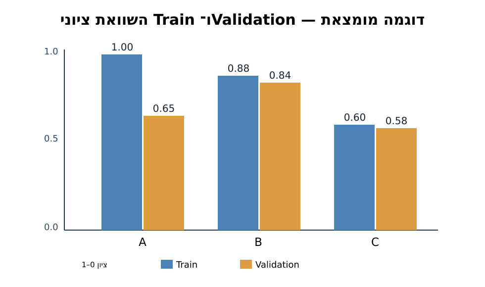
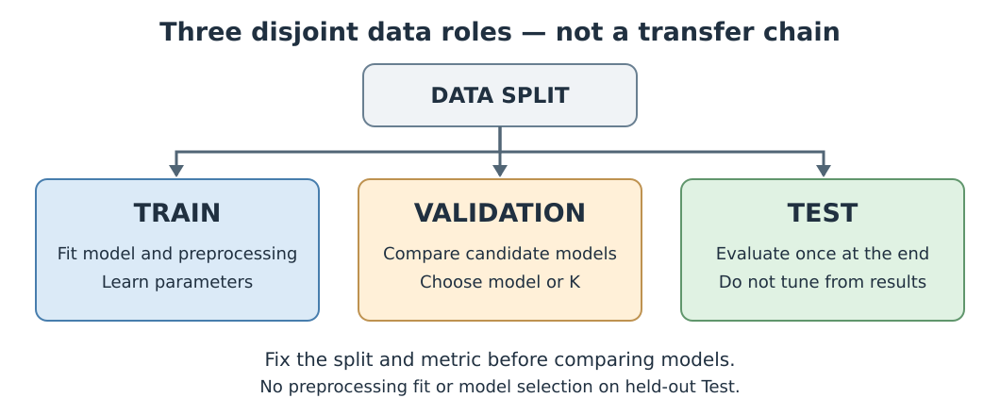

# מפגש 21 — הכללה, התאמת יתר והתאמת חסר
**ספר תלמיד | יחידה 3 | 90 דקות למידה + 45 דקות פרויקט**

## פתיחה: דודו למד בעל פה את המבחן
דודו פתר 100% משאלות התרגול שכבר ראה, אבל במבחן עם שאלות חדשות הצליח רק ב־65%. חברתו פתרה 88% מהתרגול והצליחה ב־84% בשאלות חדשות. את מי היינו מעדיפים לקבל כמורה אישי לשאלות שלא נראו קודם? **המטרה של למידת מכונה אינה לזכור את האימון, אלא להכליל לדוגמאות חדשות.**

## 1. מה למדנו עד היום?
KNN מזהה שכנים כדי לחזות תווית; בדקנו Accuracy, מטריצת בלבול, Precision, Recall, F1 ואת קו הבסיס. עכשיו נשאל כיצד נבחר מודל בלי לתת לתוצאות הבחינה להשפיע על הבחירה.

**Train**: נתונים שממנו המודל לומד את הפרמטרים או שומר דוגמאות (KNN). **Validation**: נתוני פיתוח להחלטה בין מועמדים והיפר־פרמטרים. **Test**: הערכה סופית לאחר שקיבענו את הבחירה. `K` של KNN הוא **היפר־פרמטר** שנבחר בפיתוח; אינו פרמטר הנלמד כמו משקל רגרסיה.

## 2. דוגמה על הלוח (מומצאת; לא תוצאות ניסוי בפועל)
לכל המועמדים אותו מדד, שבו מספר גבוה יותר טוב יותר.

| מועמד | ציון Train | ציון Validation | פער Train−Validation |
|---|---:|---:|---:|
| A | 1.00 | 0.65 | 0.35 |
| B | 0.88 | 0.84 | 0.04 |
| C | 0.60 | 0.58 | 0.02 |

נתוני הטבלה משמשים גם במעבדה המקורית. לצורך לימוד המושגים ננתח **את A בנפרד** מבלי לפתור כאן את שאלות הבחירה וההשוואה של המעבדה.

### הנוסחה והחישוב הידני
\[
Gap=S_{train}-S_{validation}
\]
- `S_train`: ציון במדד הנבחר על נתוני האימון.
- `S_validation`: ציון באותו מדד על נתוני האימות.
- `Gap`: הפרש ביחידות הציון. אם הציונים בין 0 ל־1, הפער נמדד ב**נקודות יחס**, לא באחוזי צמיחה.

לדוגמה, עבור A: `1.00-0.65=0.35`, כלומר **35 נקודות אחוז** בין 100% ל־65%. הפער עשוי להיות סימן להתאמת יתר (Overfitting) אך אינו מוכיח סיבתיות: יש לבדוק גם גודל מדגם, שונות, דליפת מידע וייצוגיות.



## 3. Underfitting לעומת Overfitting
**התאמת חסר (Underfitting)**: המודל פשוט מדי או לא מתאים לדפוס, ולכן עלול להשיג תוצאות חלשות אפילו ב־Train. **התאמת יתר (Overfitting)**: המודל מתאים עצמו לפרטים ולרעש שב־Train ואינו מכליל כראוי. **הכללה (Generalization)**: תפקוד על דוגמאות חדשות מאותה בעיה והתפלגות רלוונטית. פער קטן אינו מוכיח שהמודל טוב: שני ציונים נמוכים וצמודים עלולים להעיד על התאמת חסר.

## 4. הבחירה הנכונה בין מודלים
שיטת העבודה היא **לקבוע מראש** מדד, חלוקה, רשימת מועמדים וכלל בחירה; להשתמש ב־Validation להחלטה; לשמור Test בלתי נגוע עד ההערכה הסופית. אין לבחור מועמד לפי ציון Train הגבוה ביותר בלבד. אין לחזור ל־Test שוב ושוב כדי לתקן החלטות.



### הערה על עיבוד נתונים
חישוב ממוצעי השלמה, StandardScaler או קידוד כלשהו חייב להתאים **על חלק האימון** באותה חלוקה/אצווה, ואז לשמש להמרת Validation ו־Test. אחרת מידע על נתוני ההערכה מחלחל לתהליך.

## 5. אותה מחשבה ב־Python
```python
import pandas as pd
scores = pd.DataFrame({
    "candidate": ["A", "B", "C"],
    "train": [1.00, 0.88, 0.60],
    "validation": [0.65, 0.84, 0.58]
})
scores["gap"] = scores["train"] - scores["validation"]
print(scores[["candidate", "gap"]])
```
הקוד אינו מאמן מודלים ואינו מפיק הערכת הכללה חדשה: הוא מחשב פערים מנתוני הדגמה שכבר ניתנו. **לפני הרצה:** חשבו את הפער של A ביד. **לאחר הרצה:** השוו ופירשו מדוע פער קטן אינו מספיק כדי להכריז על הצלחה.

## 6. תרגול עצמאי
פתחו `Student-Lab.ipynb` המקורית או `Student-Fill-Blanks-Audited.ipynb`: חשבו את הפערים של המועמדים, הסבירו מה אפשר ומה אי אפשר להסיק, בחרו לפי Validation במדד שהוגדר מראש ונמקו מדוע Test נשמר לסוף. **אין לחשוף את פתרון הבחירה בספר או במצגת.** תכנות מלא של Cross Validation יגיע רק במפגש 22.

## 7. שאלות הבנה
1. מדוע ציון אימון 100% אינו מספיק?
2. האם פער קטן בין Train ל־Validation תמיד טוב?
3. מה יקרה אם נתקנן לפי כל הנתונים לפני החלוקה?
4. האם החלפת `random_state` מוחקת השפעה של Test שכבר ראינו?
5. מה יש לתעד כדי שאפשר יהיה לחזור על החלטת הפיתוח?

## 8. 45 דקות פרויקט
לכל פרויקט הכינו טבלת ניסוי: מאפיינים, יעד, מועמדים להיפר־פרמטר, מדד נבחר, חלוקת Train/Validation/Test, אופן מניעת זליגה וכלל החלטה. אין לייצר ציון Test דמיוני. **מפגש 22** יציג Pipeline ו־Cross Validation כדרך מסודרת יותר לשימוש בנתוני הפיתוח.
