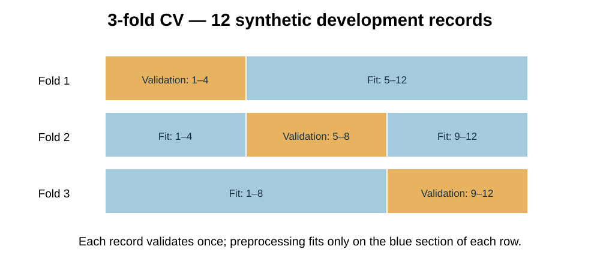
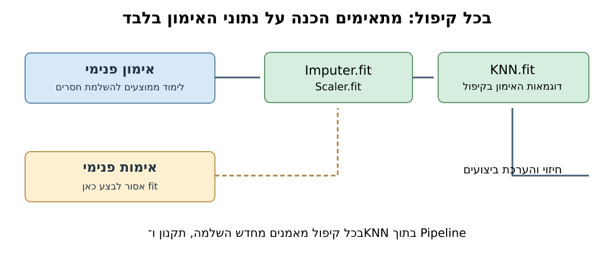

# מפגש 22 — Pipeline ו־Cross Validation
**ספר תלמיד | יחידה 3 | 90 דקות הוראה ותרגול + 45 דקות פרויקט**

## סיפור הפתיחה: מי באמת טוב יותר במבחנים?
דודו משווה שתי שיטות למידת מכונה. אחת נבחנה על קבוצת שאלות קלה והשנייה על קבוצה קשה. האם השוואת הציונים הוגנת? גם ב־AI נרצה להשוות מודלים באותה שיטת אימות. עוד סכנה: אם נחשב ממוצע או תקנון מתוך השאלות שישמשו לאימות, המודל יקבל מידע שלא היה אמור להיות בידיו.

**שאלת חקר:** איך בוחרים K ל־KNN מבלי לתת למידע מקבוצת האימות או ה־Test לדלוף להכנת הנתונים?

## חוזרים ממפגש 21: תפקיד כל חלק
**Outer Train:** קבוצת הפיתוח, שבתוכה ניתן להשוות מועמדים. **Inner Validation:** בכל קיפול משמשת רק למדידת המועמד. **Outer Test:** מוחזק בצד עד שהחלטנו על K ומדד. גם אם בפלט הספרייה מופיע `test_score` בזמן CV, הוא מתייחס **לקיפול האימות הפנימי** ולא ל־Test החיצוני.

## מבינים קיפולים בחישוב ידני
נניח שיש 12 רשומות פיתוח ממוספרות 1–12. לצורך המחשה *בלבד* נשתמש בשלושה קיפולים של 4 רשומות כל אחד (המחברת המעשית תשתמש בחמישה קיפולים משוכבים).

| סבב | אימון פנימי | אימות פנימי |
|---|---|---|
| 1 | 5–12 | 1–4 |
| 2 | 1–4, 9–12 | 5–8 |
| 3 | 1–8 | 9–12 |

בכל סבב מתאימים ממוצעי השלמה, סטיות תקן ומסווג **מחדש על האימון הפנימי בלבד**. אחרי כן מודדים ביצועים על האימות הפנימי, שלא שימש להתאמה.

נניח שציוני האימות (מומצאים, ללא קשר ל־Penguins) הם `[0.80, 0.90, 0.70]`. הממוצע:
\[
\overline{s}=\frac{1}{m}\sum_{i=1}^{m}s_i=\frac{0.80+0.90+0.70}{3}=0.80
\]
כאשר `m=3` הוא מספר הקיפולים, `s_i` ציון אימות בקיפול `i`, והממוצע הוא 80% במדד הנתון. אין זה ציון Test סופי. פיזור הציונים חשוב אף הוא, אך `cv_std` אינו אוטומטית רווח סמך.



## למה Pipeline?
נתוני Penguins מכילים מאפיינים עם יחידות שונות וערכים חסרים. סדר הפעולות הוא:
`SimpleImputer(strategy="mean") → StandardScaler() → KNeighborsClassifier()`.
אם מחשבים את ממוצעי ההשלמה ואת פרמטרי הסקיילינג על **כל** `X_train` לפני CV, רשומות האימות הפנימיות כבר השפיעו על ההכנה — זו **זליגת מידע**. בתוך Pipeline, כל `fit` ב־CV מתאים מחדש את כל השלבים הרלוונטיים על האימון הפנימי של אותו קיפול.



## תרגול מודרך ב־Python — קודם מפרשים, אחר כך מריצים
```python
from sklearn.pipeline import make_pipeline
from sklearn.impute import SimpleImputer
from sklearn.preprocessing import StandardScaler
from sklearn.neighbors import KNeighborsClassifier
from sklearn.model_selection import StratifiedKFold, cross_validate

pipe = make_pipeline(
    SimpleImputer(strategy="mean"),
    StandardScaler(),
    KNeighborsClassifier(n_neighbors=3, metric="euclidean")
)
cv = StratifiedKFold(n_splits=5, shuffle=True, random_state=42)
folds = cross_validate(
    pipe, X_train, y_train, cv=cv,
    scoring="f1_macro", return_train_score=True
)
print(folds["test_score"])  # ציוני אימות פנימי
```
כדי להריץ תא זה, צריך להריץ קודם את התא שמגדיר את `X_train` ו־`y_train` ממאגר Penguins. אין לטעון שזה קוד עצמאי ללא הנתונים.

## עוגני המשימה המקורית
- **הדגמת המורה:** מאפיינים `flipper_length_mm`, `body_mass_g`; `test_size=0.25`, `random_state=42`, `stratify=y`.
- **מעבדת התלמיד:** מאפיינים `bill_length_mm`, `bill_depth_mm`; `test_size=0.25`, `random_state=17`, `stratify=y`.
- בשני המסלולים: מועמדי K הם `[1,3,5,15,51]`; המדד הוא `f1_macro`; קיפולי `StratifiedKFold(n_splits=5,shuffle=True,random_state=42)`.
- בוחרים לפי ממוצע CV הגבוה ביותר, ובשוויון מדויק בוחרים K קטן יותר. מתאימים Pipeline **חדש** לכל Train החיצוני; רק לאחר מכן מעריכים פעם אחת על Test החיצוני.
- תוצאות המספרים ו־K הנבחר במעבדה **אינם מובאים בספר**, כדי לא לגלות את הפתרון העצמאי.

## דגשים שמונעים פרשנות שגויה
`f1_macro` הוא ממוצע ציוני F1 של המחלקות במשקל שווה. `accuracy` הוא מדד אחר; אין להשוות אותם כאילו הם אותו ציון. תקנון אינו מבטיח התפלגות נורמלית. K גדול יותר אינו תמיד עדיף. כאשר רשומות שייכות לאותו אדם או לאותו רצף זמן, צריך תכנית חלוקה מתאימה, ולא קיפולים אקראיים רגילים.

## שאלות חקר והגנה
1. מה משמעות `test_score` המוחזר מ־`cross_validate`?
2. למה יוצרים Pipeline חדש לפני ההערכה החיצונית?
3. מה בדיוק דולף אם עושים `StandardScaler.fit` לפני CV על כל נתוני הפיתוח?
4. מה ההבדל בין ממוצע קיפולים לבין מדידה סופית על Test?
5. מדוע אין לבחור K על פי תוצאת Test ואז לדווח על אותה תוצאה כביקורת עצמאית?

## פרויקט — 45 דקות
הגדירו מראש מאפיינים, יעד, מועמדים, מדד, קיפולים, כלל הכרעה ומדיניות Test. הריצו CV מצומצם רק אם קיימות מספיק דוגמאות מתויגות ומגבלות הנתונים מאפשרות זאת; אחרת כתבו תכנון ניסוי. אל תמציאו ציונים.
