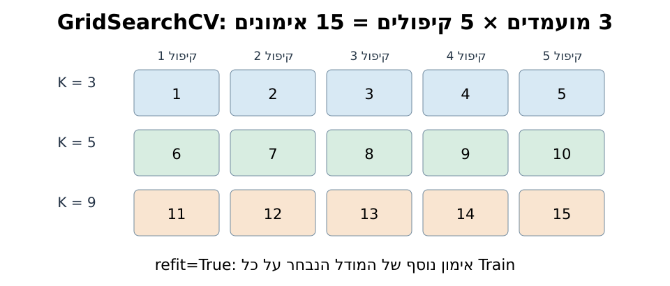
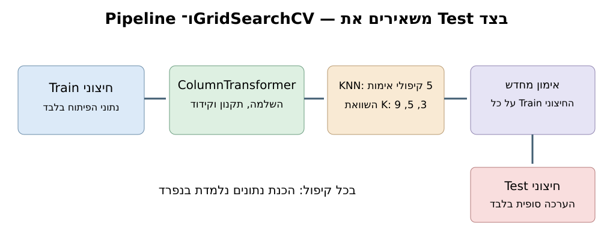

# מפגש 23 — GridSearchCV וקריאת תוצאות
**90 דקות הוראה ותרגול + 45 דקות פרויקט | יחידה 3**

## סיפור פתיחה
דודו צריך לבחור את מספר השכנים K למסווג Penguins. במקום להריץ שוב ושוב ולבחור לפי ציון Test, הוא מגדיר מראש שלושה מועמדים ואת אותו מבחן פנימי עבור כולם. האם אפשר לסמוך על תחרות שבה כל מודל קיבל שאלות אחרות או הציץ במבחן הסופי?

## מה כבר למדנו?
במפגש 22 השתמשנו ב־Pipeline וב־Cross Validation. כעת GridSearchCV מפעיל את הניסוי השיטתי, שומר טבלת תוצאות ובוחר היפר־פרמטר. **ההפרדה נשמרת:** פיתוח ובחירה ב־Train; הערכה סופית ב־Test.

## 1. הנוסחה והחישוב הידני
מועמדי ההדגמה והמעבדה: `K=[3,5,9]`, חמישה קיפולים משוכבים.
\[
N_{CV}=N_{candidates}\times N_{folds}=3\times5=15.
\]
אלו **15 התאמות של מודל לקיפולים**, לא 15 תצפיות. אם `refit=True`, מתווספת התאמת מודל נבחר אחד על **כל Train החיצוני**: סך ההתאמות של המועמדים וההתאמה הסופית = 16. בניית צינור ההכנה וההתאמות הפנימיות הן חלק מכל התאמת מודל.

ממוצע לציון מועמד יחיד:
\[
\bar s_k=\frac{s_{k,1}+s_{k,2}+\cdots+s_{k,5}}{5}.
\]
למשל, עבור ציונים **מומצאים בלבד** `[0.80,0.85,0.75,0.90,0.70]`, סכום 4.00 וממוצע 0.80. **אינם ציוני Penguins האמיתיים**. אין לבחור לפי הממוצע לפני קריאת הטבלה האמיתית.



## 2. מה עושה כל מושג?
- `param_grid={"knn__n_neighbors":[3,5,9]}`: חיפוש בשלושה ערכי K של השלב `knn` בתוך Pipeline. שתי הקווים התחתונים מחברים שם שלב לשם היפר־פרמטר.
- `GridSearchCV`: בודק את כל המועמדים באותם קיפולים לפי `scoring="f1_macro"`.
- `cv_results_`: טבלה לכל מועמד — לרבות כאלה שלא נבחרו.
- `mean_test_score`: ממוצע ציוני **Validation הפנימי**, לא Test החיצוני.
- `std_test_score`: סטיית התקן התיאורית של ציוני הקיפולים; אינה רווח סמך.
- `rank_test_score`: דירוג לפי מדד הבחירה (1 הוא הטוב ביותר).
- `best_params_`: ההיפר־פרמטר שנבחר; `best_score_`: ממוצע CV של הבחירה.
- `refit=True`: לאחר בחירה, מתאים מחדש את הצינור הנבחר על כל Train ומאפשר `predict(X_test)` בסיום.

## 3. למה מכניסים גם קטגוריה לתהליך?
עוגן המקור כולל תכונות מספריות ותכונת `island`. את המספריות משלימים בחציון ומתקננים; את `island` משלימים בערך השכיח ומקודדים ב־OneHotEncoder. אלה שלבי **ColumnTransformer בתוך Pipeline** — כך הם מותאמים בנפרד בכל אימון פנימי. לא מקודדים קטגוריה שמית כ־0,1,2 באופן שיוצר מרחק מספרי מלאכותי. אין להכניס את `species` לתכונות X.

## 4. תבנית הקוד
```python
from sklearn.model_selection import GridSearchCV, StratifiedKFold
param_grid = {"knn__n_neighbors": [3, 5, 9]}
cv = StratifiedKFold(n_splits=5, shuffle=True, random_state=42)
search = GridSearchCV(pipe, param_grid, cv=cv, scoring="f1_macro",
                      refit=True, return_train_score=True)
search.fit(X_train, y_train)
print(search.best_params_)
```
`pipe`, `X_train` ו־`y_train` מוגדרים **במחברת המודרכת** לפני קטע זה. אל תריצו את הקטע לבדו בלי הכנת הנתונים.

## 5. קריאת הטבלה
```python
import pandas as pd
table = pd.DataFrame(search.cv_results_)
display(table[["param_knn__n_neighbors",
              "mean_train_score","mean_test_score",
              "std_test_score","rank_test_score"]])
```
השוו בין `mean_train_score` ל־`mean_test_score`. ציוני האימון אינם מדד הבחירה! בשוויון מדדים מדויק, `GridSearchCV` פועל לפי סדר המועמדים שהוגדר; אין להניח שייבחר K גדול או קטן יותר מטבעו.



## 6. שני מסלולים מדויקים מתוך המקור
**הדגמת המורה:** `bill_length_mm`, `bill_depth_mm`, `island`, `random_state=42`.
**מעבדת התלמיד:** `flipper_length_mm`, `body_mass_g`, `island`, `random_state=17`.
בשניהם `test_size=0.25`, `stratify=y`, חמישה קיפולים, `[3,5,9]`, `f1_macro` ו־`refit=True`. **אין להשוות את ציוני שני המסלולים כניסוי מבוקר על אותם מאפיינים וחלוקה.**

## 7. תרגול עצמאי
בנו את ColumnTransformer וה־Pipeline, הריצו GridSearchCV רק על Train, הסבירו את מספר ההתאמות, קראו `cv_results_`, השוו לקו בסיס `DummyClassifier(strategy="most_frequent")` באותו מדד, ורק בסוף העריכו את Test. לא נחשוף כאן מהו K הנבחר במעבדה או מה היו ציוני המודל.

## 8. שאלות ביקורת
מדוע `best_params_` אינו כמו ממוצע שנלמד ב־Scaler? מה יזלוג אילו עשינו `prepare.fit(X)` לפני החלוקה? מה מבדיל `mean_test_score` מההערכה על Test החיצוני? מדוע אי־אפשר לטעון כי תוצאה על Penguins שכבר מוכר בכיתה היא הערכה מחקרית בלתי תלויה?

## 9. פרויקט — 45 דקות
תעדו בחירת מדד ומועמדים מראש. רק אם הנתונים מאפשרים, הפעילו חיפוש בתוך Train. כתבו טבלת בחירה, סיבה לבחירה, תוצאת Baseline ומגבלה; אין לשנות את הבחירה בעקבות Test.
