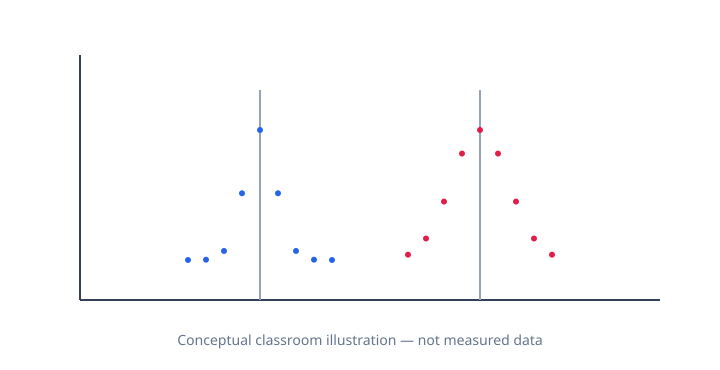

# יסודות מתמטיים, גרפים והקשר ללמידת מכונה — שיעור 8

> מסמך העמקה להוראה בכיתה: יש ללמוד אותו לפני המעבדה ולהשתמש בו גם כמקור למצגת NotebookLM. התוכן משלים, ולא מחליף, את חומרי המקור.

## נוסחה מרכזית

**σ²=Σᵢ(xᵢ−μ)²/N ; σ=√σ²**

**פירוש כל סימן:** N גודל האוכלוסייה, μ ממוצע; במדגם מתקנים בחלוקה ב־n−1 לאומדן שונות.

## דוגמה פתורה

70,80,90: μ=80, שונות 66.67 וסטיית תקן ≈8.165.

בקשו מהתלמידים לכתוב את הנתונים, להציב בנוסחה, לחשב ולהסביר במילים את התוצאה לפני הרצת הקוד.

## גרף והמחשה

**מה מציגים:** שתי התפלגויות בעלות אותו ממוצע ופיזור שונה. האיור סכמטי לצורכי הוראה ואינו תוצאה של ניסוי או הרצת הקוד. ליצירת גרף כמותי השתמשו בנתוני המחברת וציינו במפורש יחידות, שמות צירים והנחות.

## למה זה חשוב ללמידת מכונה?

סטנדרטיזציה והשוואת פיזור תכונות ב־ML.

## הגבלות והבחנות חשובות

הבחנה בין ddof=0 ו־ddof=1 חשובה.

## משימות להבנה לפני המעבדה

1. הגדירו במילים כל סימן בנוסחה וכתבו את היחידות האפשריות.
2. פתרו את הדוגמה ידנית וציינו את התוצאה ואת פירושה.
3. תארו אילו צירים, תוויות או שטחים נדרשים בגרף וכיצד הם תואמים לנוסחה.
4. הסבירו שימוש אחד בלמידת מכונה ומגבלה אחת של השימוש.

## הנחיה למצגת NotebookLM

למצגת של שיעור 8 הוסיפו **ארבעה שקפים רצופים**: נוסחה ופרשנות הסימנים; הצבה ופתרון ידני; גרף בהיר ונכון מדעית (ההמחשה המצורפת היא סכמטית); שימוש מתמטי אמיתי ב־ML. יש להסביר כל שלב בעברית תקינה, לשמור על כיוון תקין של נוסחאות, ולא להעתיק פתרונות מן המעבדה העצמאית. העלו מסמך זה יחד עם `NotebookLM-Presentation-Source.md` והעתיקו את הפרומפט הייעודי שכבר בתיקייה.
